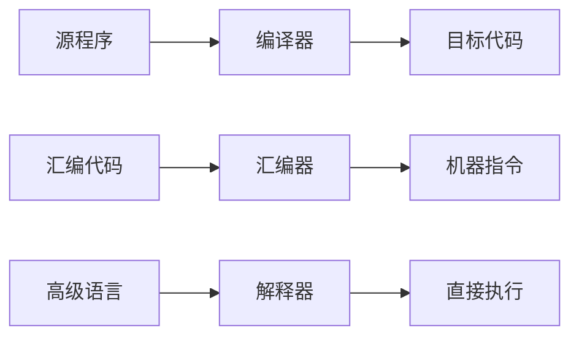

# 编译原理课程定位与教学目标

## 课程定位与核心目标

编译原理究竟在学什么？它并非单纯教你“如何写一个编译器”，而是研究==如何将高级语言程序自动转换为等价低级语言程序==的理论、方法与技术。这门课是计算机专业承上启下的枢纽：向上对接程序设计语言与算法，向下衔接操作系统与体系结构。

> [!IMPORTANT]
> 构造编译程序必须同时掌握三要素：==源程序、目标语言、编译方法==。缺一不可，这是历年选择题高频考点。

为什么需要专门学习它？因为它是理解计算机系统抽象层的关键。没有编译系统，高级语言只是文本；没有操作系统，硬件无法被高效管理。这就引出了一个经典思考题：先有操作系统还是先有编译系统？

实际上，二者是==协同演化、互为支撑==的关系。早期汇编器本身就是最原始的“编译系统”；而现代操作系统的开发又离不开编译器提供的工具链支持。它们共同构成了系统软件的基石。

## 关键概念辨析

复习时最容易混淆的是各类翻译程序的职责边界。请务必厘清以下区别：

| 程序类型 | 输入 | 输出 | 核心特征 |
| :--- | :--- | :--- | :--- |
| 编译器 | 高级语言 | 目标代码/汇编 | ==整体翻译==，生成可执行文件 |
| 解释器 | 高级语言 | 直接执行结果 | 边翻译边执行，不生成目标码 |
| 汇编器 | 汇编语言 | 机器指令 | 一对一符号替换，非语义分析 |
| 预处理器 | 带宏的源码 | 纯源码 | 文本替换、文件包含，不涉及语法 |

> [!WARNING]
> 把汇编语言翻译成机器可执行目标程序的是==汇编器==，不是编译器！选择题中常以此设置陷阱，注意区分“高级→低级”与“汇编→机器”两个阶段。

## 系统程序设计语言

能够编写编译程序或其他系统软件的高级语言被称为==系统程序设计语言==（如 C/C++、Rust）。这类语言通常具备以下特点：

-   提供底层内存操作能力
-   生成代码效率高，接近汇编
-   支持直接调用系统接口

> [!TIP]
> 记忆口诀：编汇解预要分清，高翻低用编译器，汇编转机器靠汇编器，边译边执是解释器。

## 代价模型示例

编译原理不仅关注正确性，也关注效率。例如在代码优化阶段，常需估算指令执行代价。若某条指令访问主存 $n$ 次，则其执行代价定义为：

$$
\text{Cost} = n + 1
$$

其中 “+1” 代表 CPU 执行该指令本身的基本开销。这个简单公式体现了==访存主导性能==的设计思想，也是后续指令选择与寄存器分配优化的基础依据。

> [!NOTE]
> 引言部分虽不涉及复杂算法，但建立了整门课的术语体系与思维框架。后续词法、语法、语义分析均围绕“源程序→目标语言”这一主线展开，务必在此阶段夯实概念基础。
