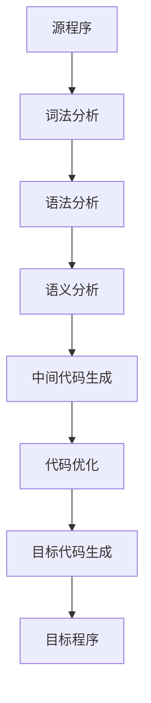

# 编译器在计算机系统中的位置

## 编译器在计算机系统中的位置

编译器是把源程序翻译成目标程序的系统软件。它并不是孤立存在的，而是位于用户编写的源程序与计算机硬件之间：


源程序通常用 C、C++、Java 等高级语言或汇编语言书写。编译器分析这些程序，并生成硬件能够执行或进一步加工的程序。生成的代码可能直接运行，也可能还需要链接、装入等过程。

> [!IMPORTANT]
> 编译器是连接==高级语言程序==与==计算机硬件==的桥梁；编译程序本身属于系统软件。

## 编译器为什么需要

若每次执行程序都让机器逐条识别高级语言语句，效率会很低。编译器可以预先完成翻译，使程序运行时只需执行已经转换好的代码。

可以把两类执行方式作如下比较：

| 方式 | 处理过程 | 是否生成独立目标程序 | 典型特点 |
|---|---|---|---|
| 编译方式 | 整体翻译后运行 | 是 | 运行效率通常较高 |
| 解释方式 | 边解释边执行 | 通常否 | 便于交互和调试 |

编译方式与解释方式的根本区别，在于是否先生成目标代码，而不是简单比较“哪一种更高级”。

## 编译程序的总体逻辑结构

编译器通常可分为多个相对独立的阶段。实际系统可以采用一趟、两趟或多遍实现，但逻辑功能基本相同。



各部分的主要功能如下：

- **词法分析**：按字符流识别单词、标识符、常量和运算符等记号。
- **语法分析**：检查程序语法，并依据文法建立相应的语法结构。
- **语义分析**：检查类型、声明、运算等是否符合语言规定，同时收集后续阶段所需信息。
- **中间代码生成**：把源程序转换为便于处理和优化的中间表示。中间代码并非所有编译器的必需组成。
- **代码优化**：在不改变程序运行结果的前提下，改进目标代码，提高执行效率。优化也不是所有编译器的必需组成。
- **目标代码生成**：把中间代码或优化后的表示转换为目标语言代码。

有些编译器还会包含符号表管理、错误处理、链接与装入配合等功能。符号表保存标识符的属性和作用域等信息，是各分析阶段共享的重要数据结构。

> [!TIP]
> 记忆逻辑结构可概括为：“**词法看单词，语法看结构，语义看意义，中间表示便于加工，优化求效率，目标生成出代码**”。

## 与操作系统、汇编程序的关系

操作系统管理处理器、存储器和外部设备等资源；编译程序则把程序员编写的程序转换成计算机可执行的形式。二者都是系统软件，但职责不同：操作系统负责==管理和运行环境==，编译器负责==翻译程序==。

汇编程序把汇编语言翻译成机器语言，因此它也是一种翻译程序。编译程序与具体机器有关，因为目标代码要符合目标机器的指令系统、寄存器和寻址方式；同时，编译程序又受到源语言规定的限制。

“操作系统和编译系统谁先出现”可以这样理解：早期计算机没有操作系统和高级语言，程序直接由机器执行或通过机器语言编写；后来先有了操作系统，再逐步出现汇编程序和高级语言编译器。不过，不同计算机系统的发展阶段可能不同，不能把这一历史顺序理解成绝对结论。

## 常见易错点

> [!WARNING]
> “编译程序与具体语言无关”是错误的。编译器必须实现某一种源语言，并了解该语言的词法、语法和语义规则。

此外，还要注意：

1. **编译程序是系统软件，不是一般应用软件。**
2. **C 语言的编译程序可以用 C 语言编写**，但这称为自举或自编译，并不意味着只能用 C 语言实现。
3. **目标程序不一定是可直接执行的独立文件**，它可能还需要链接其他目标模块，并经过装入后才能运行。
4. **中间代码生成和代码优化不是不可缺少的阶段**，简单编译器可以采用更直接的翻译方式。
5. 含有优化能力的编译器通常能生成执行效率较高的目标程序，但不能保证任何情况下都绝对更快。

## 一个典型例子

假设程序员编写：

```c
int main(void) {
    int a = 2;
    int b = 3;
    return a + b;
}
```

编译器先进行词法分析，识别 `int`、`main`、`a`、`b`、`return` 等记号；再进行语法和语义分析，确认声明与运算合法；随后生成中间表示，并可把 `a + b` 优化为常量 `5`；最后按照目标机器的指令系统生成目标代码。

这里即使源程序运行后只需要一个返回结果，编译器仍需完成规定的翻译阶段。==逻辑阶段是否存在==与==编译器最终生成多少实际机器指令==并不是同一个问题。
