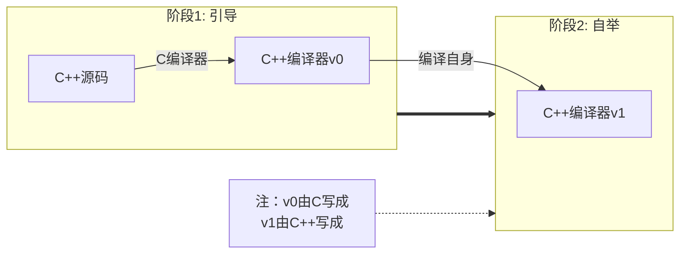

# 编译程序的构建方法（T型图、自编译、自展、交叉编译、移植）

## 核心概念与 T 型图表示

编译程序的构建依赖于**T 型图**这一可视化工具，它清晰定义了编译器的三个关键属性：
- **左臂**：源语言（Source Language）
- **右臂**：目标语言（Target Language/Machine Code）
- **竖干**：实现语言（Implementation Language，即编写编译器所用的语言）

> [!IMPORTANT]
> ==T 型图是理解自编译、交叉编译和移植技术的基石==。任何复杂的编译器构建过程，本质上都是 T 型图的拼接与变换。

## 自编译 (Self-Compilation)

若一种高级语言 $L$ 的编译器是用 $L$ 本身编写的，则称该语言为**自编译语言**。
- **为什么需要**：利用高级语言的表达能力简化编译器开发，且编译器能“吃自己的狗粮”，验证语言特性。
- **怎么做**：通常需要一个初始的、用其他语言（如汇编或 C）编写的“引导编译器”来编译第一版自编译编译器。

## 交叉编译 (Cross-Compilation)

在主机 $A$ 上运行编译器，生成能在目标机 $B$ 上运行的目标代码。
- **应用场景**：嵌入式开发（PC 开发，ARM 运行）。
- **T 型图特征**：实现语言运行环境 $\neq$ 目标机器环境。

## 自展技术 (Bootstrapping)

从一个小而简单的子集编译器开始，逐步扩充功能，最终得到完整语言的编译器。
- **过程逻辑**：
    1. 用机器语言写一个极简的 $L_0$ 编译器。
    2. 用 $L_0$ 写一个稍大的 $L_1$ 编译器。
    3. 用 $L_1$ 编译 $L_2$... 直至完整语言 $L$。
- **优势**：降低初始开发难度，每一步都可测试。

## 移植技术 (Porting)

将已有的编译器从机器 $A$ 迁移到机器 $B$。最高效的方法是**自编译 + 交叉编译**组合。

> [!TIP]
> **移植三步法**：
> 1. 在 A 上用 L 语言写一个针对 B 机器的编译器 $C_{L \to B}$（此时实现语言为 L，运行在 A）。
> 2. 用 A 上现有的编译器编译 $C_{L \to B}$，得到可在 A 上运行的二进制文件。
> 3. 在 A 上运行该二进制文件，编译它自身的源代码，生成真正在 B 上运行的 $C_{L \to B}$。

## 常见误区与辨析

| 概念 | 易错点 | 正确理解 |
| :--- | :--- | :--- |
| **自编译** | 认为不需要其他语言辅助 | 首次构建必须依赖“引导编译器” |
| **交叉编译** | 混淆实现语言与目标机器 | 重点在于**运行环境**与**目标环境**不同 |
| **优化部分** | 认为优化是必须的 | ==优化不是编译器的必要组成部分== |

> [!WARNING]
> **考试高频坑**：
> 1. 编译程序生成的目标程序**不一定**可直接执行（可能需链接）。
> 2. 中间代码生成**不是**所有编译器必需的（有些直接生成目标码）。
> 3. 判断自编译时，看清 T 型图的**竖干**（实现语言）是否与**左臂**（源语言）一致。

## 典型例题解析

**题目**：已知 A 机器上有 C 编译器，如何用 T 图描述在 A 机器上，利用 C 语言编写 C++ 翻译程序的自编译过程？

**解析步骤**：
1. **初始状态**：A 机器上有 C 编译器（源C，目标A码，实现未知/机器码）。
2. **第一步**：用 C 语言写出 C++ 编译器源码。此时 T 图为：源(C++) / 实现(C) / 目标(A码)。
3. **第二步**：用现有的 C 编译器编译上述源码，生成 C++ 编译器可执行文件。
4. **第三步（自编译核心）**：用生成的 C++ 编译器去编译它自己的源码（如果后续版本用 C++ 重写）。

> [!NOTE]
> 若题目问“移植到 B 机器”，则需构造：源(C++) / 实现(C++) / 目标(B码) 的 T 图，并通过交叉编译在 A 上生成该编译器。
