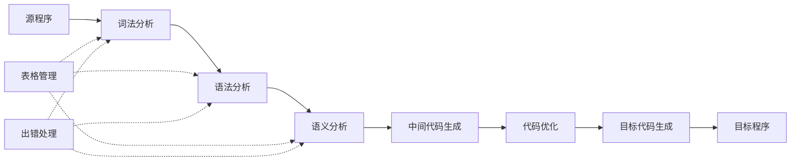

# 编译的基本过程（词法、语法、语义、优化、目标代码生成）

## 编译程序在做什么

编译程序把高级语言源程序翻译成等价的目标程序。翻译不能只靠逐字替换，还要检查单词、句子结构和语句含义。可类比人工翻译：**识别单词—分析句子—理解含义—修辞加工—写出译文**。



> [!IMPORTANT]
> 编译过程通常包括词法分析、语法分析、语义处理、中间代码生成、代码优化、目标代码生成，并贯穿==表格管理和出错处理==。中间代码生成与代码优化并非每个编译程序都必须单独设置。

## 各阶段的功能

| 阶段 | 输入与主要工作 | 典型输出 |
|---|---|---|
| 词法分析 | 扫描字符流，依构词规则识别单词，如标识符、常数、运算符 | 单词符号流 |
| 语法分析 | 在单词流上按语法规则分析句子，建立层次结构 | 语法树等 |
| 语义分析 | 检查语义、分析语句含义，如类型是否匹配 | 带语义信息的中间表示 |
| 中间代码生成 | 将源程序转为便于优化和翻译的内部形式 | 三地址码等 |
| 代码优化 | 对代码进行等价变换，改进时间或空间效率 | 优化后的代码 |
| 目标代码生成 | 结合具体机器，分配寄存器并选择指令 | 汇编或机器代码 |

例如赋值语句 $\mathrm{A}:=5*\mathrm{C}$：

- **词法分析**：识别出标识符 $\mathrm A$、赋值号 $:=$、常数 $5$、乘号 $*$、标识符 $\mathrm C$。
- **语法分析**：确认它符合赋值语句的结构，可表示为“标识符 $:=$ 表达式”，表达式为“常数 $*$ 标识符”。
- **语义分析**：其含义是==先计算 $5\times C$ 的值，再把结果赋给 $A$==，还可检查变量是否声明、运算类型是否合法。

一种可能的中间代码及目标代码示意是：

$$
t_1:=5*C,\qquad A:=t_1
$$

```asm
MUL  R0, #5, C
MOV  A, R0
```

这里 $t_1$ 是临时变量；具体指令形式依机器而定。

## 编译、解释与“遍”

编译方式通常生成目标程序，之后运行目标程序；解释方式通常边分析源程序边执行，便于及时报错和调试，但运行效率往往较低。==二者的根本区别在于是否生成目标代码==。

“遍”是从头到尾扫描一遍源程序或等价源程序，并完成有关加工处理。例如第一遍进行词法、语法分析并检查错误，第二遍生成中间代码和进行存储分配，第三遍生成目标程序。分遍数受存储容量、源语言繁简、编译程序功能、目标程序优化程度及实现条件等影响，**不等于阶段数**。

> [!WARNING]
> 常见判断误区：编译程序不是普通应用软件，而是系统软件；它既与源语言有关，也与目标机器有关。目标程序也不一定是可直接执行的完整程序，可能还需汇编、连接。含优化阶段只表示更重视目标代码质量，不能据此断定编译程序本身执行更快。
