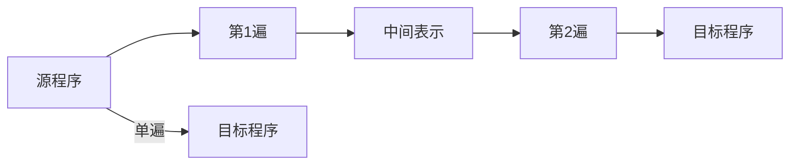
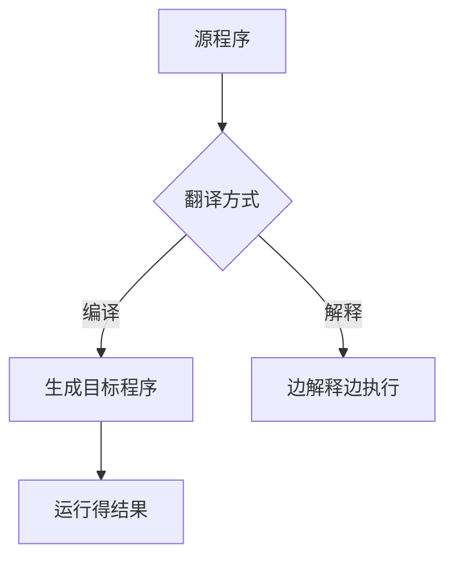

# 翻译程序、编译程序与编译系统

## 是什么：翻译程序、编译程序与编译系统

先想一个问题：你用 C 写好的 `hello.c`，计算机 CPU 根本看不懂，它只认二进制机器指令。谁来做“翻译”？

把**汇编语言或高级语言**写的程序，翻译成等价的**另一种语言**（通常是机器语言）的程序，叫 ==翻译程序==。翻译程序分三类：

| 翻译程序类型 | 输入（源程序） | 输出 / 行为 | 是否生成目标代码 |
|---|---|---|---|
| 汇编程序 | 汇编语言 | 机器语言目标程序 | 是 |
| 编译程序 | 高级语言 | 机器语言或汇编语言目标程序 | 是 |
| 解释程序 | 高级语言 | 边读入、边解释执行 | 否 |

所以 ==汇编程序、编译程序、解释程序都属于翻译程序==；而编译方式和你以后学的“解释方式”根本区别就是：==是否生成目标代码==。

> [!IMPORTANT]
> 编译程序是把**高级语言源程序**整体翻译成目标程序的翻译程序；它属于**系统软件**，不是应用软件——判断题里这个坑几乎每年都考。

## 编译系统：不止是编译器

编译程序产出的是==目标程序==（如机器代码或汇编代码）。但目标程序不能自己跑出结果，还需要**运行系统**（服务子程序、动态分配程序、装配程序等）配合才能得到计算结果。

> [!NOTE]
> 只有“目标程序 + 运行系统”合在一起，才叫 ==编译系统==。别把“编译程序”和“编译系统”混为一谈。

## 编译程序的分遍：单遍与多遍

编译过程可以“一趟扫完”，也可以分几趟：

- **单遍（一趟）扫描**：对源程序扫描一次就生成目标代码。
- **多遍扫描**：把编译工作分几遍做，每遍做一部分，每经过一趟源程序都做等价变换、更接近目标程序。

影响分遍的因素有：==编译程序功能强弱==、==使用工具的先进程度==。源语言较繁、目标优化要求高、内存小的时候，常用多遍。

## 相近概念：编译 vs 解释

注意几个判断题坑：

- 编译程序生成的目标程序**不一定是可执行程序**（可能是汇编语言目标程序，还需汇编）；
- 代码优化、中间代码生成都**不是**编译程序不可缺少的部分（简单编译程序可没有）；
- “含有优化部分的编译程序执行效率高”是错的——优化提高的是**目标代码**效率，不是编译程序本身执行效率。

## 怎么做：编译程序是怎么生成的（T 型图与自编译）

早期用机器语言、后来用汇编语言写编译器，效率低；现在多用 ==系统程序设计语言==（如 PASCAL、C、C++）写。

**自编译语言**：一种高级语言，它的编译程序能用它自己写出来。

用 **T 型图**表示三者关系：左上是“用什么语言写”，右下是“产生哪种机器代码”，上方是“源语言”。

> [!TIP]
> 考题常这样出：A 机器上已有 C 编译器，用 C 写另一语言（如 C++ / Java）的编译程序，借原 C 编译器编译，就得到新编译器。

**自展技术**：先选核心子集 $L_1$，用机器语言 $M$ 写 $L_1$ 的编译程序；再用 $L_1$ 重写自身编译程序并通过原编译程序验证；然后逐级 $L_1 \subset L_2 \subset \dots \subset L$ 扩充，直到完整 $L$ 的编译程序。

**交叉编译程序**：在 A 机器上的编译程序能产生 **B 机器**的目标代码。

## 一个算对了的例子

题目：A 机器上已有 C 编译器，用 C 写 **C++ 语言翻译程序**的自编译过程（T 型图思路）。

解：中间下方放 A 机器上已有的 C 编译程序；左上是“用 C 写、源语言为 C++、生成 A 代码”的待写编译程序；编译后右边得到“用 A 机器代码书写、把 C++ 翻成 A 代码”的编译程序。核心就是：==借已有 C 编译器，去编译新写的以 C 为实现语言的编译器==。
