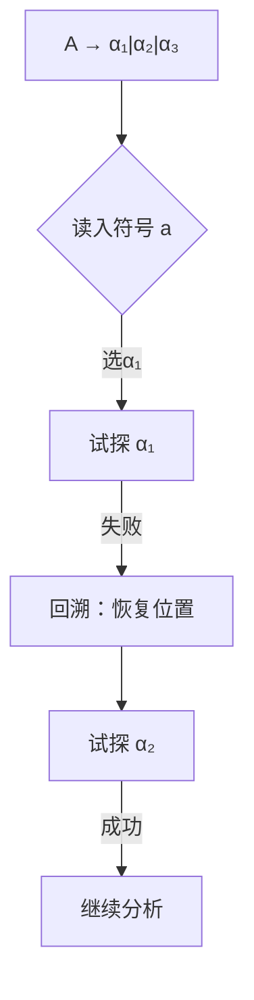
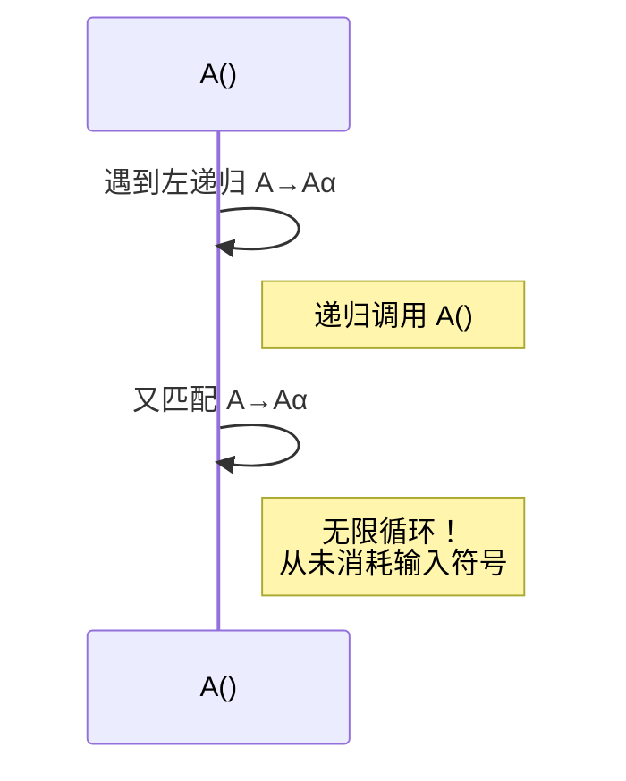

# 自顶向下分析的问题（左递归、回溯）及解决办法

## 自顶向下分析的两大障碍与破解方法

自顶向下分析的目标是：**从文法的开始符号出发，尝试为输入串建立一个最左推导**。你可以把它想象成“从树根开始，按照输入字符的指引，逐步画出语法树”。

但在实际编写分析程序时，有两个典型问题会让这个过程“卡死”或“走冤枉路”：**回溯** 和 **左递归**。

### 为什么会有回溯？

假设你现在要为一个非终结符选择产生式。例如：

当多个候选式都能推导出 **相同的首终结符** 时，分析器只能“猜”一个规则去试探。如果猜错了，就必须回到出错点换另一条规则重新尝试 —— 这就是 **回溯**。

> [!CAUTION]
> 回溯会带来大量的无效推导和恢复开销，使语法分析效率急剧下降。实际的编译器必须避免回溯。

**解决办法：提取左公因子**

如果产生式形如 $U ::= \alpha V \mid \alpha W$，我们无法一眼看出该选谁。改写文法，推迟决策：

1.  找到公共前缀 $\alpha$。
2.  引入新的非终结符 $U‘$ 承接后缀部分。
3.  改写为 $U ::= \alpha U’$ 和 $U‘ ::= V \mid W$。

改写后，分析器只要看到输入是 $\alpha$，就能立刻选择唯一的产生式，不需要回溯。

### 为什么左递归是死循环？

**左递归** 指的是非终结符 $A$ 能推导出“以自己开头”的串，即 $A \Rightarrow^+ A\alpha$。

在 **递归下降分析器** 里，这会立刻映射成一个致命的递归函数：

分析器还没消耗任何输入，就陷入了无限递归。对于 LL(1) 分析，左递归会导致分析表的同一表项出现多个产生式（冲突），同样无法工作。

> [!IMPORTANT]
> LL(1) 文法必然 ==无左递归、无二义==。消除左递归是自顶向下分析的前提条件。

### 如何消除左递归？

**1. 消除直接左递归（改写法）**

核心思想：左递归重复产生的是 `βααα...`，我们可以用“右递归”等价地生成它。

对于规则 $A ::= A\alpha \mid \beta$（$\beta$ 不以 $A$ 开头）：

$$
\begin{aligned}
A  &::= \beta A' \\
A' &::= \alpha A' \mid \varepsilon
\end{aligned}
$$

> [!TIP]
> **记忆口诀**：`A → βA‘`，`A’ → αA‘ | ε`。尾巴 α 重复交给新的 A’ 右递归生成。

**2. 消除间接左递归**

如果左递归是“绕弯”出现的（如 $A \to B \dots, B \to A \dots$），需要先代入转化为直接左递归，再用上述方法消除。

**一个算对了的例子**

消除下面文法 $G[Z]$ 的左递归：

$$
\begin{aligned}
 Z &::= AZ \mid b  \\
 A &::= ZA \mid a
\end{aligned}
$$

**步骤一：代入**

把 $A$ 的产生式代入 $Z$ 的右部 $AZ$ 中：

$Z ::= (ZA \mid a)Z \mid b$

展开得到直接左递归： $Z ::= ZAZ \mid aZ \mid b$

**步骤二：消除直接左递归**

对照公式 $A ::= A\alpha \mid \beta$，这里：

- 待消除的非终结符是 $Z$。
- $\alpha = AZ$
- $\beta_1 = aZ$，$\beta_2 = b$

代入消除公式 $Z ::= \beta Z’$ 和 $Z‘ ::= \alpha Z’ \mid \varepsilon$：

$$
\begin{aligned}
 Z  &::= aZZ' \mid bZ' \\
Z' &::= AZZ' \mid \varepsilon
\end{aligned}
$$

加上保留的 $A ::= ZA \mid a$，整个文法的直接与间接左递归就都消除了。
