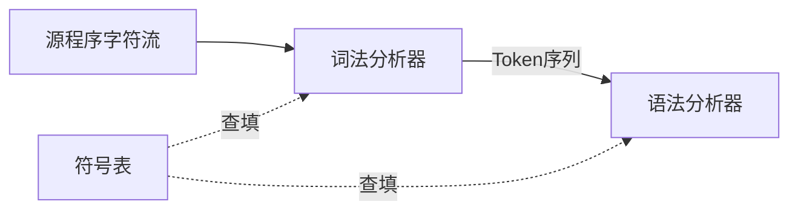

# 词法分析器的功能与在编译器中的地位

编译器的输入是源程序的字符流，但语法分析器能直接处理一个个字符吗？显然不能。就像读英文句子时我们识别的是“单词”而非字母，编译器也需要一个专门的阶段把字符流切分成有意义的“单词”，这就是词法分析。

## 词法分析器的功能

词法分析器（也称扫描器）是编译过程的==第一个阶段==，核心任务是从左到右逐字符扫描源程序，将其组装成**单词符号（Token）**并输出给语法分析器。

具体而言，它完成以下工作：

1. **识别单词**：将字符流划分为关键字、标识符、常数、运算符、界符等类别。
2. **内部编码**：将识别出的单词转换为统一的二元式 `(种别码, 属性值)`。
   - 为什么要编码？因为语法分析器不关心单词拼写，只关心它的语法类别。对标识符通常统一分配同一个种别码，用属性值指向符号表中的具体入口来区分不同标识符。
3. **过滤无用信息**：剔除空格、换行、注释等不影响语法的字符。
4. **报告词法错误**：发现非法字符或未闭合的字符串时给出报错。

> [!IMPORTANT]
> 词法分析器的输出不是字符，而是==单词符号的内部编码（二元式）==。

## 在编译器中的地位

词法分析器在整个编译前端中处于什么位置？看下图：

- **作为独立阶段**：它是语法分析的前置模块，每次语法分析器需要新单词时，就调用一次词法分析器（即 `getNextToken()`）。
- **与符号表交互**：遇到标识符时，词法分析器需将其登记到符号表中。

> [!NOTE]
> 为什么要把词法分析单独分出来，而不让语法分析器直接读字符？
> 一是**简化设计**，让语法分析专注于结构推导；二是**提高效率**，词法规则简单，可用更底层的自动机高效实现；三是**增强可移植性**，源文件编码差异只在词法层处理。

## 关键机制：超前搜索与扫描缓冲区

识别某些单词时，仅看当前字符不够。例如读到 `<` 时，必须再往后看一个字符才能确定是 `<=` 还是单独的 `<`。

这种==仅向前读取字符以判别情况，但不做其他处理，判明后再回头处理已读字符==的技术，称为**超前搜索（Lookahead）**。

为了支持频繁的字符回退与读取，通常设置**扫描缓冲区**（双半区结构），避免频繁磁盘 I/O，同时保证超前搜索后指针能安全回退。

> [!TIP]
> 记忆口诀：**超前搜索只看不办，看清之后再回头算。**

## 与相近概念的区别

| 对比维度 | 词法分析 | 语法分析 |
| :--- | :--- | :--- |
| 处理对象 | 字符流 | Token 序列 |
| 识别目标 | 单词（正则文法/正规式） | 句子结构（上下文无关文法） |
| 常用工具 | DFA / NFA | LL(1) / LR 分析表 |
| 错误类型 | 非法字符 | 结构缺失或错乱 |

## 常见易错坑

> [!WARNING]
> 1. **混淆种别码与属性值**：所有标识符的种别码相同（如都编为 `id`），靠属性值区分；而每个关键字通常有独立的种别码。
> 2. **忽略最长匹配原则**：遇到 `do12` 时，不能看到 `do` 就截断为关键字，必须继续超前搜索直到遇到非标识符字符，整体识别为标识符。
> 3. **超前搜索越界**：在文件末尾进行超前搜索时，若未加结束符（如 `#` 或 EOF），会导致越界读取。
