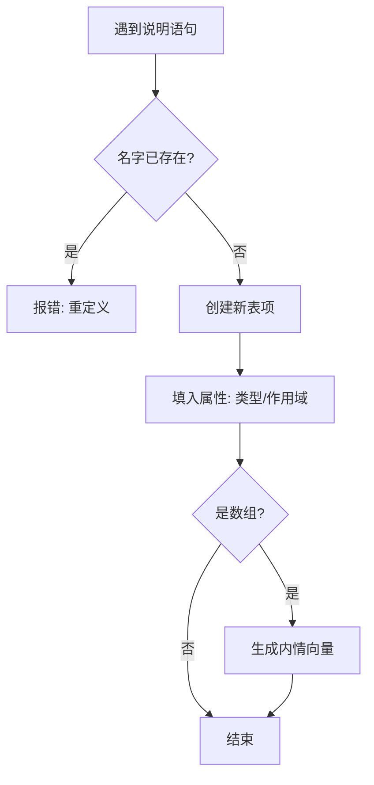

# 说明语句的翻译与符号表管理

# 说明语句的翻译与符号表管理

在编译过程中，程序语言的语句大体可分为 **==执行性==** 语句和 **==说明性==** 语句两大类。说明语句（如变量声明、数组定义）不产生可执行的目标代码，其核心任务是收集名字的属性并填入符号表，为后续的阶段提供信息支撑。

## 为什么需要符号表？

一个名字（Identifier）在程序中不仅仅是一个字符串，它携带了关键的语义属性。从功能上说，名字的属性主要包括 **==类型==** 和 **==作用域==**。

> [!IMPORTANT]
> 符号表是编译器各阶段共享的信息中心。在目标代码生成阶段，符号表主要用于 **==地址分配==**（对应选择 55），即确定变量在内存中的具体位置或寄存器映射。

若没有符号表，编译器无法判断 `a + b` 是整数加法还是浮点加法，也无法检查变量是否先声明后使用。

## 数组的内情向量（Dope Vector）

对于数组这种复杂数据结构，仅记录名字和类型是不够的。编译器通常使用“内情向量”来存储数组的运行时刻信息。

| 包含信息 | 说明 |
| :--- | :--- |
| 维数 | 数组有几个维度 |
| 类型 | 元素的数据类型（如 int, float） |
| 维上下界 | 每一维的起始和结束索引 |
| 各维界差 | 用于计算地址偏移量的步长 |

> [!WARNING]
> **常见考点陷阱**：数组的内情向量中肯定 **不含有** 数组的 **==维数==** 信息吗？
> 回顾真题（选择 30）：题目问“肯定不含有”，答案选 A（维数）。
> *注：此处需结合南邮特定教材语境。通常内情向量**包含**维数以支持动态访问，但若题目强调“静态已知”或特定实现下，维数可能作为常量处理而不存入运行时向量。但在大多数通用编译原理教学中，内情向量**包含**维数、类型、上下界和界差。若依据该题答案 A，则暗示在该课程体系中，维数被视为声明时的静态属性，而非运行时内情向量的动态部分，或者题目意在考察“哪些是必须在运行时通过向量获取的”，而维数可能在编译期已确定。*
>
> **修正理解**：更常见的考法是问“包含什么”。若依题库答案 A，请记忆：**在该特定考题逻辑下，维数不被视为内情向量的核心动态字段**（可能因编译期已定）。但请务必注意，**类型、上下界、界差**是绝对核心的。

## 翻译过程与左值/右值

在处理说明语句时，编译器需区分名字的 **左值（L-value）** 和 **右值（R-value）**。

- **左值**：表示变量的存储地址（Location）。
- **右值**：表示变量的内容值（Value）。

> [!TIP]
> **变量应当既持有左值又持有右值**（对应选择 3）。
> - 出现在赋值号左边时，使用其左值（地址）。
> - 出现在表达式右边时，使用其右值（内容）。

### 翻译流程示意

## 典型例题解析

**题目**：分析句子 `[a]#` 相关的符号表操作。

在语法制导翻译中，当扫描到标识符 `a` 时：
1.  **查表**：在符号表中查找 `a`。
2.  **填表**：若为新声明，记录其类型（如整型）、作用域（如当前过程 P(A)）。
3.  **数组处理**：若 `a` 是数组，还需计算并存储其内情向量信息（上下界、界差等）。

> [!CAUTION]
> **易错点**：不要混淆“语法检查”与“语义检查”。说明语句的翻译属于 **语义分析** 阶段，主要依赖符号表进行类型检查和属性传递，而非单纯的语法结构匹配。
