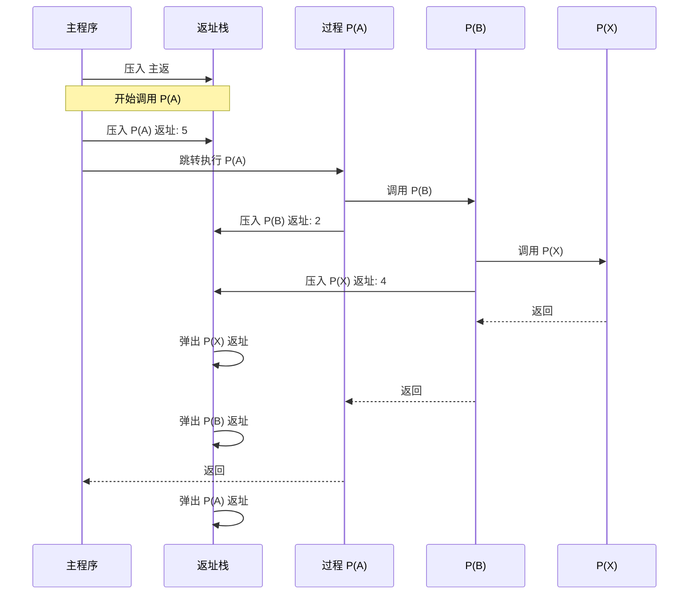

# 过程语句的翻译（参数传递）

---

> [!IMPORTANT]
> ==**参数传递的翻译，核心是计算并维护形参与实参的“数据地址”与“返回地址”，确保过程调用能正确跳转并返回。**==

## 什么是过程调用的翻译？

当我们编译一个函数或过程调用，比如 `P(A+B, X)`，编译器需要生成代码，完成三件事：
1.  **传参**：计算实参 `A+B` 的值，并将其存放到被调用过程 `P` 能访问到的位置。
2.  **跳转**：记录下**返回地址**（即调用语句的下一条指令地址），然后跳转到过程 `P` 的入口代码。
3.  **返回**：`P` 执行完毕后，根据记录的返回地址，跳回调用者继续执行。

这整个过程中，参数传递和返回地址的管理是翻译的核心，通常借助**运行栈**来实现。

## 南京邮电大学课件中的典型模型

从课件和考题来看，这门课重点考察一种**基于“返址栈”的直观翻译模型**。我们通过一个例题来一步步理解。

### 一个算对了的例子：分析句子 `[a]#`

假设我们有这样的语法和语义规则：
- `P ( A )` 代表一个过程调用，形参是 `A`，实参也在括号里。
- 句子以 `[` 开始，以 `#` 结束，是某个过程的代码体。
- 有一条特殊指令 `P（B）`，其语义是：将当前过程的“返址”作为实参，去调用一个能处理它的过程？这看起来很抽象，我们直接看考卷里的推演。

题目要求我们“分析句子 `[a]#`”，并给出了一个关键执行序列的图。根据碎片化图片，我们可以还原出整个**返址栈的动态变化过程**，这其实就是过程调用与返回的翻译演示。

我们把过程执行流程画成一张 `Mermaid` 时序图，这样更直观：

下面我们详细拆解每一步，这就是答题时需要写出的“分析”。

**第一步：初始状态**

| 返址栈 |
| --- |
| 主返 |
| P(A):5 |

*图：开始执行过程 P(A)，其返址为 5 被压栈*

**分析**：主程序开始执行，遇到过程调用 `P(A)`。系统将主程序的返回地址 `主返` 压栈，然后将 `P(A)` 自己的返回地址 `5` 压栈，并跳转去执行 `P(A)` 的代码。

**第二步：P(A) 调用 P(B)**

| 返址栈 |
| --- |
| 主返 |
| P(A):5 |
| P(B):2 |

*图：P(A) 执行中调用 P(B)，P(B) 的返址 2 压栈*

**分析**：在 `P(A)` 的代码体 `[a]#` 中，执行到某处时，发起了对 `P(B)` 的调用。于是，`P(B)` 的返回地址 `2` 被压入返址栈。此时，栈顶是 `P(B):2`，这意味着当前正在执行 `P(B)`，它执行完后应该返回到 `P(A)` 的地址 `2` 处。

**第三步：P(B) 调用 P(X)**

| 返址栈 |
| --- |
| 主返 |
| P(A):5 |
| P(B):2 |
| P(X):4 |

*图：P(B) 执行中又调用 P(X)，P(X) 的返址 4 压栈*

**分析**：过程 `P(B)` 在执行时，又调用了 `P(X)`。于是，`P(X)` 的返回地址 `4` 被压栈。栈顶现在是 `P(X):4`，控制权在 `P(X)` 手上。

**第四步：P(X) 返回**

| 返址栈 |
| --- |
| 主返 |
| P(A):5 |
| P(B):2 |

*图：P(X) 执行完毕，其返址 4 出栈，返回到 P(B)*

**分析**：`P(X)` 执行完毕后，从返址栈弹出栈顶元素 `P(X):4`，利用这个地址 `4`，精准跳回过程 `P(B)` 的代码中继续执行。此时栈顶恢复为 `P(B):2`。

**第五步：P(B) 返回**

| 返址栈 |
| --- |
| 主返 |
| P(A):5 |

*图：P(B) 执行到 P(B') 后返回，返址 2 出栈，回到 P(A)*

**分析**：`P(B)` 执行到其内部 `P（B'）` 这条指令后，其任务完成并返回。系统弹出栈顶的 `P(B):2`，并跳转到 `P(A)` 地址 `2` 处继续执行。此时栈顶又变成了 `P(A):5`。

**第六步：P(A) 返回**

| 返址栈 |
| --- |
| 主返 |

*图：P(A) 执行完毕，返址 5 出栈，回到主程序*

**分析**：`P(A)` 执行完最后一句 `P（A）` 后，从栈中弹出自己的返回地址 `5`，据此跳回主程序。最终，栈中只剩下 `主返`，程序在主程序中继续运行。

## 常见的坑与辨析

> [!WARNING]
> **返址与数据地址混淆**：参数传递不仅要处理“返址”，更要处理“数据地址”。考卷中的 `P(A):5`，这里的 `A` 是形参标记，`5` 是返回地址，但 **`A` 的值究竟存在哪里？** 这是“传值”、“传地址”、“传名”等不同传递方式要解决的问题。南邮考题可能默认了一种简单模型，答题时务必跟紧课件符号，不要混淆。

> [!TIP]
> **记忆口诀：调用就压栈，返回就弹出**。返址栈的“后进先出”特性，完美匹配了过程的嵌套调用与返回顺序。看到栈图，就自底向上读，这就是当前活动的调用链。

> [!NOTE]
> **值与地址的翻译区别**：
> - **传值**：实参 `A+B` 的值被算出来，拷贝到一个新位置给形参用。形参的修改不影响实参。
> - **传地址**：把实参 `A` 的地址传给形参。形参和实参指向同一块内存，形参的修改会直接影响实参。翻译时需要处理寻址操作。
>
> 虽然考题的静态图没直接体现，但这是参数传递翻译最核心的两种四元式序列生成模式。

这个返址栈模型，是理解运行时过程调用机制的绝佳简化版，吃透它，后面学习更复杂的活动记录和显示表就水到渠成了。
