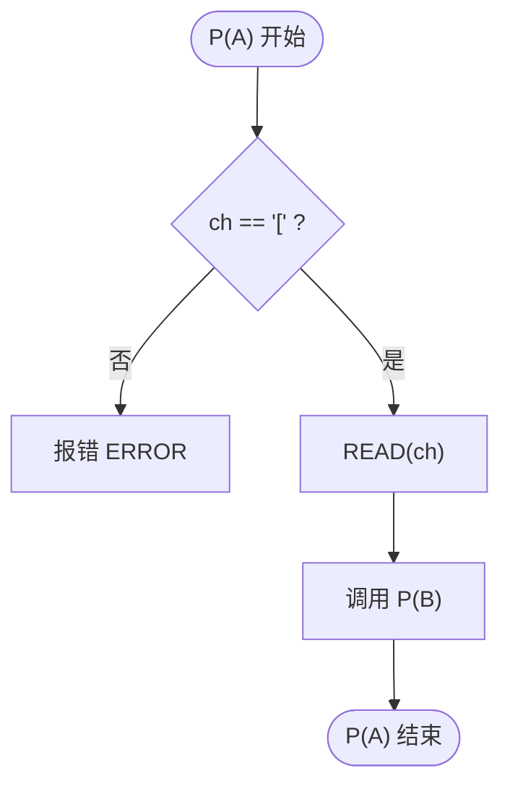
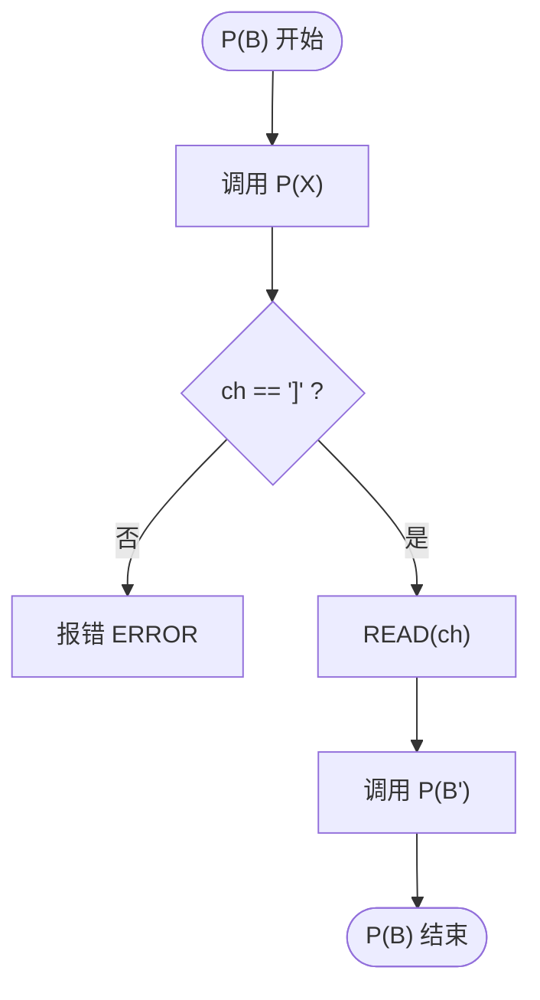
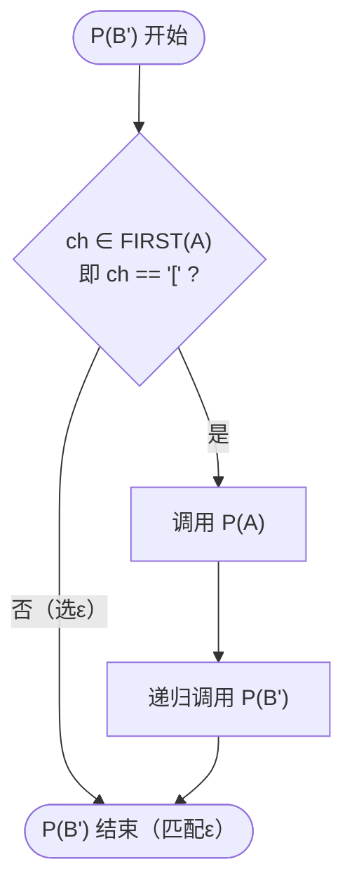
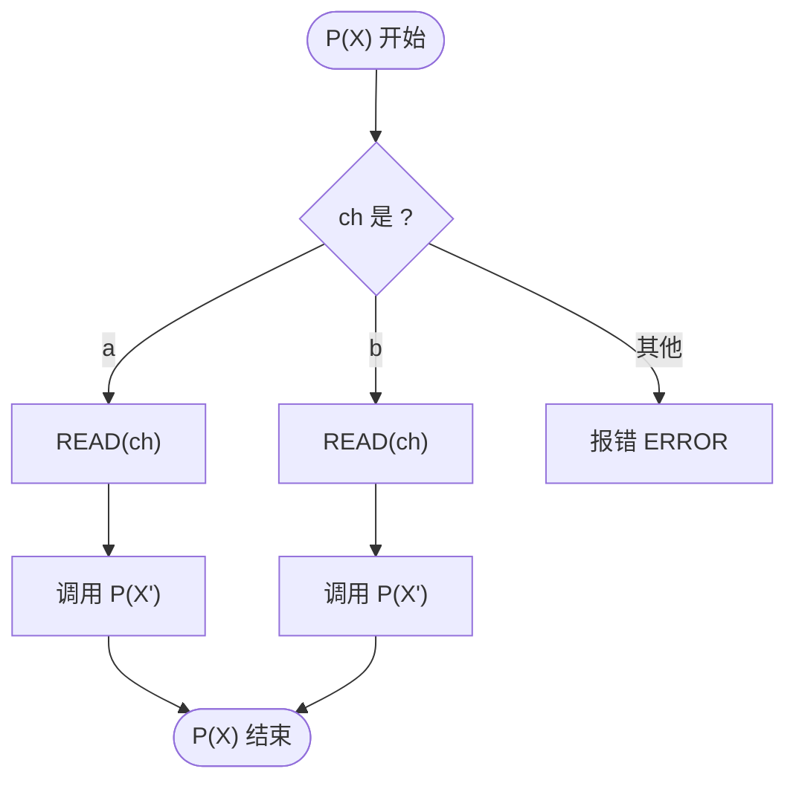
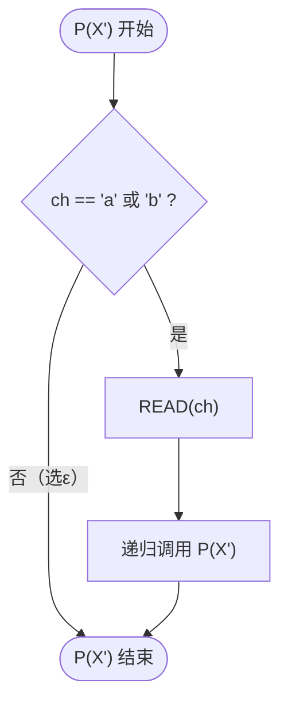

# 递归下降分析法

## 引言：为什么需要递归下降分析法？

在词法分析得到单词流后，编译器需要判断这些单词的排列是否符合语言的语法规则。例如，对于 `[ a ]` 这样的输入，它是否属于我们定义的某个语法成分？

一个直观的想法是：**为每一种语法成分（非终结符）编写一个识别函数**，从最大的语法成分开始，递归地调用这些函数去匹配输入。如果最终完全匹配且输入刚好读完，则语法正确。这就是递归下降分析法的核心思想。

## 什么是递归下降分析法？

递归下降分析法（Recursive-Descent Parsing）是一种**自顶向下**的语法分析方法。它为文法的每个非终结符编写一个子程序（或函数），子程序的调用关系反映了非终结符之间的推导关系。当子程序之间出现相互调用时，便形成递归，故称“递归下降”。

>[!IMPORTANT]
> 递归下降分析法的核心要求是：==文法必须消除左递归和回溯==，即改造为 LL(1) 文法。课件反复强调“递归下降分析法对文法有严格要求”，原因正在于此。

## 如何改造文法以满足要求？

实际遇到的文法往往含有左递归（如 $X ::= Xa$）或存在多个候选式首符号相同的情况（回溯）。改造的标准步骤为：

1. **消除左递归**：将 $U ::= U\alpha \mid \beta$ 改写为 $U ::= \beta U'$ 与 $U' ::= \alpha U' \mid \varepsilon$。
2. **提取左公因子**：将 $U ::= \alpha\beta_1 \mid \alpha\beta_2$ 改写为 $U ::= \alpha U'$ 与 $U' ::= \beta_1 \mid \beta_2$。

下面的例子展示了完整的改造过程。

### 示例：改造并识别 $A ::= [B,\ B ::= X] \mid BA,\ X ::= Xa \mid Xb \mid a \mid b$

**原始文法**存在左递归（$B ::= BA$ 和 $X ::= Xa \mid Xb$），无法直接编写递归子程序。首先进行等价变换：

**消除 $B$ 的左递归：**
由 $B ::= BA \mid X]$，将 $X]$ 视为基础情形 $\beta$，$A$ 视为 $\alpha$，得到：
$B ::= X]B'$
$B' ::= AB' \mid \varepsilon$

**消除 $X$ 的左递归：**
由 $X ::= Xa \mid Xb \mid a \mid b$，将 $a \mid b$ 视为 $\beta$，提取公因子后消除：
$X ::= aX' \mid bX'$
$X' ::= aX' \mid bX' \mid \varepsilon$

**改造后的完整文法 G'[A]：**
$$
\begin{aligned}
A &::= [B \\
B &::= X]B' \\
B' &::= AB' \mid \varepsilon \\
X &::= aX' \mid bX' \\
X' &::= aX' \mid bX' \mid \varepsilon
\end{aligned}
$$

现在，每个非终结符对应的候选式首符号均唯一，可以编写递归子程序了。

## 递归子程序的构造方法

为每个非终结符 $U$ 编写一个子程序 $P(U)$。子程序体内，根据当前输入符号 `ch` 选择唯一的候选式进行匹配：

1. **若候选式以终结符 $y_i$ 开头**：判断 `ch == yi`。若相等，则读入下一字符 `READ(ch)`；否则报错。
2. **若候选式以非终结符 $y_i$ 开头**：直接调用子程序 $P(y_i)$。
3. **若遇到空串 $\varepsilon$**：自动认为匹配成功，不做任何读入操作。
4. **递归处理**：当非终结符自身再次出现时，子程序通过调用自身（或间接调用）形成递归。课件特别提到，需要设立递归入口 `SCIN` 与出口 `SCOUT` 来管理返回地址栈，以支持通用实现。

下面是依据改造后文法绘制的子程序流程框图及对应代码思路。

## 子程序流程图与实现

### 1. 主程序与 P(A)

`A ::= [B` 直接匹配终结符 `[` 与非终结符 `B`。

### 2. P(B) 与 P(B')

`B ::= X]B'` 顺序匹配 $X$、`]` 和 $B'$。

对于 $B' ::= AB' \mid \varepsilon$，关键在于判断何时选择 $\varepsilon$。这里的选择依据是 $A$ 的首符号集合。在本例中，$A$ 以 `[` 开头。若 `ch` 为 `[`，则选 $AB'$；否则选 $\varepsilon$。

### 3. P(X) 与 P(X')

`X ::= aX' \mid bX'` 根据 `ch` 是 `a` 或 `b` 进入分支。

$X' ::= aX' \mid bX' \mid \varepsilon$ 的设计与 $B'$ 类似，遇到 `a` 或 `b` 时继续匹配，否则自动选择 $\varepsilon$ 返回。

## 常见误区与辨析

>[!WARNING]
> **不是所有文法都可直接使用递归下降**。若文法含有左递归（如 $E ::= E + T$），子程序会无限调用自身而不消耗任何输入，导致栈溢出。必须先消除左递归。

>[!CAUTION]
> **$\varepsilon$ 的选择依赖 FOLLOW 集合**。当候选式含 $\varepsilon$ 时，不能随意选择。只有当当前输入符号 $ch$ 属于该非终结符的 FOLLOW 集时，才能选择 $\varepsilon$。课件所述“当输入符号遇选择项为 $\varepsilon$ 时，就自动认为获得了匹配”是一种在**保证无回溯**前提下的简化处理——即通过分析上下文，此时选择 $\varepsilon$ 是唯一正确的路径。

| 概念 | 递归下降分析法 | LL(1) 分析法 |
| :--- | :--- | :--- |
| **实现方式** | 手写递归函数/过程 | 由分析表驱动，通常自动生成 |
| **直观性** | 非常直观，接近文法推导 | 较不直观，需维护栈和表 |
| **文法限制** | 必须非左递归、无回溯 | 必须是 LL(1) 文法 |
| **等价关系** | ==能写递归下降的文法必然是 LL(1) 文法== | LL(1) 文法必然能用递归下降实现 |

递归下降分析法将文法规则直接映射为程序结构，是高可读性、易调试的手写语法分析器首选方案。理解它，你就掌握了编译器前端的核心构造技术。
