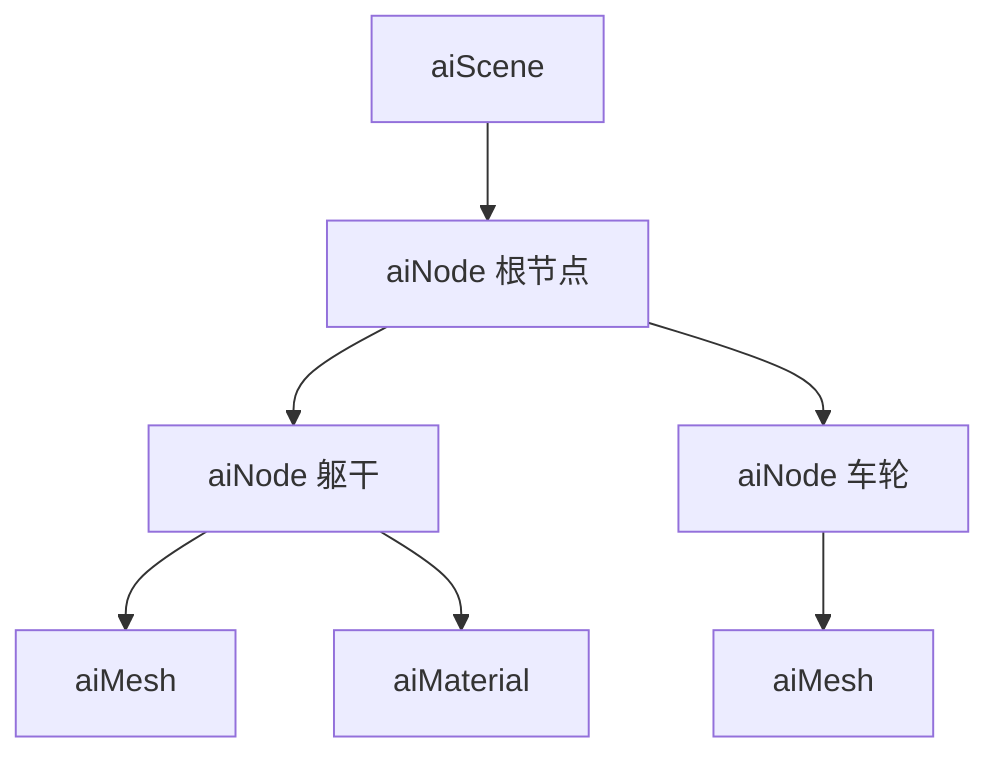
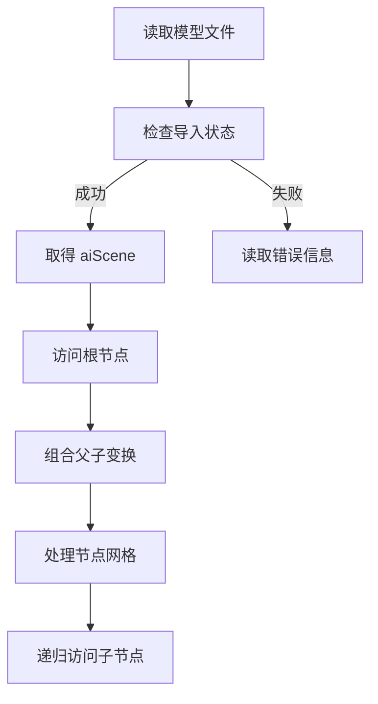

# 使用Assimp导入3D模型场景树 (Importing 3D Models with Assimp Scene Graph)

## 场景树是什么

使用 Assimp 导入 3D 模型时，程序得到的不只是网格顶点，还包括一个描述模型组织方式的 **Scene Graph（场景图）**。场景树以 `aiScene` 为根节点，下面保存多个 `aiNode`；每个节点既可以继续连接子节点，也可以关联网格 `aiMesh`、材质 `aiMaterial`、纹理或骨骼动画等信息。

可以把场景树理解为：模型由哪些部件组成、部件之间如何变换、每个部件使用什么网格与材质。



## 为什么需要场景树

如果只读取三角形缓冲区，程序会失去模型的整体结构，难以独立移动部件、切换材质或执行骨骼动画。场景树保留了模型导入器解析出的层级和变换关系，因此适合实现角色动画、车辆装配、编辑器编辑等功能。

节点局部变换通常按父节点到子节点累积：

$$
M_{\text{world}}=M_{\text{parent}}M_{\text{local}}
$$

其中 $M_{\text{local}}$ 包含节点的平移、旋转和缩放。最终，顶点还可能受到关联 `aiMesh` 的 `mTransform` 影响。

## 导入与遍历流程

Assimp 的基本使用方式是创建导入器、读取文件、取得场景，再递归访问节点：

```cpp
Assimp::Importer importer;
const aiScene* scene =
    importer.ReadFile(path, aiProcess_Triangulate |
                         aiProcess_JoinIdenticalVertices |
                         aiProcess_GenSmoothNormals);

if (!scene || scene->mErrorCode != AI_SUCCESS) {
    // 输出 importer.GetErrorString()
    return false;
}

void ProcessNode(const aiNode* node,
                 const aiMatrix4x4& parent) {
    aiMatrix4x4 world = parent * node->mTransformation;

    for (unsigned i = 0; i < node->mNumMeshes; ++i) {
        const aiMesh* mesh =
            scene->mMeshes[node->mMeshes[i]];
        // 创建 GPU 网格并使用 world 变换
    }

    for (unsigned i = 0; i < node->mNumChildren; ++i) {
        ProcessNode(node->mChildren[i], world);
    }
}
```

调用 `ProcessNode(scene->mRootNode, identity)` 即可从根节点开始遍历。实际项目还应检查 `scene`、`mRootNode` 和网格数据是否有效。



> [!IMPORTANT]
> `aiNode` 负责组织层级，网格数据实际存放在 `aiScene::mMeshes` 中；节点通常通过 `mMeshes` 下标引用它们。

> [!TIP]
> 常见绘制顺序是：先递归遍历场景树建立节点到网格的对应关系，再遍历 `mMeshes` 上传 GPU 资源；不要假定网格下标就是节点下标。

## 与相近概念的区别

| 概念 | 主要内容 | 典型用途 |
|---|---|---|
| `aiScene` | 一次导入得到的完整场景 | 管理网格、材质、纹理、动画 |
| `aiNode` | 场景树中的层级节点 | 保存名称、变换和子节点 |
| `aiMesh` | 顶点、索引、法线等绘制数据 | 创建 GPU 网格 |
| `aiMaterial` | 材质属性与纹理引用 | 设置着色参数 |
| `aiBone` | 骨骼及权重信息 | 蒙皮与角色动画 |

`aiNode` 不是 `aiMesh` 的子对象；许多节点可以不包含网格，多个节点也可能引用同一个网格。

## 常见坑

> [!WARNING]
> - 文件路径要使用 `std::string`；部分版本不直接接受 `const char*`。
> - `ReadFile` 返回空指针后不要继续解引用。
> - 节点变换和网格变换不要重复应用。
> - 递归遍历要同时处理当前节点的网格和全部子节点。
> - 导入坐标单位不一定与引擎一致；DirectX 风格文件常需要转换 Z 轴方向。
> - 大量模型宜使用 `aiProcess_OptimizeMeshes` 等后处理减少网格数量，但会改变原始结构。

## 一个正确处理的例子

假设根节点平移 $(1,0,0)$，车身节点相对根节点平移 $(2,0,0)$，车身网格自身没有额外变换，则车身顶点的世界位置应比网格原始位置多偏移 $(3,0,0)$：

$$
M_{\text{world}}
=M_{\text{root}}M_{\text{body}}M_{\text{mesh}}
=I\cdot T(1,0,0)\cdot T(2,0,0)
=T(3,0,0)
$$

如果程序只应用车身节点的局部变换，顶点会错误地停在偏移 $(2,0,0)$ 的位置；若又重复应用网格变换，则可能进一步重复偏移。==场景树遍历的核心是按父子层级正确组合变换矩阵。==
