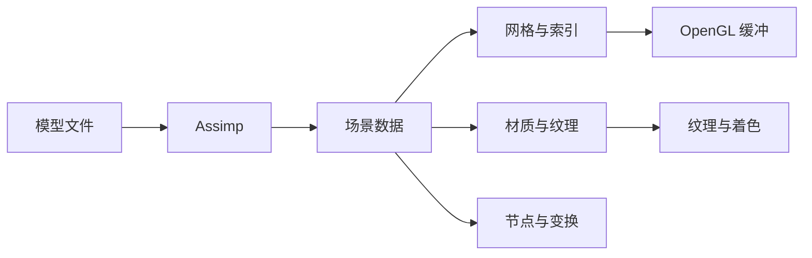

# Assimp模型导入库配置 (Assimp Library Configuration)

Assimp（Open Asset Import Library）是一个开源的模型导入库，可把多种三维文件格式转换为程序可直接处理的数据结构。课程中常用它读取 `.obj`、`.fbx`、`.dae`、`.blend` 等模型，并结合 OpenGL 完成纹理、材质、网格和法线等数据的加载。

## 为什么需要 Assimp

OpenGL 本身不认识 FBX、OBJ 等文件格式。即使直接读取 OBJ，也需要自行处理顶点、法线、纹理坐标、材质和索引。Assimp 将这些差异统一起来：



> [!IMPORTANT]
> Assimp 负责“把文件变成场景数据”，OpenGL 负责“把场景数据画到屏幕”。

## 基本配置与导入流程

在 Linux 环境中，可使用系统包管理器安装：

```bash
sudo apt install libassimp-dev
```

CMake 中查找并链接：

```cmake
find_package(assimp REQUIRED)

add_executable(ModelViewer main.cpp)
target_link_libraries(ModelViewer PRIVATE
    ${OPENGL_LIBRARIES}
    assimp::assimp
)
```

若使用较旧版本的 CMake，可能需要手动指定头文件目录和库文件：

```cmake
include_directories(${ASSIMP_INCLUDE_DIRS})
target_link_libraries(ModelViewer PRIVATE ${ASSIMP_LIBRARIES})
```

典型导入过程如下：

```cpp
Assimp::Importer importer;

const aiScene* scene = importer.ReadFile(
    "models/cube.fbx",
    aiProcess_Triangulate |
    aiProcess_JoinIdenticalVertices |
    aiProcess_GenSmoothNormals
);

if (!scene || scene->mErrorFlags != 0) {
    std::cerr << importer.GetErrorString() << '\n';
    return -1;
}
```

常用处理选项包括：

| 选项 | 作用 |
|---|---|
| `aiProcess_Triangulate` | 将多边形统一转换为三角形 |
| `aiProcess_JoinIdenticalVertices` | 合并重复顶点 |
| `aiProcess_GenSmoothNormals` | 生成平滑法线 |
| `aiProcess_FlipUVs` | 翻转纹理坐标 |
| `aiProcess_CalcTangentSpace` | 计算切线空间 |

读取场景后，再遍历 `mRootNode` 及其子节点，处理每个节点的 `mTransformations`、网格、材质和纹理，并创建 VAO、VBO、EBO 与纹理对象。

## 与相近概念的区别

| 概念 | 主要职责 |
|---|---|
| Assimp | 解析并转换三维模型文件 |
| OpenGL | 渲染场景中的模型 |
| glTF | 面向运行时传输和 GPU 友好设计的模型格式 |
| MeshLib | 另一种开源网格处理库 |
| Blender | 建模、编辑和导出模型 |

Assimp 并不能代替 OpenGL。它不会自动创建可用的 OpenGL 缓冲，也不会自动完成纹理过滤、光照和着色器设置。

> [!TIP]
> 可把流程记成：配置 Assimp → 导入场景 → 遍历节点 → 提取网格 → 创建 GPU 资源 → 绘制。

## 常见坑

> [!WARNING]
> - `ReadFile()` 失败时，`scene` 可能为空，必须先检查指针和错误信息。  
> - 使用完 `aiScene` 前不要释放 `Assimp::Importer`；可在处理完毕后调用 `FreeScene()`。  
> - OBJ 顶点索引通常从 1 开始，而 OpenGL 索引通常从 0 开始，需要转换：`glIndex = assimpIndex - 1`。  
> - 纹理坐标原点方向可能与 OpenGL 不一致，可使用 `aiProcess_FlipUVs`。  
> - 交叉网格宜采用三角形列表，不要依赖未明确指定的面拼接顺序。

例如，OBJ 中一个面为 `1 2 3`，应转换为 OpenGL 索引 `0 1 2`。若顶点数据依次为位置、法线、纹理坐标，每个顶点包含 $3+3+2=8$ 个 `float`，则顶点缓冲步长为：

$$
\text{stride}=8\times\operatorname{sizeof}(\text{float})=32\text{ bytes}
$$

> [!IMPORTANT]
> 正确配置的关键是：==链接 Assimp、检查导入结果、统一顶点格式，并正确转换索引与纹理坐标==。
