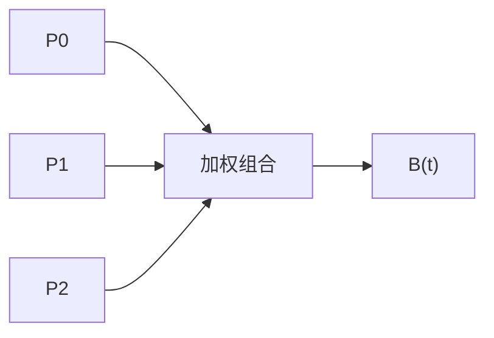

# Bezier曲线的定义、Bernstein基函数与控制多边形性质 (Bezier Curves & Properties)

## 什么是 Bézier 曲线

Bézier 曲线是用一组控制点定义的参数曲线。控制点并不要求全部落在曲线上，它们主要决定曲线的形状、方向和整体趋势。

在计算机图形学中，常见的是==次数为 $n$ 的 Bézier 曲线==：

$$
\mathbf B(t)=\sum_{i=0}^{n}\binom{n}{i}(1-t)^{n-i}t^i\mathbf P_i,
\qquad 0\le t\le1
$$

其中，$\mathbf P_i$ 是第 $i$ 个控制点，$\binom{n}{i}$ 是组合数。

## Bernstein 基函数

将上式中的标量部分定义为 Bernstein 基函数：

$$
b_{i,n}(t)=\binom{n}{i}(1-t)^{n-i}t^i
$$

于是：

$$
\mathbf B(t)=\sum_{i=0}^{n}b_{i,n}(t)\mathbf P_i
$$

基函数有以下重要性质：

- 非负性：$b_{i,n}(t)\ge 0$；
- 归一性：$\sum_i b_{i,n}(t)=1$；
- 端点性质：$b_{0,n}(0)=1$，$b_{n,n}(1)=1$。

因此，曲线可以看作控制点在权重作用下的加权组合。

## 控制多边形与曲线性质

依次连接控制点 $\mathbf P_0,\mathbf P_1,\ldots,\mathbf P_n$ 得到的折线称为**控制多边形**。

对于 $n$ 次 Bézier 曲线：

| 性质 | 结论 |
|---|---|
| 端点插值 | $\mathbf B(0)=\mathbf P_0$，$\mathbf B(1)=\mathbf P_n$ |
| 端点切线 | $\mathbf B'(0)=n(\mathbf P_1-\mathbf P_0)$，$\mathbf B'(1)=n(\mathbf P_n-\mathbf P_{n-1})$ |
| 凸包性质 | 整条曲线位于控制点的凸包内 |
| 对称性 | 控制点反向排列时，曲线也沿相反方向反向 |
| 参数范围 | 通常限制在 $[0,1]$ |

> [!IMPORTANT]
> 控制多边形的首条边决定曲线起点切线方向，末条边决定曲线终点切线方向；但中间控制点通常不在曲线上。

例如，三次 Bézier 曲线有四个控制点：

$$
\mathbf B(t)=(1-t)^3\mathbf P_0+3t(1-t)^2\mathbf P_1+
3t^2(1-t)\mathbf P_2+t^3\mathbf P_3
$$

当 $t=0.5$ 时：

$$
\mathbf B(0.5)
=\frac18\mathbf P_0+\frac38\mathbf P_1+
\frac38\mathbf P_2+\frac18\mathbf P_3
$$

这就是一个“算对了的例子”：曲线并不位于控制多边形的正中间，而是按 Bernstein 权重对控制点进行组合。

## 为什么需要 Bézier 曲线

如果直接用大量采样点描述曲线，修改一个局部区域往往会影响许多数据。Bézier 曲线通过控制点提供了一种简洁的形状编辑方式：

- 少量控制点即可表示平滑曲线；
- 移动控制点可以直观地改变形状；
- 可用于字体轮廓、矢量绘图、动画路径和曲面构造；
- 三次 Bézier 曲线在表达精度与计算复杂度之间较常使用。

不过，==高阶 Bézier 曲线并不等于“越高越好”==。高阶控制多边形可能产生不必要的摆动，局部修改也会影响更大的范围，因此实际系统常使用分段低阶曲线。

## 与相近概念的区别

| 概念 | 主要特点 | 与 Bézier 曲线的区别 |
|---|---|---|
| B 样条曲线 | 使用分段多项式，局部控制能力强 | Bézier 曲线可看作单段 B 样条 |
| Catmull–Rom 样条 | 常用于插值已知数据点 | 通常会经过各控制点；Bézier 曲线只保证经过首尾控制点 |
| 折线 | 线段连接，边界不连续 | Bézier 曲线通常具有连续切线 |
| 隐式曲线 | 由 $F(x,y)=0$ 定义 | Bézier 曲线是显式参数曲线，直接由 $t$ 求点 |

## 常见坑

> [!WARNING]
> 端点插值不等于经过所有控制点。除首尾点外，中间控制点通常只是“控制”曲线，而不是曲线上的采样点。

> [!CAUTION]
> Bernstein 基函数的权重依赖于次数和参数 $t$。不能把三次曲线的 $1/8,3/8,3/8,1/8$ 权重直接套到二次或其他次数的曲线上。

> [!TIP]
> 记忆重点：**首尾一定过，首尾切线看控制多边形，整体不离开凸包；中间点一般不过。**
