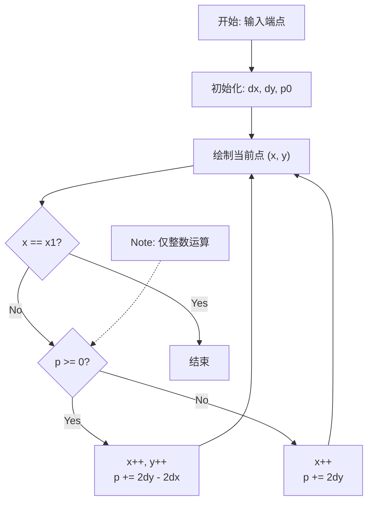

# Bresenham画线算法 (Bresenham's Line Algorithm)

# Bresenham画线算法 (Bresenham's Line Algorithm)

## 算法本质与动机

在光栅显示器上绘制直线，核心挑战是如何从连续的数学直线 $y = kx + b$ 中，选出最接近理想路径的**像素序列**。DDA算法虽然直观，但涉及浮点运算和取整，效率较低且存在累积误差。

==Bresenham算法的核心优势==：仅使用**整数加法、减法和位移**操作，完全避免浮点运算，极大提升了硬件实现效率和速度。它通过维护一个“决策参数”（Decision Parameter），判断下一个像素点应选在当前点的右侧还是右上方。

## 算法推导与流程

假设直线斜率 $0 \le k \le 1$，起点 $(x_0, y_0)$，终点 $(x_1, y_1)$。令 $\Delta x = x_1 - x_0$，$\Delta y = y_1 - y_0$。

算法每一步 $x$ 增加 1，$y$ 要么不变，要么加 1。我们引入决策参数 $p_k$。若 $p_k < 0$，选下方像素 $(x_{k+1}, y_k)$；若 $p_k \ge 0$，选上方像素 $(x_{k+1}, y_{k+1})$。

> [!IMPORTANT]
> 初始决策参数 $p_0 = 2\Delta y - \Delta x$。
> 若 $p_k < 0$，则 $p_{k+1} = p_k + 2\Delta y$。
> 若 $p_k \ge 0$，则 $p_{k+1} = p_k + 2\Delta y - 2\Delta x$。

## 典型例题演示

**题目**：使用Bresenham算法画出从 $(1, 1)$ 到 $(6, 4)$ 的直线。

**解析**：
1.  **计算增量**：$\Delta x = 6-1=5$，$\Delta y = 4-1=3$。
2.  **初始参数**：$p_0 = 2(3) - 5 = 1$。
3.  **迭代过程**：

| 步骤 $k$ | $p_k$ | 判断 ($p_k \ge 0$?) | 下一点 $(x_{k+1}, y_{k+1})$ | 更新 $p_{k+1}$ |
| :--- | :--- | :--- | :--- | :--- |
| 0 | 1 | Yes | $(2, 2)$ | $1 + 6 - 10 = -3$ |
| 1 | -3 | No | $(3, 2)$ | $-3 + 6 = 3$ |
| 2 | 3 | Yes | $(4, 3)$ | $3 + 6 - 10 = -1$ |
| 3 | -1 | No | $(5, 3)$ | $-1 + 6 = 5$ |
| 4 | 5 | Yes | $(6, 4)$ | - |

最终像素序列：$(1,1), (2,2), (3,2), (4,3), (5,3), (6,4)$。

> [!TIP]
> 记忆口诀：**“左加2y，右上加2y减2x”**。即 $y$ 不变时只加 $2\Delta y$，$y$ 增加时需再减去 $2\Delta x$。

## 常见陷阱与辨析

| 特性 | DDA算法 | Bresenham算法 |
| :--- | :--- | :--- |
| **运算类型** | 浮点加减、取整 | ==纯整数加减== |
| **精度** | 有累积误差 | 无累积误差 |
| **适用性** | 通用，易理解 | 需针对不同斜率分段处理 |

> [!WARNING]
> **斜率限制**：上述公式仅适用于 $0 \le k \le 1$。若 $|k| > 1$，需交换 $x, y$ 角色（以 $y$ 为步进方向）；若 $k < 0$，需调整 $y$ 的递减逻辑。考试中务必先判断斜率范围，再选择对应的增量公式。

> [!CAUTION]
> 注意 $\Delta x$ 和 $\Delta y$ 必须取**绝对值**参与参数计算，而坐标增减方向由起点和终点的相对位置决定。
