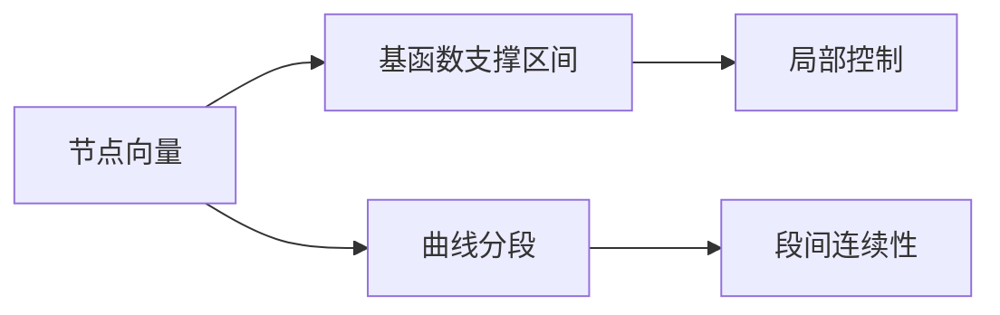

# B样条曲线(B-Splines)与节点向量 (Knot Vectors)

## 为什么需要 B 样条

贝塞尔曲线把整段曲线交给 $n+1$ 个控制点共同决定：移动一个点，整条曲线都会变；增加控制点，次数也随之升高。B 样条曲线（B-spline curve）把曲线分成若干段，并让每个控制点只影响局部区间，因此更适合交互造型。

其一般形式为
$$
P(u)=\sum_{i=0}^{n}P_iN_{i,k}(u),\qquad u\in[u_{k-1},u_{n+1}],
$$
其中 $P_i$ 是控制点，$k$ 是阶数（order），次数为 $k-1$，$N_{i,k}(u)$ 是 B 样条基函数。

> [!IMPORTANT]
> ==阶数 $k$、次数 $k-1$、控制点数 $n+1$ 必须分清==。三次 B 样条对应 $k=4$。

## 节点向量决定什么

节点向量（knot vector）是单调不减序列
$$
U=[u_0,u_1,\ldots,u_{n+k}],
$$
它把参数轴划分为节点区间（knot spans），决定各基函数在哪里非零，也决定控制点的影响范围。节点可以重复，重复次数称为重数（multiplicity）。

基函数由 Cox–de Boor 递推式定义：
$$
N_{i,1}(u)=
\begin{cases}
1,&u_i\le u<u_{i+1},\\
0,&\text{其他},
\end{cases}
$$
$$
N_{i,k}(u)=
\frac{u-u_i}{u_{i+k-1}-u_i}N_{i,k-1}(u)
+\frac{u_{i+k}-u}{u_{i+k}-u_{i+1}}N_{i+1,k-1}(u).
$$
递推中若分母为零，相应项规定为 $0$，不能当作“无法计算”。

## 开放均匀与均匀节点

开放节点向量（open knot vector）把首尾节点各重复 $k$ 次，例如 $n=3$、$k=4$ 时：
$$
U=[0,0,0,0,1,2,3,4,4,4,4].
$$
首端 $u=0$ 处只有 $N_{0,4}=1$，末端 $u=4$ 处只有 $N_{3,4}=1$，所以曲线经过首、末控制点。若只有一个有效区间，开放 B 样条就退化为同次贝塞尔曲线。

| 类型 | 节点特点 | 典型效果 |
|---|---|---|
| 均匀（uniform） | 内部节点等距 | 区间划分规则 |
| 开放均匀（open uniform） | 端点重复 $k$ 次，内部等距 | 插值首末控制点 |
| 非均匀（non-uniform） | 节点间距可不同 | 灵活调整参数化与局部形状 |

> [!NOTE]
> 开放不等于“曲线不闭合”，均匀也不等于“曲线经过控制点”。除端点插值等特殊情况外，B 样条通常只是逼近控制多边形。

## 一个可直接核算的例子

取 $k=2$，即一次 B 样条，节点向量为
$$
U=[0,0,1,2,2],
$$
控制点为 $P_0=(0,0)$、$P_1=(2,0)$、$P_2=(2,2)$，求 $P(1.5)$。

在 $1\le u<2$ 上，只有 $N_{1,2}$、$N_{2,2}$ 非零：
$$
N_{1,2}(u)=2-u,\qquad N_{2,2}(u)=u-1.
$$
因此
$$
P(1.5)=0.5P_1+0.5P_2=(2,1).
$$
这也说明：一次 B 样条就是控制多边形的折线；本例参数区间中点恰好落在线段 $P_1P_2$ 的中点。

> [!TIP]
> 求值先定位 $u$ 所在区间，再找非零基函数。$k$ 阶曲线在普通节点区间内最多有 $k$ 个基函数非零，不必把 $n+1$ 项全部展开。

## 常见坑与相近概念

- ==节点数不是控制点数==：标准节点向量共有 $n+k+1$ 个节点。
- 有效参数域不是机械地写成 $[0,1]$；应先看节点向量与阶数。
- 重复节点会缩小支撑区间。内部节点重数为 $r$ 时，通常有 $C^{k-1-r}$ 连续性；重数达到 $k$ 可能失去位置连续性。
- B 样条具有局部支撑、非负性和单位分解性：$\sum_iN_{i,k}(u)=1$，所以仿射变换控制点等价于变换曲线。
- NURBS 在 B 样条上增加权因子，可精确表示圆锥曲线；所有权因子相等且分母一致时才退化为相应 B 样条形式。

> [!WARNING]
> 不要混淆“移动控制点”和“修改节点”。前者直接改变局部几何，后者改变基函数及参数分配；同一组控制点换节点向量后，曲线通常会变。
