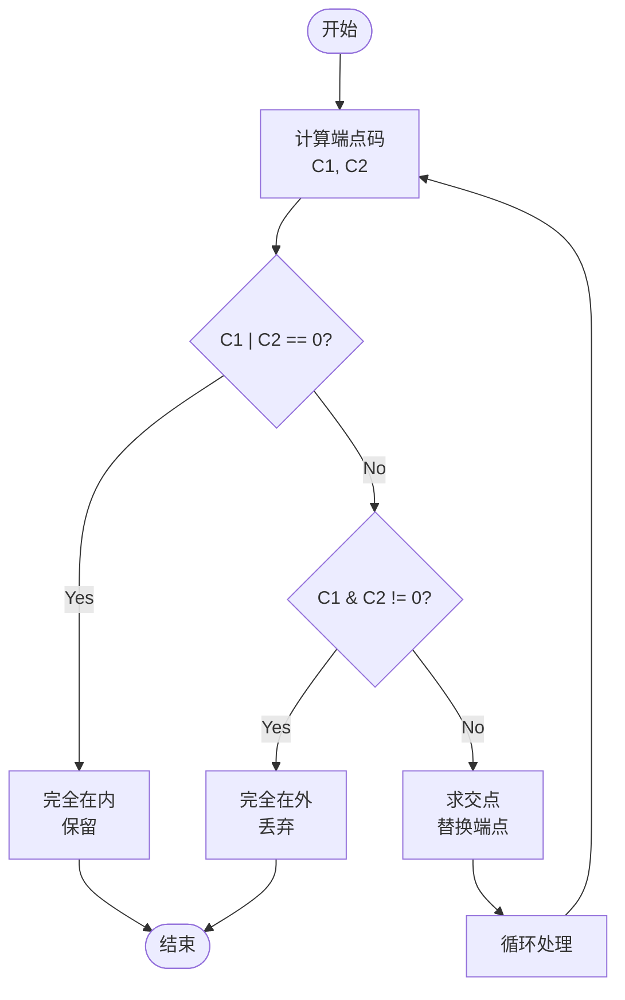

# Cohen-Sutherland线段裁剪算法 (Cohen-Sutherland Line Clipping)

## 算法本质与区域编码

Cohen-Sutherland 算法是一种高效的**二维线段裁剪**方法。其核心思想是将二维平面划分为 9 个区域，通过给每个端点分配一个 4 位二进制**区域码 (Region Code)**，快速判断线段与裁剪窗口的位置关系，从而避免不必要的求交计算。

> [!IMPORTANT]
> ==核心结论==：利用位运算快速剔除完全在窗外或完全在窗内的线段，仅对跨越边界的线段进行求交。

区域码 $C = C_3 C_2 C_1 C_0$ 的生成规则如下（设窗口范围为 $[x_{min}, x_{max}] \times [y_{min}, y_{max}]$）：

| 位 | 含义 | 条件 |
| :---: | :--- | :--- |
| $C_0$ (Right) | 右侧 | $x > x_{max}$ |
| $C_1$ (Left) | 左侧 | $x < x_{min}$ |
| $C_2$ (Top) | 上方 | $y > y_{max}$ |
| $C_3$ (Bottom) | 下方 | $y < y_{min}$ |

## 判定逻辑与流程

算法通过两次简单的位运算即可处理大部分情况：

1.  **完全可见 (Trivial Accept)**：若 $code_1 \mid code_2 = 0$，说明两端点都在窗口内，直接保留。
2.  **完全不可见 (Trivial Reject)**：若 $code_1 \ \& \ code_2 \neq 0$，说明两端点在窗口的同一侧外部（如都在左侧），直接丢弃。
3.  **部分可见**：若不满足上述两种情况，则线段跨越窗口边界。需计算线段与窗口边界的交点，用交点替换位于窗口外的端点，然后**重复**上述过程。

> [!TIP]
> 记忆口诀：**“或零全留，与非全丢，其余求交”**。即 $OR$ 为 0 则留，$AND$ 非 0 则丢。

## 易错点与边界条件

> [!WARNING]
> 常见坑：
> 1. **斜率无穷大**：计算垂直线交点时，分母可能为 0，需单独处理或使用参数方程。
> 2. **浮点精度**：交点坐标计算涉及除法，需注意浮点误差导致的判断偏差。
> 3. **循环终止**：每次迭代只处理一个端点，必须确保替换后的新端点重新计算区域码，否则可能导致死循环或错误结果。

## 实例演示

假设裁剪窗口为 $[0, 0]$ 到 $[4, 4]$。线段 $P_1(1, 5)$ 到 $P_2(6, 2)$。

1.  **计算区域码**：
    *   $P_1(1, 5)$: $x=1 \in [0,4]$, $y=5 > 4$ $\rightarrow C_1 = 0010$ (Top)
    *   $P_2(6, 2)$: $x=6 > 4$, $y=2 \in [0,4]$ $\rightarrow C_2 = 0001$ (Right)
2.  **初步判定**：
    *   $C_1 \mid C_2 = 0011 \neq 0$ (非完全在内)
    *   $C_1 \ \& \ C_2 = 0000$ (非完全在外)
    *   $\rightarrow$ 需要求交。
3.  **求交与替换**：
    *   选 $P_1$ (在窗外)。因其 $C_1$ 最高位为 1 (Top)，求与 $y=y_{max}=4$ 的交点。
    *   直线方程斜率 $k = \frac{2-5}{6-1} = -0.6$。
    *   交点 $x = x_1 + \frac{y_{max}-y_1}{k} = 1 + \frac{4-5}{-0.6} = 1 + 1.67 = 2.67$。
    *   新端点 $P_1'(2.67, 4)$。
4.  **迭代**：
    *   新线段 $P_1'(2.67, 4)$ 到 $P_2(6, 2)$。
    *   重新计算 $P_1'$ 码为 $0000$ (在边界上视为内)，$P_2$ 码仍为 $0001$。
    *   再次求交（$P_2$ 在右外侧），与 $x=4$ 求交，得最终可见线段。

> [!NOTE]
> 相比 Liang-Barsky 算法，Cohen-Sutherland 在大多数线段完全在窗外时效率更高，但在频繁求交的场景下略慢。
