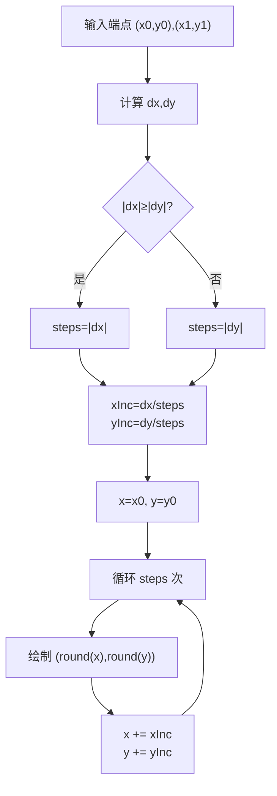

# DDA画线算法 (DDA Line Drawing Algorithm)

## 为什么需要画线算法

要在屏幕上显示一条直线，计算机需要解决一个核心问题：屏幕由离散的像素点构成，而数学上的直线是连续的。你必须决定==点亮哪些像素==才能让人眼看到一条“最接近真实直线”的线段。

## 什么是 DDA 算法

DDA（Digital Differential Analyzer，数字微分分析器）是一种==增量扫描转换算法==。它利用直线的微分方程，沿线段的主轴方向逐单位步进，并在另一方向上按斜率对应地递增，从而计算出每一步应点亮的像素坐标。

算法的本质思想：对于斜率 $|m| \le 1$ 的直线，$x$ 每步进 $1$，$y$ 增加 $m$；对于斜率 $|m| > 1$ 的直线，$y$ 每步进 $1$，$x$ 增加 $1/m$。这样能保证主轴方向没有间隙，直线连续且均匀。

## 算法流程

## 具体怎么做（一步步算）

给定两个端点 $(x_0, y_0)$ 和 $(x_1, y_1)$：

1. 计算增量：$dx = x_1 - x_0$，$dy = y_1 - y_0$
2. 确定步数：==steps = max(|dx|, |dy|)==
3. 计算单步增量：$x_{inc} = \frac{dx}{steps}$，$y_{inc} = \frac{dy}{steps}$
4. 初始位置：$x = x_0$，$y = y_0$
5. 循环 steps 次，每次：
   - 在当前 $(round(x), round(y))$ 处绘制像素
   - 更新 $x = x + x_{inc}$，$y = y + y_{inc}$

> [!IMPORTANT]
> 循环次数必须取 `steps = max(|dx|, |dy|)`，而非固定沿 $x$ 方向步进。否则当 $|m| > 1$ 时，直线会出现断裂的间隙。

## 一个算对了的例子

**从 (2,2) 到 (6,5) 画线**（来自课件/考试常考题型）

计算过程：
- $dx = 6 - 2 = 4$，$dy = 5 - 2 = 3$
- $steps = \max(4, 3) = 4$
- $x_{inc} = 4/4 = 1$，$y_{inc} = 3/4 = 0.75$

| step | $x$   | $y$   | round(x) | round(y) | 点亮像素 |
|:----:|:-----:|:-----:|:--------:|:--------:|:--------:|
| 0    | 2.00  | 2.00  | 2        | 2        | (2,2)    |
| 1    | 3.00  | 2.75  | 3        | 3        | (3,3)    |
| 2    | 4.00  | 3.50  | 4        | 4        | (4,4)    |
| 3    | 5.00  | 4.25  | 5        | 4        | (5,4)    |
| 4    | 6.00  | 5.00  | 6        | 5        | (6,5)    |

最终点亮的像素序列：(2,2) → (3,3) → (4,4) → (5,4) → (6,5)，视觉效果连续、阶梯分布合理。

## 与 Bresenham 算法的区别

| 比较项 | DDA 算法 | Bresenham 算法 |
|:------|:---------|:---------------|
| 运算方式 | 浮点数加法 | 纯整数加减 |
| 取整操作 | 每步需 round() | 无需，直接整数判定 |
| 效率 | 较慢（浮点运算、取整） | 更快 |
| 累积误差 | 有（浮点累积） | 无 |
| 硬件实现 | 不太友好 | 非常友好 |

> [!NOTE]
> DDA 算法用浮点运算模拟微分过程，直观易懂，是学习扫描转换的起点。但在实际图形系统中，==Bresenham 算法==因纯整数运算和零累积误差而成为绝对主流。

## 常见的坑

> [!WARNING]
> **steps 取错导致直线断裂**
> 初学者常默认用 $|dx|$ 作为步数。当斜率绝对值大于 1 时，$y$ 方向跨度更大，若仍以 $x$ 方向步进，$y$ 方向将出现跳点，直线不再连续。务必用 $\max(|dx|, |dy|)$。

> [!CAUTION]
> **忘记 round() 直接截断**
> $x, y$ 是浮点数，必须用四舍五入 `round()` 而非直接 `int()` 取整。例如 $y=2.75$ 应四舍五入为 $3$，截断则得 $2$，像素位置偏差累积后直线明显变形。

> [!TIP]
> **记忆口诀**：主轴步进一，副轴累加斜率；步数取大不取小，四舍五入不能少。
