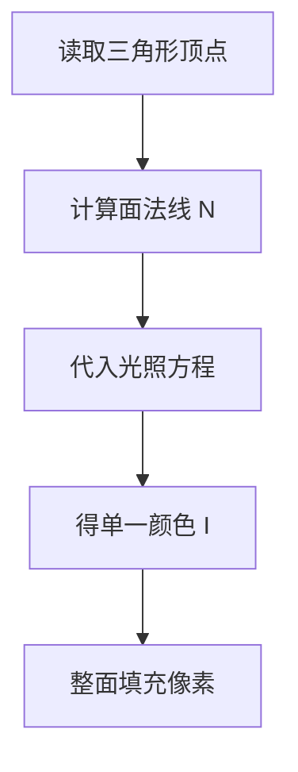

# Flat Shading平面着色 (Flat Shading)

平面着色（Flat Shading）是==逐多边形（Per-Polygon）==计算光照的着色方法：对整个三角形只计算一次光照，内部所有像素共享同一个颜色。它把多边形面片当作理想平面，用**面法线（Face Normal）**参与光照方程，速度快但无法表现光滑曲率。

## 为什么需要

曲面通常用三角形网格逼近。若对每个顶点单独求光，曲面内部需要插值，计算量大；而平面着色直接假定“一个面就是一块均匀颜色”，用一次点积代替成百上千次计算。在 20 世纪 90 年代硬件只有固定管线时，这是唯一可行的实时方案。

## 怎么做

平面着色只关心==面法线 $\mathbf{N}$==，不关心顶点法线。对三角形三个顶点 $\mathbf{V}_0,\mathbf{V}_1,\mathbf{V}_2$，法线由两条边叉积得到：

$$
\mathbf{N} = (\mathbf{V}_1 - \mathbf{V}_0) \times (\mathbf{V}_2 - \mathbf{V}_0), \quad \hat{\mathbf{N}} = \frac{\mathbf{N}}{\|\mathbf{N}\|}
$$

随后把 $\hat{\mathbf{N}}$ 代入 Lambert 漫反射模型（课件常称 **Diffuse Reflection**）：

$$
I = I_a k_a + I_d k_d (\hat{\mathbf{L}} \cdot \hat{\mathbf{N}})
$$

其中 $\mathbf{L}$ 是指向光源的单位向量。整个三角形内部像素直接填充这个 $I$，不做任何插值。

> [!IMPORTANT]
> 平面着色==没有插值步骤==。Gouraud 是逐顶点算光再双线性插值颜色；Phong 是逐顶点插值法线再逐像素算光。三者核心差异在“何时算光、插值什么”。

## 与相近方法的区别

| 特性 | Flat Shading | Gouraud Shading | Phong Shading |
|------|--------------|-----------------|---------------|
| 法线 | 面法线 | 顶点法线 | 顶点法线插值 |
| 计算时机 | 每面一次 | 每顶点一次 | 每像素一次 |
| 插值内容 | 无 | 颜色 | 法线 |
| 高光表现 | 无 | 可能漏掉 | 最好 |
| 速度 | 最快 | 中等 | 最慢 |

## 常见的坑

> [!WARNING]
> 面法线方向依赖顶点环绕顺序（Winding Order）。若 $\mathbf{V}_0,\mathbf{V}_1,\mathbf{V}_2$ 为顺时针，叉积得到的 $\mathbf{N}$ 会指向曲面内部，导致 $\hat{\mathbf{L}} \cdot \hat{\mathbf{N}} < 0$，整面变黑。务必统一采用逆时针（CCW）或及时翻转法线。

> [!CAUTION]
> 不要把“平面着色”理解成“只能用于平面物体”。它同样用于逼近曲面，只是每个小面片颜色突变，所以曲面边界会出现明显的**马赫带（Mach Bands）**。

## 算例

设三角形顶点 $\mathbf{V}_0=(0,0,0)$, $\mathbf{V}_1=(1,0,0)$, $\mathbf{V}_2=(0,1,0)$，光源方向 $\hat{\mathbf{L}}=(0,0,1)$，材质 $k_d=0.8$，环境光 $I_a k_a=0.2$。

边向量：$\mathbf{E}_1=\mathbf{V}_1-\mathbf{V}_0=(1,0,0)$，$\mathbf{E}_2=\mathbf{V}_2-\mathbf{V}_0=(0,1,0)$。

面法线：$\mathbf{N}=\mathbf{E}_1\times\mathbf{E}_2=(0,0,1)$，已是单位向量。

点积：$\hat{\mathbf{L}}\cdot\hat{\mathbf{N}}=1$。

最终颜色：$I=0.2+0.8\times 1=1.0$。整个三角形像素均填充 $I=1.0$ 的亮度，无渐变。

> [!TIP]
> 若题目给出的是顶点法线而非面法线，平面着色下应忽略它们，重新用叉积求面法线；否则就退化成 Gouraud 了。
