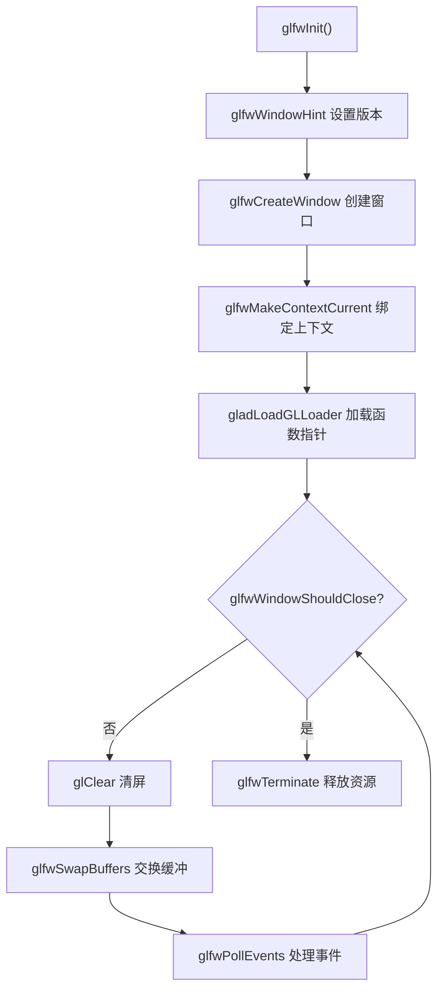

# GLFW创建窗口与上下文 (Window & Context Creation with GLFW)

## 它是什么

GLFW 是一个开源的 C 库，专门用来处理 OpenGL 程序里那些与图形本身无关、却每个程序都绕不开的杂活：创建窗口、创建 OpenGL 上下文、处理键盘鼠标输入、管理窗口事件。没有它，你就得直接跟操作系统打交道——Windows 上写 Win32 API，Linux 上写 X11/Wayland，macOS 上写 Cocoa。GLFW 把这些平台差异全部封装掉，让你用同一套代码跨平台运行。

窗口和上下文是两个不同的东西：

- **窗口（Window）**：操作系统层面的可见矩形区域，有标题栏、边框，由窗口管理器管着。
- **上下文（Context）**：OpenGL 存放所有状态（当前使用的着色器、绑定的纹理、清除颜色、深度测试开关……）的容器。它不是一个可见的东西，却决定了你每个绘制调用作用于哪套状态。

> [!IMPORTANT]
> ==窗口是"画布"，上下文是"画板上所有的颜料、刷子和当前设置"==。有窗口没上下文，什么都画不了；有上下文没窗口，画了也看不见。

## 为什么需要它

现代 OpenGL 是核心模式（Core Profile），不再有 `glBegin/glEnd` 那种"边画边提交"的旧式接口。所有的绘制都必须在一个合法的上下文里进行，而这个上下文必须附着在某个窗口或离屏表面上。GLFW 的标准流程就是把这三件事串起来：

1. 初始化 GLFW 库；
2. 创建一个窗口；
3. 为该窗口创建 OpenGL 上下文，并设为当前线程的活动上下文；
4. 进入渲染循环，直到用户关闭窗口。

---

## 怎么做：标准流程



对应代码骨架如下：

```c
// 1. 初始化 GLFW
if (!glfwInit()) {
    return -1;
}

// 2. 告诉 GLFW 我们要用 OpenGL 3.3 核心模式
glfwWindowHint(GLFW_CONTEXT_VERSION_MAJOR, 3);
glfwWindowHint(GLFW_CONTEXT_VERSION_MINOR, 3);
glfwWindowHint(GLFW_OPENGL_PROFILE, GLFW_OPENGL_CORE_PROFILE);

// 3. 创建窗口（800×600，标题 "OpenGL Demo"）
GLFWwindow* window = glfwCreateWindow(800, 600, "OpenGL Demo", NULL, NULL);
if (!window) {
    glfwTerminate();
    return -1;
}

// 4. 把该窗口的上下文设为当前线程的活跃上下文
glfwMakeContextCurrent(window);

// 5. 用 GLAD 加载 OpenGL 函数指针
gladLoadGLLoader((GLADloadproc)glfwGetProcAddress);

// 6. 渲染循环
while (!glfwWindowShouldClose(window)) {
    glClear(GL_COLOR_BUFFER_BIT);
    // ... 绘制代码 ...
    glfwSwapBuffers(window);
    glfwPollEvents();
}

glfwTerminate();
```

## 关键细节与常见的坑

### 窗口提示必须在创建窗口之前设置

`glfwWindowHint` 必须在 `glfwCreateWindow` 之前调用，否则设置不会生效。比如你想用 OpenGL 3.3 核心模式，但忘了设置 `GLFW_CONTEXT_VERSION_MAJOR/MINOR`，GLFW 可能给你一个默认的旧版上下文，后续调用新版函数直接崩溃。

### 必须调用 `glfwMakeContextCurrent`

创建窗口后，上下文并不会自动成为"当前上下文"。不调用它，你的所有 GL 调用要么直接崩溃，要么静默无效（取决于驱动）。==这一步是新手最容易漏掉的==。

### 交换缓冲与事件处理缺一不可

`glfwSwapBuffers` 负责把后台缓冲的内容送到前台显示。如果不调它，你会看到一个黑窗口或者闪烁的残影。`glfwPollEvents` 负责处理窗口移动、关闭按钮点击等事件。如果漏掉它，点关闭按钮都不会有反应。

### 上下文版本不匹配

> [!WARNING]
> 若你在 `glfwWindowHint` 里要求 OpenGL 3.3 核心模式，但显卡驱动只支持到 3.2，`glfwCreateWindow` 会返回 `NULL`。所以**务必检查 `glfwCreateWindow` 的返回值**，否则后续任何 GL 调用都是对空指针的窗口操作。

### GLFW 与 GLUT 的区别

南京邮电大学这门课历史上用过 GLUT，但 GLUT 已经停止维护二十多年了。GLFW 相比于 GLUT：

| 对比项 | GLFW | GLUT/freeglut |
|--------|------|---------------|
| 维护状态 | 活跃维护 | 基本冻结 |
| 上下文版本控制 | 原生支持 3.3+ 核心模式 | 难用，需额外手段 |
| 窗口关闭后控制权 | 回调返回，可自行决定退出 | `glutMainLoop` 永不返回 |
| 多窗口支持 | 支持 | 有限 |

## 一个跑通的例子

需求：用 GLFW 创建一个 $800\times 600$ 的窗口，用 OpenGL 3.3 核心模式，清屏颜色设为深蓝绿色，验证窗口与上下文都正常工作。

**步骤拆解**：

1. `glfwInit()` 返回 `GLFW_TRUE`（即 1），说明 GLFW 库本身初始化成功。
2. 设置 `glfwWindowHint` 三件套：主版本 3、次版本 3、核心模式。
3. `glfwCreateWindow(800, 600, ...)` 返回非 `NULL` 指针 `window`，说明窗口创建成功——注意，这里只是窗口存在于操作系统层面，OpenGL 上下文还没就位。
4. `glfwMakeContextCurrent(window)` 后，用 `gladLoadGLLoader((GLADloadproc)glfwGetProcAddress)` 加载函数指针。若返回非零，说明 OpenGL 3.3 的函数都拿到了。
5. 在循环里调用 `glClearColor(0.0f, 0.4f, 0.35f, 1.0f)` 设置清屏色，再 `glClear(GL_COLOR_BUFFER_BIT)` 实际执行清除，最后 `glfwSwapBuffers(window)` 把后台缓冲交换到前台。用户此时看到的窗口是均匀的深蓝绿色，说明窗口可见、上下文活跃、双缓冲工作正常。

> [!TIP]
> 判断"窗口建好了吗"和"上下文能用了吗"用两个不同的检查：前者看 `glfwCreateWindow` 的返回值是否为 `NULL`，后者看 `gladLoadGLLoader` 的返回值。只看窗口成功就往下写 GL 调用，是典型的事故前奏。

## 与"离屏渲染"的辨析

有些场景不需要可见窗口（例如离线渲染、单元测试、服务器端图像生成）。这时可以用 `glfwWindowHint(GLFW_VISIBLE, GLFW_FALSE)` 创建一个隐藏窗口 + 上下文，或者直接使用 EGL 等离屏上下文方案。但这超出了 GLFW 的主流程，本课程不要求。==课程默认的模型始终是：一个可见窗口 + 一个当前上下文 + 双缓冲==。
