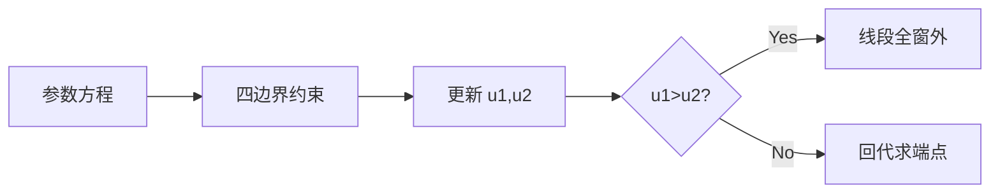

# Liang-Barsky线段裁剪算法 (Liang-Barsky Line Clipping)

## 它是什么，为什么需要

在二维观察中，我们常有一个矩形窗口，只希望把窗口内的图形显示出来。线段裁剪要判断一条线段是否全部在窗口内、全部在窗口外，还是部分在窗口内。

先看一个场景：线段端点为 $P_1(1,2)$、$P_2(8,5)$，窗口边界是左 $x=2$、右 $x=6$、下 $y=1$、上 $y=4$。如果直接按端点 $x,y$ 分别比较，能不能准确求出裁剪后线段端点？

Liang-Barsky 算法把线段写成参数形式：

$$x=x_1+u\Delta x,\quad y=y_1+u\Delta y,\quad 0\le u\le 1$$

其中 $\Delta x=x_2-x_1,\ \Delta y=y_2-y_1$。它用**参数区间 $[u_1,u_2]$ 与窗口边界约束的更新**来求可见部分，比逐边求交更系统。

> [!NOTE]
> 它属于第5章 2D Viewing，用的术语是 window、clip、parametric line。

## 算法流程

对窗口四条边，统一写成不等式：

$$p_k u \le q_k$$

其中 $k=1,2,3,4$ 对应左、右、下、上边界：

- 左：$p_1=-\Delta x,\ q_1=x_1-x_{\min}$
- 右：$p_2=\Delta x,\ q_2=x_{\max}-x_1$
- 下：$p_3=-\Delta y,\ q_3=y_1-y_{\min}$
- 上：$p_4=\Delta y,\ q_4=y_{\max}-y_1$

初始 $u_1=0,\ u_2=1$。更新规则是：

- 若 $p_k=0$ 且 $q_k<0$：**线段平行该边界且在窗外**，直接舍弃；
- 若 $p_k<0$：$u_1=\max(u_1,\ q_k/p_k)$；
- 若 $p_k>0$：$u_2=\min(u_2,\ q_k/p_k)$。

最后若 $u_1>u_2$，线段不可见；否则把 $u_1,u_2$ 回代参数方程，得到裁剪后端点。

## 和相近概念的区别

| 方法 | 核心思路 | 特点 |
|---|---|---|
| Cohen-Sutherland | 区域编码+递归求中点 | 编码直观，但可能反复细分 |
| Liang-Barsky | 参数 $u$ 区间更新 | 一次扫描边界，效率稳定 |

## 常见的坑

> [!WARNING]
> 当 $p_k=0$ 时不能做除法，要先判 $q_k<0$ 不然会把窗外平行线段也算进来。

> [!TIP]
> 记忆：==负 $p$ 管下界 $u_1$，正 $p$ 管上界 $u_2$，先判平行丢线段==。

## 一个算对了的例子

取开头线段 $P_1(1,2),P_2(8,5)$，窗口 $x\in[2,6],y\in[1,4]$。

有 $\Delta x=7,\ \Delta y=3$。

- 左：$p=-7,q=1-2=-1<0$，且 $p<0\Rightarrow u_1=\max(0,(-1)/(-7))=\frac17$
- 右：$p=7,q=6-1=5>0\Rightarrow u_2=\min(1,5/7)=\frac57$
- 下：$p=-3,q=2-1=1>0\Rightarrow u_1=\max(\frac17,-\frac13)=\frac17$
- 上：$p=3,q=4-2=2>0\Rightarrow u_2=\min(\frac57,\frac23)=\frac57$

因 $u_1=\frac17<u_2=\frac57$，可见端点为：

$$x=1+\frac17\cdot7=2,\quad y=2+\frac17\cdot3=\frac{17}{7}$$
$$x=1+\frac57\cdot7=6,\quad y=2+\frac57\cdot3=\frac{29}{7}$$

裁剪后线段从 $(2,\frac{17}{7})$ 到 $(6,\frac{29}{7})$，正好贴在左、右边界之间。

> [!IMPORTANT]
> 核心结论是先算四组 $p_k,q_k$，按符号更新 $u_1,u_2$，==负 $p$ 只动 $u_1$，正 $p$ 只动 $u_2$==，再回代求坐标。
