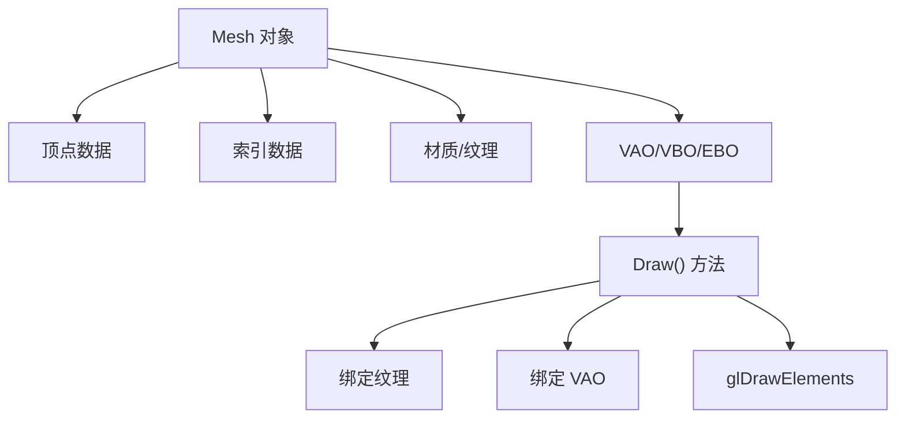

# Mesh类的封装(顶点、索引、材质) (Encapsulating the Mesh Class)

## 什么是 Mesh 类封装

在计算机图形学中，一个完整的 3D 模型通常由多个子网格（Sub-mesh）组成。如果直接将顶点、索引和材质数据散落在渲染循环中，代码将变得难以维护且无法复用。==Mesh 类的封装==就是将**顶点数组（Vertices）**、**索引数组（Indices）** 与 **材质（Material）** 绑定为一个独立对象，并内部管理 VAO/VBO/EBO 等 OpenGL 资源。

> [!IMPORTANT]
> Mesh 不仅是数据容器，更是 ==GPU 资源的 RAII 管理器==。它负责在构造时上传数据，在销毁时释放显存，对外仅暴露 `Draw()` 接口。

## 为什么需要封装

试想：若场景中有 100 个物体，每个物体有独立的顶点格式和纹理，难道要写 100 段重复的 `glBindVertexArray` + `glDrawElements`？封装后，渲染逻辑简化为：

```cpp
for (const auto& mesh : model.meshes)
    mesh.Draw(shader);
```

这实现了 ==数据与渲染逻辑解耦==，同时支持多材质模型的统一管理。

## Mesh 类的核心结构



一个标准 Mesh 类包含三个关键成员：

| 成员 | 类型 | 作用 |
|------|------|------|
| `vertices` | `std::vector<Vertex>` | 存储位置、法线、UV 等属性 |
| `indices` | `std::vector<GLuint>` | 定义三角形拓扑连接关系 |
| `textures` | `std::vector<Texture>` | 关联漫反射、镜面等纹理单元 |

> [!TIP]
> `Vertex` 应定义为紧凑结构体，确保内存布局与 Shader 的 `layout(location=...)` 严格对应，避免步长（Stride）计算错误。

## 与相近概念的区别

| 概念 | 职责 | 是否管理 GPU 资源 |
|------|------|------------------|
| Raw Vertex Array | 仅 CPU 端原始数据 | ❌ |
| Model | 持有多个 Mesh + 变换矩阵 | ❌（委托给 Mesh） |
| ==Mesh== | ==单几何体+材质+GPU缓冲== | ==✅== |

Model 是 Mesh 的集合，而 Mesh 才是实际执行绘制的最小单元。

## 常见陷阱与注意事项

> [!WARNING]
> 纹理绑定时必须按 `textureUnits[i]` 顺序激活，而非假设纹理 ID 连续。Shader 中的 sampler uniform 需与 Mesh 内纹理索引一一映射，否则会出现贴图错乱。

> [!CAUTION]
> 拷贝 Mesh 对象会导致双重 `glDeleteVertexArrays`！务必禁用拷贝构造/赋值，或实现深拷贝+引用计数。推荐用 `std::shared_ptr<Mesh>` 管理。

## 正确封装示例

以加载一个含漫反射纹理的子网格为例：

```cpp
// 构造时上传数据
Mesh::Mesh(vector<Vertex>& verts, vector<GLuint>& inds, vector<Texture>& texs)
    : vertices(verts), indices(inds), textures(texs) {
    setupMesh(); // 创建 VAO/VBO/EBO 并配置顶点属性
}

// 绘制时绑定资源
void Mesh::Draw(Shader& shader) const {
    unsigned int diffuseNr = 0;
    for (unsigned int i = 0; i < textures.size(); ++i) {
        glActiveTexture(GL_TEXTURE0 + i);
        string name = textures[i].type; // e.g., "texture_diffuse"
        shader.setInt(name, i);         // ==关键：uniform名匹配==
        glBindTexture(GL_TEXTURE_2D, textures[i].id);
    }
    glBindVertexArray(VAO);
    glDrawElements(GL_TRIANGLES, indices.size(), GL_UNSIGNED_INT, 0);
    glBindVertexArray(0);
}
```

此例中，`setupMesh()` 在构造期完成一次性开销，`Draw()` 仅做轻量绑定，符合 ==运行时性能最优原则==。注意 `shader.setInt` 的参数名必须与 GLSL 中声明一致，这是初学者最常忽略的调试难点。
