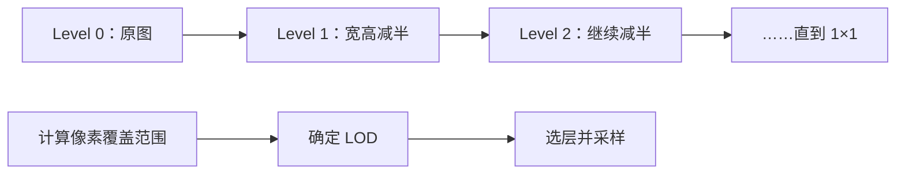

# 多级渐远纹理 Mipmap 及其生成 (Mipmaps Generation)

## 为什么需要 Mipmap

纹理映射时，一个屏幕像素往往不对应一个纹理像素（texel）。当物体远离摄像机，纹理被缩得很小，一个像素可能覆盖几十个 texel。若仍用最近邻或简单双线性采样，只取其中几个点，就会漏掉大量信息，产生闪烁、锯齿和摩尔纹；物体移动时尤其明显。

问题不只是“图片不够清晰”，而是==采样频率跟不上纹理在屏幕上的变化频率==。直接对原图做更多随机采样能缓解，却会增加开销，而且缓存访问分散。

## 它是什么

**Mipmap（多级渐远纹理）** 是同一纹理的一组预滤波版本。第 0 级是原图；每向下一级，宽、高通常各减半，直到 $1\times1$。它不是把原图重复缩小显示，而是根据像素覆盖纹理的范围，选择合适分辨率再采样。

若原图尺寸为 $W\times H$，完整层级数通常为

$$
\left\lfloor \log_2(\max(W,H))\right\rfloor+1 .
$$

各级总显存约为原图的

$$
1+\frac14+\frac1{16}+\cdots<\frac43,
$$

即额外开销约为原纹理的 $1/3$，不是成倍增加。

## 如何生成与使用

生成时，第 $k+1$ 级通常由第 $k$ 级做低通滤波并降采样得到。最简单的是每 $2\times2$ 个 texel 取平均：

$$
T_{k+1}(i,j)=\frac14\sum_{u=0}^{1}\sum_{v=0}^{1}
T_k(2i+u,2j+v).
$$

逐级生成比每级都直接从原图缩小更方便；盒式滤波实现简单，高质量滤波器可减少过软或振铃。

运行时，根据纹理坐标对屏幕坐标的导数估计像素足迹：

$$
\rho=\max\!\left(
\left\|\frac{\partial(u,v)}{\partial x}\right\|,
\left\|\frac{\partial(u,v)}{\partial y}\right\|
\right),\qquad
\lambda=\log_2\rho .
$$

$\lambda$ 就是连续 LOD：$\lambda\le0$ 表示纹理被放大，通常仍用第 0 级；$\lambda$ 越大，使用越粗糙的层。实际实现会结合纹理尺寸与各向异性，不能只背公式机械代入。

| 方式 | 层内过滤 | 层间处理 | 特点 |
|---|---|---|---|
| 最近邻选层 | 可最近邻或双线性 | 不切层间插值 | 快，但换层可能突变 |
| Trilinear filtering | 两层分别双线性 | 按 $\lambda$ 小数部分插值 | 过渡平滑，常用 |
| Anisotropic filtering | 沿像素足迹多次采样 | 可结合 mipmap | 斜视地面更清晰，开销更高 |

> [!NOTE]
> Mipmap 解决的是纹理缩小造成的欠采样；放大时没有更多真实细节，仍主要靠双线性等过滤。三线性过滤也不等于各向异性过滤，后者更适合细长、倾斜的像素足迹。

## 算一个层级

一张 $256\times256$ 纹理，某像素在纹理空间约覆盖 $8\times8$ 个 texel，则理想 LOD 为

$$
\lambda=\log_2 8=3.
$$

第 3 级尺寸为

$$
256/2^3=32,
$$

所以应选 $32\times32$ 的第 3 级。若算得 $\lambda=2.25$，三线性过滤会在第 2 级（$64\times64$）与第 3 级（$32\times32$）的双线性结果之间，按 $0.75:0.25$ 混合，而不是把纹理坐标乘以 $2.25$。

> [!WARNING]
> 常见错误：把“每级面积减半”写成面积变为 $1/2$；正确是宽高各减半、面积变为 $1/4$。非 2 的幂尺寸也可建立 mipmap，各级通常取整减半，不能简单认定层级数一定是 $\log_2W+1$。此外，纹理图集若未处理边界，粗糙层可能混入相邻图案；透明纹理直接平均 RGB 还可能产生黑边。

> [!TIP]
> 记忆链条：==先估计像素足迹，再选 LOD，最后做层内与层间过滤==。看到“远处闪烁、摩尔纹”想到 mipmap；看到“斜视地面仍模糊”再考虑各向异性过滤。
