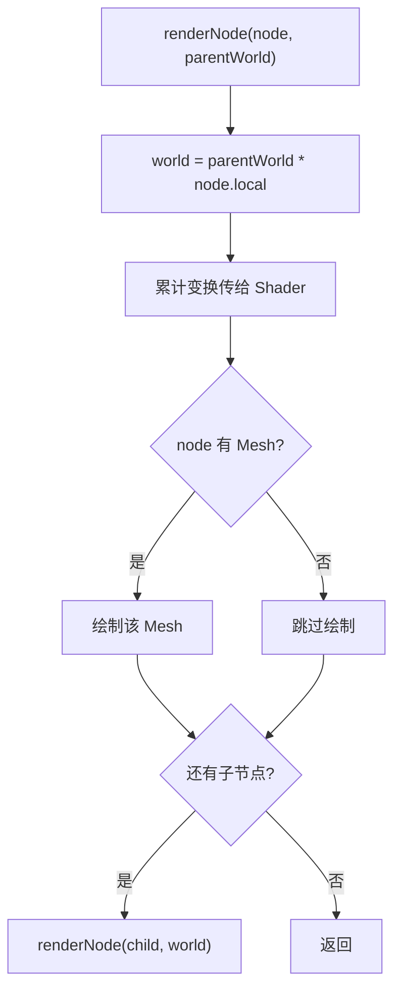
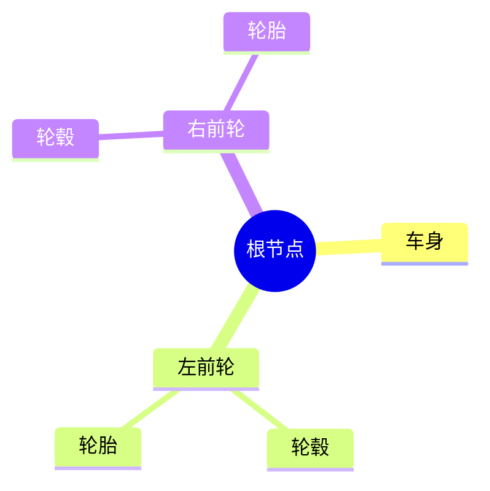

# Model类的递归节点处理与渲染 (Recursive Node Processing in Model Class)

## Model 类的递归节点处理

加载一个模型文件（如 OBJ、glTF）后，数据通常不是“一堆三角形”的扁平数组，而是一棵**场景树（scene graph）**。根节点下挂车身、四个轮子；轮子节点下又挂轮胎、轮毂、刹车盘。每个节点携带自身的局部变换，父节点的变换会影响所有子节点。

**为什么需要递归处理？** 因为渲染时必须把每个节点的局部变换累积起来，得到世界变换，再交给 GPU。同时，旋转方向盘时轮子跟着转、推动车身时整棵树跟着动——这类“子随父动”的层级关系只能通过递归遍历来维护。

[!IMPORTANT]
> ==递归节点处理的核心是“传入父级累积变换 → 计算自身世界变换 → 递归遍历子节点”==。若漏传父变换，子节点会“散架”。

[!NOTE]
> 与“单物体渲染”的区别：单物体只需 `Model = WorldMatrix * Mesh` 一步；场景树要求每个节点保留 **局部变换（local transform）**，渲染时动态组合成 **全局变换（global/world transform）**。网格数据只存一份，多个节点可以引用同一 Mesh。

## 递归遍历的流程



实现的伪代码可以写成：

```cpp
void renderNode(Node* node, const glm::mat4& parentWorld) {
    glm::mat4 world = parentWorld * node->localTransform;
    
    // 当前节点有网格才绘制
    if (node->mesh != nullptr) {
        shader.setMat4("uModel", world);
        node->mesh->draw();
    }
    
    // 递归处理所有子节点
    for (Node* child : node->children) {
        renderNode(child, world);   // 关键：传 world，不是 parentWorld
    }
}

// 入口：从根节点开始，父级是单位矩阵
renderNode(root, glm::mat4(1.0f));
```

[!WARNING]
> 递归调用时第二个参数必须是**当前节点的 world**（`parentWorld * local` 的结果），不是 `parentWorld` 也不是 `local`。传错参数是作业里最常见的 bug。

## 变换层级与网格复用的关系

场景树里网格数据（顶点、法线、索引）存在叶子或中间节点上，**节点只负责“摆放”网格**。同一个轮毂 Mesh 可以被四个轮子节点引用，每个节点用不同的 local 变换把它放到不同位置。

[!TIP]
> 记忆方法：**“先乘父、再画自己、再递给儿子”**。只要抓住这条链，递归渲染逻辑基本不会错。

## 一个算对了的例子

某模型树如下：



已知：

- 根节点的 local 变换为单位矩阵 $I$
- 车身节点 local 变换为平移 $T_{body}$
- 左前轮节点 local 变换为平移 $T_{wheel}$，且它下面挂着一个网格 `wheelMesh`

**问题：渲染左前轮的网格时，传入着色器的模型矩阵是什么？**

一步步推：

1. 根节点：`world_root = I * I = I`
2. 车身节点：`world_body = world_root * T_body = T_body`
3. 左前轮节点：`world_wheel = world_body * T_wheel = T_body * T_wheel`
4. 左前轮挂载了 `wheelMesh`，所以用 `T_body * T_wheel` 作为模型矩阵绘制它

模型矩阵的正确写法是：

$$M_{\text{wheel}} = T_{\text{body}} \times T_{\text{wheel}}$$

注意矩阵乘法**不满足交换律**，必须父在前、子在后的顺序连乘。先平移车身，再在车身坐标系里平移轮子，语义才正确。

[!CAUTION]
> 很多同学会写成 `T_wheel * T_body`，以为“顺序无所谓”。对于纯平移矩阵恰好结果相同，但一旦涉及旋转（如轮子绕自身轴旋转 + 车身也有旋转），交换顺序结果完全不同。==模型矩阵的连乘顺序永远是“从根到叶”的顺序==。

## 更新节点的动画

当节点需要动起来（如轮子自转），做法是**更新该节点的 local 变换**，再重新遍历渲染：

```cpp
// 轮子自转：绕局部 Y 轴旋转
wheelNode->localTransform = glm::rotate(wheelNode->localTransform, deltaAngle, glm::vec3(0,1,0));
```

下一帧从根节点重新递归时，新旋转自动传播到所有后代。
