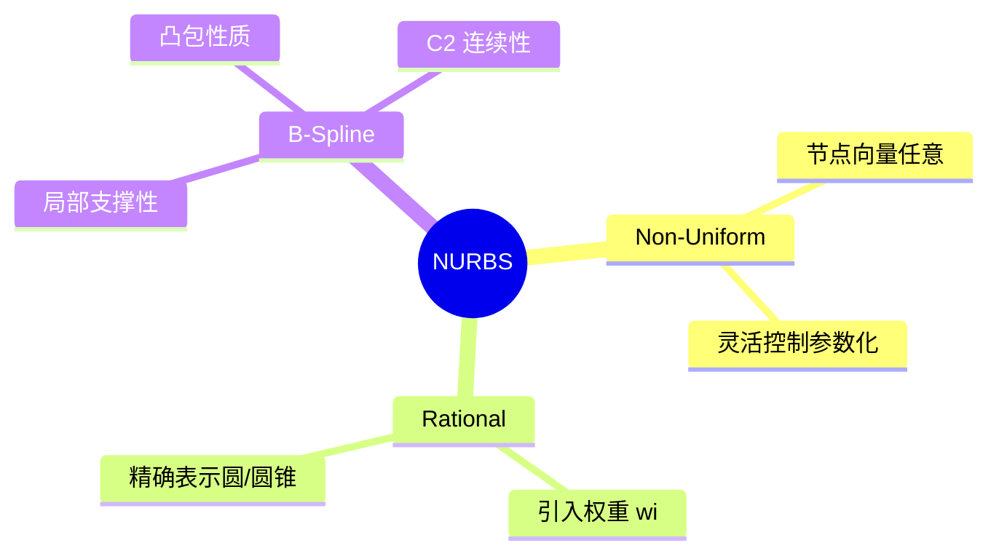

# 非均匀有理B样条 NURBS (Non-Uniform Rational B-Splines)

# 非均匀有理 B 样条 NURBS

NURBS (Non-Uniform Rational B-Splines) 是计算机图形学中描述曲线与曲面的**工业标准**。它统一了多项式曲线（如 Bézier、B-Spline）和解析几何形状（如圆、圆锥曲线）的数学表示。

## 为什么需要 NURBS？

传统的 B-Spline 只能精确表示多项式曲线，无法精确描述圆或椭圆等二次曲线（只能用多段逼近）。而 NURBS 通过引入**权重 (Weights)**，将多项式推广为有理分式，从而能够==精确表示圆锥曲线==，同时保留了 B-Spline 的局部支撑性和凸包性质。

> [!IMPORTANT]
> NURBS 的核心优势：**统一性**（既能处理自由曲线，又能处理解析形状）与**精确性**（无逼近误差）。

## 数学定义与构成

NURBS 曲线由控制点 $P_i$、权重 $w_i$、节点向量 $U$ 和阶数 $p$ 定义。其基函数 $N_{i,p}(u)$ 与非有理 B-Spline 相同，但最终的曲线方程为：

$$ C(u) = \frac{\sum_{i=0}^{n} w_i P_i N_{i,p}(u)}{\sum_{i=0}^{n} w_i N_{i,p}(u)} $$

其中：
- **非均匀 (Non-Uniform)**：节点间距可以不均匀，提供更高的灵活性。
- **有理 (Rational)**：分子分母均为多项式，比值形式允许表示圆锥曲线。
- **B-Spline**：基于 B-Spline 基函数，具备局部修改特性。

## 权重的作用机制

权重 $w_i$ 控制控制点 $P_i$ 对曲线的吸引力。
- 若 $w_i$ 增大，曲线被拉向 $P_i$。
- 若 $w_i = 1$，退化为普通 B-Spline。
- 若所有 $w_i$ 相等，也退化为普通 B-Spline。

> [!TIP]
> 记忆技巧：权重越大，控制点“引力”越强，曲线越靠近该点。

## 与相近概念对比

| 特性 | Bézier 曲线 | B-Spline 曲线 | NURBS 曲线 |
| :--- | :--- | :--- | :--- |
| **全局/局部** | 全局影响 | 局部影响 | 局部影响 |
| **连续性** | $C^0$ (拼接处) | $C^{p-1}$ | $C^{p-1}$ |
| **精确表示圆** | 否 (仅逼近) | 否 (仅逼近) | ==是 (精确)== |
| **自由度** | 低 | 中 | 高 (含权重) |

## 常见误区与计算示例

> [!WARNING]
> **坑点**：不要混淆“节点向量”与“控制点”。节点向量定义参数域划分，不直接位于曲线上；控制点定义形状。另外，NURBS 的除法运算在实现时需注意分母为零的情况（通常发生在节点重数过高时）。

**示例计算**：
假设一段线性 NURBS ($p=1$)，有两个控制点 $P_0=(0,0), P_1=(10,0)$，权重 $w_0=1, w_1=3$。求 $u=0.5$ 时的点 $C(0.5)$。
此时基函数 $N_{0,1}(0.5)=0.5, N_{1,1}(0.5)=0.5$。

$$ C(0.5) = \frac{1\cdot(0,0)\cdot 0.5 + 3\cdot(10,0)\cdot 0.5}{1\cdot 0.5 + 3\cdot 0.5} = \frac{(0,0) + (15,0)}{0.5 + 1.5} = \frac{(15,0)}{2} = (7.5, 0) $$

注意：结果不是中点 $(5,0)$，而是偏向权重更大的 $P_1$，验证了权重的牵引作用。
