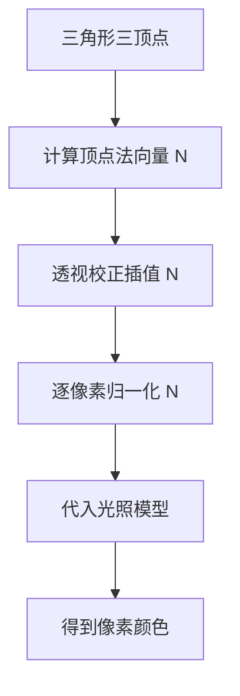

# Phong Shading法向量插值 (Phong Shading)

## 它是什么：为什么 Phong Shading 要插值法向量

Gouraud Shading 对**顶点颜色**做双线性插值，速度快，但高光区域会被“抹平”——因为高光项 $\left(\mathbf{R}\cdot\mathbf{V}\right)^n$ 或 $\left(\mathbf{N}\cdot\mathbf{H}\right)^n$ 是法向量的**非线性函数**，顶点处算好再插值，中间像素的高光峰值就丢了。

那能不能反过来：==先对每个像素插值出法向量 $\mathbf{N}$，再在这个像素上完整算一次光照==？这就是 Phong Shading。

> [!IMPORTANT]
> **Phong Shading 与 Phong Reflection Model 是两回事**：前者是**着色方法**（对每个像素算光照），后者是**光照模型**（环境光+漫反射+高光）。Phong Shading 里完全可以用 Blinn-Phong 模型来算。

## 怎么做：三步流水线

具体步骤：

1. **顶点法向量**：对共享顶点的各面法向量取平均（或按面积加权），得到顶点法向量 $\mathbf{N}_1,\mathbf{N}_2,\mathbf{N}_3$。
2. **扫描线插值**：在三角形内部对 $\mathbf{N}$ 做双线性插值（实际工程中常做透视校正插值，否则投影后插值不正确）。
3. **逐像素光照**：每个像素先 $\mathbf{N}\leftarrow\mathbf{N}/\|\mathbf{N}\|$ 归一化，再算
$$
I = I_a k_a + I_d k_d(\mathbf{N}\cdot\mathbf{L}) + I_s k_s(\mathbf{N}\cdot\mathbf{H})^{n}
$$
（Blinn-Phong 形式；若课件用 $\mathbf{R}\cdot\mathbf{V}$ 就替换最后一项）。

> [!WARNING]
> ==插值出来的 $\mathbf{N}$ 一般不再是单位向量，必须先归一化再点乘==，否则 $\mathbf{N}\cdot\mathbf{L}$ 会系统性偏小，高光变暗、位置偏移。

## 和 Gouraud Shading 的对比

| | Gouraud Shading | Phong Shading |
|---|---|---|
| 插值对象 | 顶点**颜色** | 顶点**法向量** |
| 光照计算次数 | 每顶点 1 次 | **每像素 1 次** |
| 高光质量 | 差，高光易被平滑掉 | 好，能捕捉小高光 |
| 计算代价 | 低 | 高 |
| 多边形边界 | 仍有 Mach Band | 更平滑 |

## 算对了的例子

设三角形某扫描线上，两端点法向量经插值得
$$
\mathbf{N}_a=(0,0,1),\quad \mathbf{N}_b=\left(\tfrac{\sqrt2}{2},0,\tfrac{\sqrt2}{2}\right)
$$
中点处线性插值：
$$
\mathbf{N}_m=\frac{\mathbf{N}_a+\mathbf{N}_b}{2}=\left(\tfrac{\sqrt2}{4},0,\tfrac{2+\sqrt2}{4}\right)
$$
**先归一化**：
$$
\|\mathbf{N}_m\|\approx 0.924,\quad \hat{\mathbf{N}}_m\approx(0.383,0,0.924)
$$
若 $\mathbf{L}=(0,0,1)$，则
$$
\mathbf{N}\cdot\mathbf{L}=0.924
$$
再代入 $I = I_a k_a + I_d k_d(0.924) + I_s k_s(0.924)^n$ 即得该像素颜色。注意若**不归一化**直接点乘，会得到 $\frac{2+\sqrt2}{4}\approx0.854$，漫反射偏暗——这就是常见扣分点。

> [!TIP]
> 记忆口诀：**Gouraud 插颜色，Phong 插法向；插完先归一，再算高光项**。考试问“Phong Shading 为什么高光更准”，答：高光对 $\mathbf{N}$ 非线性，逐像素重建 $\mathbf{N}$ 保留了法向变化细节。
