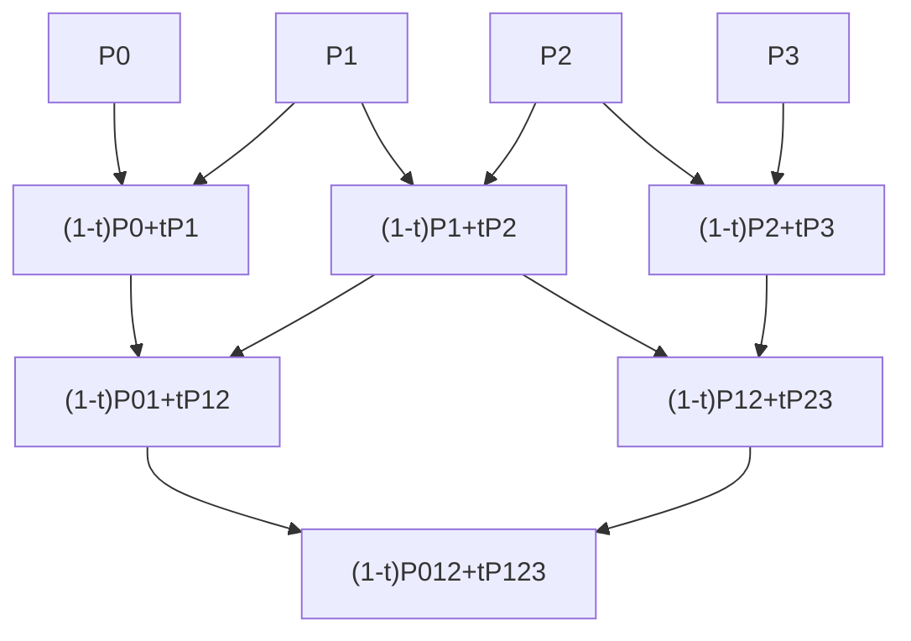

# Bezier曲线的de Casteljau递推算法 (de Casteljau Algorithm)

## 它是什么

de Casteljau 算法是计算 Bézier 曲线上某一点的标准递推方法。给定控制点 $\mathbf{P}_0, \mathbf{P}_1, \dots, \mathbf{P}_n$ 及参数 $t \in [0,1]$，通过反复线性插值，最终得到曲线上的点 $\mathbf{P}(t)$。

核心操作只有一步：对相邻控制点做线性插值

$$
\mathbf{P}_i^{(r)} = (1-t)\,\mathbf{P}_i^{(r-1)} + t\,\mathbf{P}_{i+1}^{(r-1)}
$$

其中 $r$ 表示递推层数，初始 $\mathbf{P}_i^{(0)} = \mathbf{P}_i$。每递推一层，点数减少一个；第 $n$ 层只剩一个点，即为 $\mathbf{P}(t)$。

## 为什么需要

Bézier 曲线的定义用 Bernstein 多项式：

$$
\mathbf{P}(t) = \sum_{i=0}^{n} B_i^n(t)\,\mathbf{P}_i, \quad B_i^n(t) = \binom{n}{i} t^i (1-t)^{n-i}
$$

直接计算高次 Bernstein 多项式组合数大、数值不稳定。de Casteljau 算法把多项式求值转化为一连串线性插值，==几何意义直观、数值稳定性好==，且无需显式计算 Bernstein 多项式。

## 怎么做

以三次 Bézier（$n=3$）为例，三层递推结构：

计算步骤：

**第一层**（每相邻两点插值）：

$$
\mathbf{P}_0^{(1)} = (1-t)\mathbf{P}_0 + t\mathbf{P}_1, \quad
\mathbf{P}_1^{(1)} = (1-t)\mathbf{P}_1 + t\mathbf{P}_2, \quad
\mathbf{P}_2^{(1)} = (1-t)\mathbf{P}_2 + t\mathbf{P}_3
$$

**第二层**：

$$
\mathbf{P}_0^{(2)} = (1-t)\mathbf{P}_0^{(1)} + t\mathbf{P}_1^{(1)}, \quad
\mathbf{P}_1^{(2)} = (1-t)\mathbf{P}_1^{(1)} + t\mathbf{P}_2^{(1)}
$$

**第三层**：

$$
\mathbf{P}_0^{(3)} = (1-t)\mathbf{P}_0^{(2)} + t\mathbf{P}_1^{(2)} = \mathbf{P}(t)
$$

> [!TIP]
> 记忆口诀：**“相邻插值，逐层减一，最后一点就是曲线点”**。每层点数减 $1$，$n$ 次曲线总共 $n$ 层递推。

## 一个算对了的例子

三次 Bézier，控制点：

$$
\mathbf{P}_0 = (0,0),\ \mathbf{P}_1 = (1,2),\ \mathbf{P}_2 = (3,2),\ \mathbf{P}_3 = (4,0)
$$

求 $t = 0.5$ 处的曲线点。

**第一层**：

$$
\mathbf{P}_0^{(1)} = 0.5(0,0) + 0.5(1,2) = (0.5,\,1)
$$

$$
\mathbf{P}_1^{(1)} = 0.5(1,2) + 0.5(3,2) = (2,\,2)
$$

$$
\mathbf{P}_2^{(1)} = 0.5(3,2) + 0.5(4,0) = (3.5,\,1)
$$

**第二层**：

$$
\mathbf{P}_0^{(2)} = 0.5(0.5,1) + 0.5(2,2) = (1.25,\,1.5)
$$

$$
\mathbf{P}_1^{(2)} = 0.5(2,2) + 0.5(3.5,1) = (2.75,\,1.5)
$$

**第三层**：

$$
\mathbf{P}(0.5) = 0.5(1.25,\,1.5) + 0.5(2.75,\,1.5) = (2.0,\,1.5)
$$

> [!IMPORTANT]
> 最终结果 $\mathbf{P}(0.5) = (2.0, 1.5)$ 也可以通过 Bernstein 定义式验证：在 $t=0.5$ 时四项系数为 $1/8,\,3/8,\,3/8,\,1/8$，加权和一致。两种方法殊途同归。

## 与相近概念的区别

| 特征 | de Casteljau 算法 | Bernstein 定义式 | 直接多项式展开 |
|------|-------------------|------------------|----------------|
| 计算方式 | 递推线性插值 | 组合数加权求和 | 展开高次多项式 |
| 数值稳定性 | 高 | 中 | 低（高次易病态） |
| 几何含义 | 直观（逐层切角） | 中等 | 不直观 |
| 是否显式用 Bernstein 基 | 否 | 是 | 是 |
| 适合场景 | 求单点、曲线细分 | 理论分析、求导 | 低次曲线 |

## 常见的坑

> [!WARNING]
> **参数范围**：$t$ 必须落在 $[0,1]$。超出范围仍能“算出一个点”，但那已不是原控制多边形生成的 Bézier 曲线段，而是曲线的解析延伸，不等同于曲线上的有效点。

> [!CAUTION]
> **层数搞反**：第一层有 $n$ 个点，第 $n$ 层才是最终点。有人在三次曲线只算两层就停，得到的是第二层的两个点 $\mathbf{P}_0^{(2)}, \mathbf{P}_1^{(2)}$ 而不是一个点——这两个点其实是曲线在 $t$ 处细分后子曲线的控制点。

> [!NOTE]
> **曲线细分副产品**：递推过程中左侧中间点序列 $\mathbf{P}_0^{(0)}, \mathbf{P}_0^{(1)}, \mathbf{P}_0^{(2)}, \dots$ 恰恰是曲线 $\mathbf{P}(u),\ u\in[0,t]$ 的控制点；右侧同理对应 $[t,1]$ 段。这是 de Casteljau 算法用于绘制 Bézier 曲线的基础（递归二分直到控制点近似共线）。
