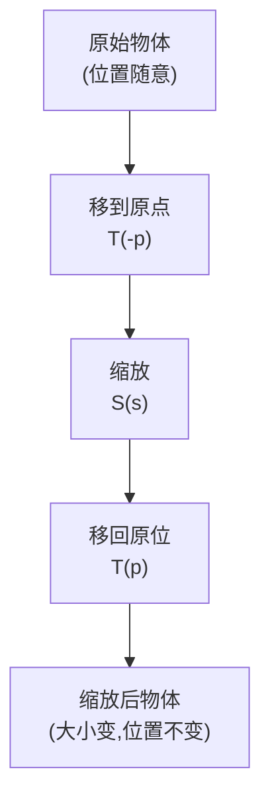

# 三维平移与缩放变换 (3D Translation & Scaling)

好的，我们来讲解三维变换中最基础也最重要的两个操作：平移与缩放。

首先，思考一个根本问题：为什么我们需要把“移动物体”和“改变物体大小”这两个操作，统一到矩阵乘法里？

在三维图形流水线中，我们希望所有的几何变换（平移、旋转、缩放等）都能用一种统一的方式处理——即矩阵乘法。因为 GPU 擅长并行做矩阵运算，统一的形式能极大提升渲染效率。如果平移只是简单的向量加法，而缩放是分量乘法，那流水线就断裂了。

解决之道就是**齐次坐标**。我们把三维空间的点 $(x, y, z)$ 扩充为四维向量 $(x, y, z, 1)$。

## 三维平移变换

### 它是什么
平移就是将一个点沿着给定方向移动一段距离。假设我们有一个位移向量 $\mathbf{t} = (t_x, t_y, t_z)$，要将点 $P(x, y, z)$ 平移到 $P'(x', y', z')$。

利用齐次坐标，我们可以用 $4 \times 4$ 矩阵一举完成此事：

$$
\begin{bmatrix} x' \\ y' \\ z' \\ 1 \end{bmatrix}
=
\begin{bmatrix} 
1 & 0 & 0 & t_x \\
0 & 1 & 0 & t_y \\
0 & 0 & 1 & t_z \\
0 & 0 & 0 & 1
\end{bmatrix}
\cdot
\begin{bmatrix} x \\ y \\ z \\ 1 \end{bmatrix}
$$

展开计算即： $x' = x + t_x, \quad y' = y + t_y, \quad z' = z + t_z$。

> [!IMPORTANT]
> 平移变换只是改变了坐标原点相对于物体的位置，==它不改变物体的形状、大小和方向==，是典型的刚体变换。其矩阵主对角线元素全为 $1$。

## 三维缩放变换

### 它是什么
缩放变换改变物体的大小。它可以是**均匀缩放**，即沿三个坐标轴方向缩放比例相同；也可以是**差异化缩放**，即沿不同轴缩放比例不同，这会导致物体形状改变。

缩放操作由缩放因子 $s_x, s_y, s_z$ 控制，其变换矩阵如下：

$$
\begin{bmatrix} x' \\ y' \\ z' \\ 1 \end{bmatrix}
=
\begin{bmatrix} 
s_x & 0 & 0 & 0 \\
0 & s_y & 0 & 0 \\
0 & 0 & s_z & 0 \\
0 & 0 & 0 & 1
\end{bmatrix}
\cdot
\begin{bmatrix} x \\ y \\ z \\ 1 \end{bmatrix}
$$

> [!IMPORTANT]
> 缩放变换是以**原点为中心**进行的。如果物体中心不在原点，单纯缩放不仅会改变大小，还会**改变它的位置**。
因此，要对任意点 $Q(x_f, y_f, z_f)$ 为中心缩放，必须先用平移把 $Q$ 移到原点，缩放，再反向平移回去。

## 常见的坑：固定点缩放

想对一个立方体“原地”放大，直接用缩放矩阵，它会中心飞离原点。正确做法是三步组合操作。

对于以任意点 $\mathbf{p} = (p_x, p_y, p_z)$ 为固定点进行的缩放，其组合变换矩阵为：

$$
\mathbf{T}(\mathbf{p}) \cdot \mathbf{S}(s_x, s_y, s_z) \cdot \mathbf{T}(-\mathbf{p})
$$

> [!WARNING]
> 组合变换的乘法顺序**不可交换**。平移和缩放矩阵相乘时，必须遵循“先发生，右乘之”的原则。如果顺序颠倒了，缩放中心就不再是你预期的那一点了。

## 与旋转等变换的关系

- **刚体变换**：仅由平移与旋转组合，保持物体的长度、角度、面积、体积不变。缩放不属于刚体变换。
- **相似变换**：在刚体变换基础上加入**均匀缩放**（$s_x = s_y = s_z$），形状不变但大小可改。
- **仿射变换**：包含平移、旋转、缩放、错切，保持平行线关系，但不保持角度和长度。我们所讲的基本变换矩阵都是仿射变换的特例。

## 算例：组合变换

**题目**：求点 $P(1,2,3)$ 先以原点为中心缩放至 $2$ 倍，再沿 $X$ 轴平移 $4$ 个单位的复合矩阵，并计算变换后的坐标。

**解**：
1. **缩放矩阵** $S$：三个轴均放大 $2$ 倍，即 $s_x=s_y=s_z=2$。
2. **平移矩阵** $T$：$t_x=4, t_y=0, t_z=0$。
3. **复合顺序**：先缩放后平移，故组合矩阵 $\mathbf{M} = \mathbf{T} \cdot \mathbf{S}$。

$$
\mathbf{M} = 
\begin{pmatrix} 
1 & 0 & 0 & 4 \\
0 & 1 & 0 & 0 \\
0 & 0 & 1 & 0 \\
0 & 0 & 0 & 1 
\end{pmatrix}
\cdot
\begin{pmatrix} 
2 & 0 & 0 & 0 \\
0 & 2 & 0 & 0 \\
0 & 0 & 2 & 0 \\
0 & 0 & 0 & 1 
\end{pmatrix}
=
\begin{pmatrix} 
2 & 0 & 0 & 4 \\
0 & 2 & 0 & 0 \\
0 & 0 & 2 & 0 \\
0 & 0 & 0 & 1 
\end{pmatrix}
$$

4. **作用于点 $P$**：
$$
P' = \mathbf{M} \cdot P = 
\begin{pmatrix} 
2 & 0 & 0 & 4 \\
0 & 2 & 0 & 0 \\
0 & 0 & 2 & 0 \\
0 & 0 & 0 & 1 
\end{pmatrix}
\cdot
\begin{pmatrix} 1 \\ 2 \\ 3 \\ 1 \end{pmatrix}
=
\begin{pmatrix} 2\cdot1 + 0\cdot2 + 0\cdot3 + 4\cdot1 \\ 0\cdot1 + 2\cdot2 + 0\cdot3 + 0\cdot1 \\ 0\cdot1 + 0\cdot2 + 2\cdot3 + 0\cdot1 \\ 1 \end{pmatrix}
=
\begin{pmatrix} 6 \\ 4 \\ 6 \\ 1 \end{pmatrix}
$$

变换后，点 $P$ 的新位置为 $(6, 4, 6)$。

> [!TIP]
> 复合矩阵能预先将所有变换“烘焙”成一个 $4 \times 4$ 矩阵，对大量顶点施加变换时，能够将多次乘法化为单次高效运算。这就是管线追求统一形式化的核心收益。
