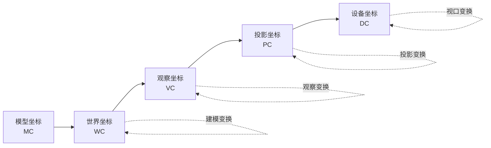

# 三维观察管线概述 (3D Viewing Pipeline)

## 三维观察管线概述 (3D Viewing Pipeline)

在二维观察中，我们只需要把世界坐标系中的一个窗口映射到视口。但在三维观察中，问题要复杂得多：三维场景包含深度信息，最终却要显示在二维屏幕上。如何把三维世界“拍”成一张二维图像？这正是三维观察管线要解决的问题。

> [!IMPORTANT]
> **三维观察管线**是将三维场景坐标经过一系列变换，最终映射到二维设备坐标（屏幕）的处理流程。它与二维观察管线的核心区别在于：==增加了投影变换（Projection）==，用于处理深度信息。

## 管线流程

三维观察管线可以看作一条“流水线”，物体坐标依次经过四个主要阶段：

**各阶段功能：**

| 阶段 | 变换名称 | 功能 | 关键操作 |
|------|---------|------|---------|
| 1 | 建模变换 (Modeling) | 局部→世界 | 摆放物体 |
| 2 | 观察变换 (Viewing) | 世界→观察 | 设置相机 |
| 3 | 投影变换 (Projection) | 观察→投影 | 3D→2D，处理深度 |
| 4 | 视口变换 (Viewport) | 投影→设备 | 映射到屏幕像素 |

## 核心步骤详解

**第一步：从世界坐标到观察坐标**

想象你拿着相机拍照。首先需要确定相机的位置（观察参考点 VRP）、朝向（观察平面法向量 VPN）和上方（观察向上向量 VUP）。观察变换就是把世界坐标系中的物体，转换到以相机为原点的**观察坐标系**（Viewing Coordinate System）中。这样，相机位于原点，视线方向通常是 $z$ 轴负方向。

**第二步：投影变换（核心区别）**

这是三维观察与二维观察的==本质区别==。投影将三维观察坐标映射到二维投影平面：
- **平行投影**（Parallel）：投影线平行，保持物体实际尺寸，用于工程制图。
- **透视投影**（Perspective）：投影线汇聚于投影中心（COP），近大远小，符合人眼视觉。

**第三步：裁剪与视口变换**

在投影坐标系中，根据**观察体**（View Volume，透视投影为棱台，平行投影为长方体）裁剪掉不可见部分。最后，将保留下来的内容映射到屏幕的视口（Viewport）中，得到设备坐标。

## 与二维观察管线的区别

| 对比项 | 二维观察管线 | 三维观察管线 |
|--------|-------------|-------------|
| **坐标维度** | 2D → 2D | 3D → 2D |
| **核心变换** | 窗口-视口变换 | 增加**投影变换** |
| **深度处理** | 无深度概念 | 需处理遮挡、透视 |
| **观察体** | 矩形窗口 | 棱台（透视）或长方体（平行） |

> [!WARNING]
> 不要混淆**观察变换**与**投影变换**：前者只是改变坐标系（移动相机），不改变维度；后者才真正将 3D 降为 2D，会丢失深度信息（需配合深度缓冲）。

## 计算示例

**题目**：已知世界坐标系中一点 $P_w = (1, 2, 3)$，相机位于 $(0, 0, 5)$ 看向原点，采用透视投影，投影中心 COP 在原点，投影平面为 $z = 1$。求该点的设备坐标（假设视口为 $800 \times 600$，无裁剪）。

**解**：
1. **观察变换**：将相机移至原点，物体相对移动。$P_v = P_w - (0,0,5) = (1, 2, -2)$（简化处理，假设视线沿 $-z$ 轴）。
2. **透视投影**：相似三角形原理，$x_p = x_v \cdot \frac{d}{z_v} = 1 \cdot \frac{1}{2} = 0.5$，$y_p = 2 \cdot \frac{1}{2} = 1$。投影坐标 $P_p = (0.5, 1)$。
3. **视口变换**：假设投影平面范围 $[-1,1]$ 映射到 $[0,800] \times [0,600]$：
   - $x_d = (0.5 + 1) \times 400 = 600$
   - $y_d = (1 + 1) \times 300 = 600$

最终设备坐标为 $(600, 600)$。

> [!TIP]
> 记忆口诀：**“先摆相机（观察），再拍照（投影），最后洗照片（视口）”**。考试常考管线顺序：MC → WC → VC → PC → DC，以及投影变换是 3D 特有的步骤。
