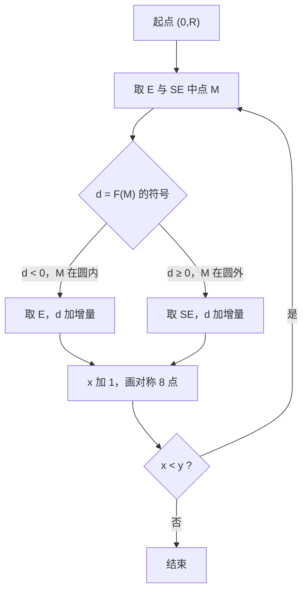

# 中点画圆算法 (Midpoint Circle Algorithm)

## 中点画圆算法是什么

中点画圆算法（Midpoint Circle Algorithm）是==利用圆的八对称性、用整数增量计算把圆扫描转换出来==的算法。它属于输出图元（Output Primitives）中的圆生成方法，核心思想与 Bresenham 画线算法一致：每一步只在两个候选像素中选一个，并用一个判别式的符号决定取舍，从而避免浮点运算。

> [!IMPORTANT]
> 圆心在坐标原点、半径为 $R$ 的圆隐式函数为
> $$F(x,y)=x^2+y^2-R^2$$
> 圆上 $F=0$；圆内 $F<0$；圆外 $F>0$。

## 为什么需要它

直接按 $y=\sqrt{R^2-x^2}$ 计算会引入开方和浮点误差。能不能像画直线那样，每一步只做加减和比较？把候选点取在==当前点正右方 $E$ 与右下方 $SE$ 的中点 $M$==，判断 $M$ 在圆内还是圆外即可。

## 怎么做

只推导从 $(0,R)$ 到 $x=y$ 的 $45^\circ$ 弧，其余 7 段由对称性得到。

设当前像素为 $(x_k,y_k)$，中点 $M=(x_k+1,\ y_k-\tfrac12)$，判别式

$$d_k=F(M)=(x_k+1)^2+\left(y_k-\tfrac12\right)^2-R^2$$

- 若 $d_k<0$，$M$ 在圆内，$SE$ 离圆更远，取 $E=(x_k+1,y_k)$，下一步
  $$d_{k+1}=d_k+2x_k+3$$
- 若 $d_k\ge 0$，$M$ 在圆外或在圆上，取 $SE=(x_k+1,y_k-1)$，下一步
  $$d_{k+1}=d_k+2(x_k-y_k)+5$$

初始点 $(0,R)$ 处

$$d_0=F(1,R-\tfrac12)=\frac54-R$$

由于只关心符号，==初始判别式可直接取整数 $d_0=1-R$==，不影响判断结果。

## 算对了的例子

取 $R=10$，从 $(0,10)$ 开始，$d_0=1-10=-9$。

| $k$ | $(x_k,y_k)$ | $d_k$ | 选择 | 下一个像素 |
|---|---|---|---|---|
| 0 | $(0,10)$ | $-9<0$ | $E$ | $(1,10)$ |
| 1 | $(1,10)$ | $-6<0$ | $E$ | $(2,10)$ |
| 2 | $(2,10)$ | $-1<0$ | $E$ | $(3,10)$ |
| 3 | $(3,10)$ | $6\ge0$ | $SE$ | $(4,9)$ |
| 4 | $(4,9)$ | $-3<0$ | $E$ | $(5,9)$ |
| 5 | $(5,9)$ | $8\ge0$ | $SE$ | $(6,8)$ |
| 6 | $(6,8)$ | $5\ge0$ | $SE$ | $(7,7)$ |

当 $x\ge y$ 时停止。例如 $(7,7)$ 已到达对称轴，该段结束，再按 $(\pm x,\pm y)$ 与 $(\pm y,\pm x)$ 画出其余 7 段。

> [!TIP]
> 增量记忆：选 $E$ 加 $2x+3$；选 $SE$ 加 $2(x-y)+5$。把 $d_0=1-R$、$x$ 从 $0$ 开始逐行列表，考试最稳。

## 与相近方法的区别

| 方法 | 是否用对称性 | 判别式初值 | 主要特点 |
|---|---|---|---|
| 中点画圆算法 | 八对称 | $d_0=1-R$ | 整数增量，效率高 |
| Bresenham 画圆 | 八对称 | 与中点法等价 | 本质上同一决策过程 |
| 简单方程法 $y=\sqrt{R^2-x^2}$ | 一般不用 | 无 | 计算量大，浮点误差明显 |
| 极坐标法 $x=R\cos\theta$ | 可配合 | 无 | 三角函数计算代价高 |

> [!WARNING]
> 常见错误：一是把初始判别式写成 $\tfrac54-R$ 后仍用浮点比较，正确做法是直接取 $1-R$；二是忘记每次选完像素后 $x$ 必加 $1$，选 $SE$ 时 $y$ 还要减 $1$；三是画点范围写错，应画到 $x<y$ 为止，再由八对称补全整个圆。

> [!CAUTION]
> 判别式 $d_k\ge0$ 时取 $SE$，不要取 $E$。因为 $M$ 在圆外说明右下方像素更贴近真实圆弧，这也是“中点”这个名字的来源。
