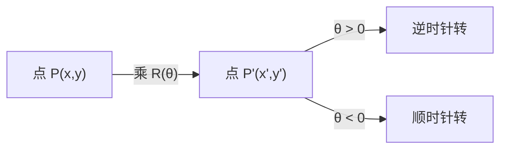

# 二维旋转变换 (2D Rotation)

二维旋转变换（2D Rotation）是改变图形方向的基本操作：将点 $P(x, y)$ 绕原点旋转角度 $\theta$，得到新点 $P'(x', y')$。

## 为什么需要它

平移只能改变位置，缩放只能改变大小。要让风车转动、指针偏转或角色转身，就必须引入旋转变换。它是构建复杂动画与交互的基石。

## 怎么做：推导与矩阵

假设点 $P$ 到原点的距离为 $r$，初始极角为 $\phi$，则：
$$x = r\cos\phi, \quad y = r\sin\phi$$

逆时针旋转 $\theta$ 后，新极角变为 $\phi + \theta$：
$$x' = r\cos(\phi+\theta) = r(\cos\phi\cos\theta - \sin\phi\sin\theta) = x\cos\theta - y\sin\theta$$
$$y' = r\sin(\phi+\theta) = r(\sin\phi\cos\theta + \cos\phi\sin\theta) = x\sin\theta + y\cos\theta$$

写成齐次坐标下的 ==3×3 旋转矩阵==：
$$R(\theta) = \begin{bmatrix} \cos\theta & -\sin\theta & 0 \\ \sin\theta & \cos\theta & 0 \\ 0 & 0 & 1 \end{bmatrix}$$

> [!IMPORTANT]
> 标准公式默认**逆时针为正**。若题目要求顺时针旋转 $\alpha$，直接代入 $\theta = -\alpha$ 即可。

## 与相近概念的区别

| 变换 | 齐次矩阵核心特征 | 几何效果 |
| :--- | :--- | :--- |
| **Rotation** | 对角线为 $\cos\theta$，反对角线为 $\pm\sin\theta$ | 仅改变方向，保持形状与大小 |
| **Scaling** | 对角线为 $s_x, s_y$，其余非对角元素为 0 | 仅改变大小，可能拉伸变形 |
| **Translation** | 左上角 2×2 为单位阵，第三列为 $t_x, t_y$ | 仅改变位置 |

> [!NOTE]
> 旋转矩阵是正交矩阵（$R^{-1} = R^T$），这意味着旋转不改变向量的长度和两向量间的夹角。

## 常见的坑

> [!WARNING]
> **绕任意点旋转 ≠ 直接套用公式！** $R(\theta)$ 只能绕**原点**旋转。若要绕固定点 $(x_r, y_r)$ 旋转，必须分三步走：
> 1. 平移至原点：$T(-x_r, -y_r)$
> 2. 执行旋转：$R(\theta)$
> 3. 平移回原位：$T(x_r, y_r)$
> 复合矩阵为 $M = T(x_r, y_r) \cdot R(\theta) \cdot T(-x_r, -y_r)$，注意**矩阵乘法从右向左作用**。

> [!CAUTION]
> 计算时极易混淆 `sin` 和 `cos` 的位置。记住第一行是“$\cos, -\sin$”，第二行是“$\sin, \cos$”。

## 算对了的例子

**题目**：求点 $P(1, 0)$ 绕原点逆时针旋转 $90°$ 后的新坐标。

**解**：
此时 $\theta = 90°$，故 $\cos 90° = 0$，$\sin 90° = 1$。
代入旋转矩阵：
$$\begin{bmatrix} x' \\ y' \\ 1 \end{bmatrix} = \begin{bmatrix} 0 & -1 & 0 \\ 1 & 0 & 0 \\ 0 & 0 & 1 \end{bmatrix} \begin{bmatrix} 1 \\ 0 \\ 1 \end{bmatrix} = \begin{bmatrix} 0\times1 + (-1)\times0 \\ 1\times1 + 0\times0 \\ 1 \end{bmatrix} = \begin{bmatrix} 0 \\ 1 \\ 1 \end{bmatrix}$$

结果为 $P'(0, 1)$。直观验证：X 轴正半轴上的点逆时针转 $90°$ 刚好落在 Y 轴正半轴上，完全正确。

> [!TIP]
> 考试遇到特殊角（$30°, 45°, 60°, 90°$）直接写根号值；遇到一般角保留 $\cos\theta$、$\sin\theta$ 符号即可，不要强行按计算器近似，以免丢精度分。
