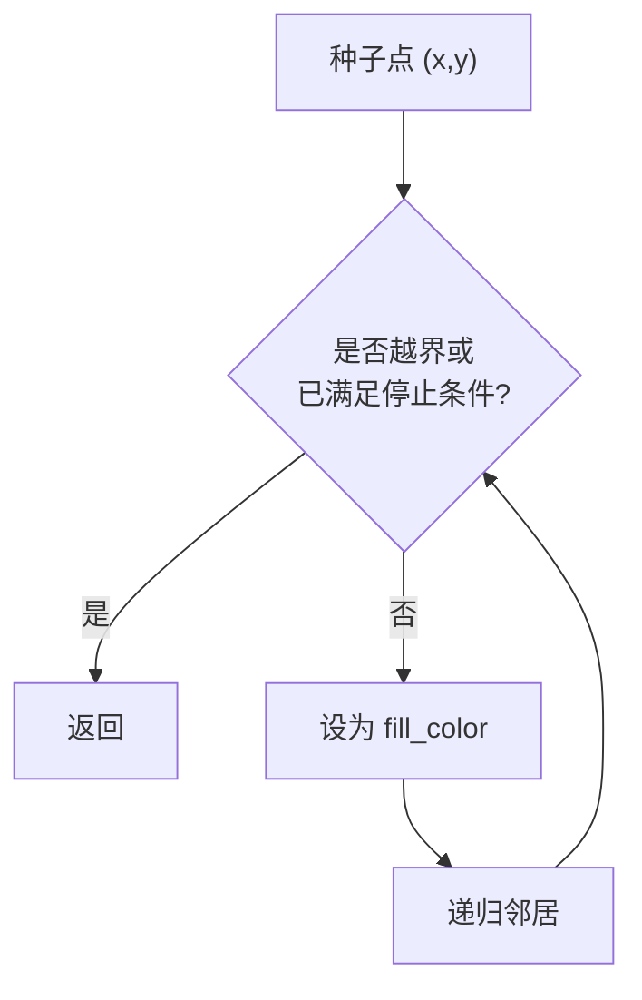

# 边界填充与泛洪填充算法 (Boundary-Fill & Flood-Fill Algorithms)

---
requires: [计算机图形学/光栅化, 数据结构/栈与队列]
---

当我们用 `lineTo` 或画圆算法得到封闭图形的轮廓后，如何把内部也涂上颜色？逐像素判断是否在多边形内太慢了。有没有办法从内部一个已知点出发，“像水一样”向四周蔓延，直到碰到边界才停下？这就是区域填充要解决的问题。

## 它是什么与为什么需要

**区域填充（Area-Filling）** 是将指定区域内所有像素设置为同一颜色的过程。在交互式绘图、油漆桶工具中极为常见。根据“如何定义区域”，分为两类：

- **边界填充（Boundary-Fill）**：区域由==特定边界色==围成，内部填充至碰到该颜色为止。
- **泛洪填充（Flood-Fill）**：区域由==特定内部色==连通而成，将所有相连的同色像素替换为新颜色（不关心边界色）。

> [!IMPORTANT]
> 核心区别：Boundary-Fill 认“墙”（边界色），Flood-Fill 认“地”（待替换的旧颜色）。

| 特性 | Boundary-Fill | Flood-Fill |
| :--- | :--- | :--- |
| 停止条件 | 遇到 `boundary_color` | 像素不是 `old_color` |
| 适用场景 | 单色边界的封闭图形 | 内部颜色单一、边界可能多色 |
| 参数 | 种子点、填充色、边界色 | 种子点、填充色、旧颜色 |

## 怎么做：四连通与八连通

填充前必须定义“相邻”。若只考虑上下左右四个方向，称为 **4-connected**；若加上四个对角线方向，称为 **8-connected**。



> [!NOTE]
> 节点文字精炼提示：图中邻居数量取决于连通性。4-connected 有 4 个邻居，8-connected 有 8 个邻居。

以 4-connected Boundary-Fill 为例，伪代码如下：

```text
BoundaryFill4(x, y, fill_color, boundary_color):
    current = getPixel(x, y)
    if current != boundary_color AND current != fill_color:
        setPixel(x, y, fill_color)
        BoundaryFill4(x+1, y, fill_color, boundary_color)
        BoundaryFill4(x-1, y, fill_color, boundary_color)
        BoundaryFill4(x, y+1, fill_color, boundary_color)
        BoundaryFill4(x, y-1, fill_color, boundary_color)
```

Flood-Fill 只需将判断条件改为 `current == old_color`。

## 一个算对了的例子

假设有一个 $5 \times 5$ 的网格，边界色为 `B`，内部初始为空白 `.`，种子点在 $(2,2)$，填充色为 `F`。采用 4-connected Boundary-Fill。

```text
初始状态:          填充后:
B B B B B          B B B B B
B . . . B          B F F F B
B . . . B   --->   B F F F B
B . . . B          B F F F B
B B B B B          B B B B B
```

**执行步骤：**
1. 检查 $(2,2)$：当前为 `.`，既非 `B` 也非 `F`，涂为 `F`。
2. 递归检查 $(3,2), (1,2), (2,3), (2,1)$，均合法，涂为 `F`。
3. 继续向外扩展，当到达如 $(1,1)$ 等边缘时，发现邻居是 `B`，触发停止条件，递归返回。
最终内部 9 个像素全部被正确填充。

## 常见的坑

> [!WARNING]
> **栈溢出风险**：朴素递归实现会消耗大量系统栈空间。对于大区域，应改用==显式栈（Stack）或队列（Queue）==的迭代方式实现。

> [!CAUTION]
> **连通性陷阱**：如果边界是 4-connected 绘制的，而填充使用 8-connected，填充色可能会从对角线缝隙“漏”出边界！
> 规则：==边界的连通性必须 $\ge$ 填充的连通性==。即 8-connected 边界才能安全配合 8-connected 填充。

> [!TIP]
> 记忆口诀：**填四必界四，填八需界八**（4-填充可用 4-或 8-边界，8-填充必须用 8-边界防泄漏）。
