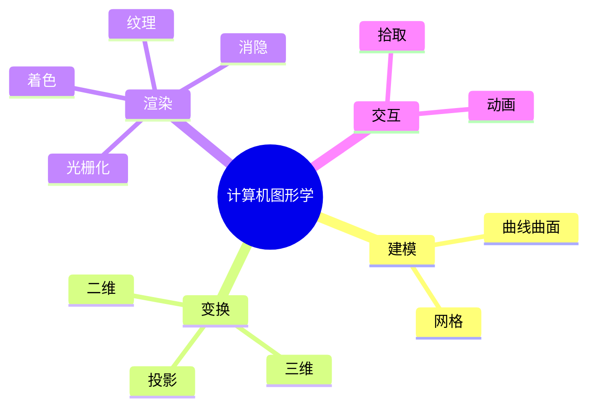

# 计算机图形学的定义与研究范畴 (Definition & Scope of Computer Graphics)

## 它是什么

计算机图形学（Computer Graphics, CG）研究如何**用计算机生成、表示、处理与显示图形**。注意这里的“图形”不仅是照片或绘画——从一条直线、一个三角形网格，到三维场景的光影渲染，都属于它的范畴。

可以直接说：==计算机图形学解决的是“从模型到图像”的问题==。模型是场景的数学描述（几何、材质、光源、相机），图像是最终呈现在屏幕上的像素阵列。

> [!IMPORTANT]
> 核心定义：Computer Graphics is the discipline of **creating, manipulating, and displaying images** from **computational models**.

## 为什么需要

在图形学出现之前，人们只能靠手工绘图或物理模型来表达设计。计算机图形学的价值在于：

- **可交互性**：比如在 CAD 软件里旋转一个零件，实时看到任意视角；
- **可复用与精确**：模型参数一改，渲染结果自动更新；
- **能处理人画不出的东西**：有限元应力云图、医学体数据、分子结构；
- **虚拟与沉浸**：游戏、VR/AR、影视特效都需要以图形学为底座。

## 研究范畴

南邮这门课通常按**渲染管线**主线组织内容，范畴大致如下：

| 子领域 | 研究什么 | 对应课程章节 |
| --- | --- | --- |
| 几何建模 | 点、线、面的数学表示，曲线曲面 | 曲线与曲面 |
| 几何变换 | 平移、旋转、缩放、投影 | 二维/三维变换 |
| 光照与着色 | 光源模型、材质反射、颜色 | 光照模型 |
| 光栅化 | 把几何图元离散成像素 | 扫描转换 |
| 纹理映射 | 把图像贴到几何表面 | 纹理 |
| 可见性 | 谁挡住谁，消隐 | 深度缓冲 |
| 动画 | 物体随时间运动 | 后续课程延伸 |

## 和相近概念的区别

> [!NOTE]
> **计算机图形学 vs 图像处理 vs 计算机视觉** 是高频辨析点。

| 方向 | 输入 | 输出 | 核心问题 |
| --- | --- | --- | --- |
| ==计算机图形学== | 模型/描述 | 图像 | 如何把模型画出来 |
| 图像处理 | 图像 | 图像 | 如何增强、去噪、压缩 |
| 计算机视觉 | 图像 | 模型/理解 | 如何从图像恢复世界信息 |

一句话记忆：**CG 是“描述→图”，CV 是“图→描述”**，图像处理则两端都是图。

## 常见的坑

> [!WARNING]
> 不要以为“图形学 = 学会调用 OpenGL/Unity 的 API”。API 只是工具，==图形学核心是理解渲染管线中每个阶段做什么、数据怎样流动==。考试常问“这一步发生在哪个坐标系”“该矩阵左乘还是右乘”，而不是问某个函数名。

> [!CAUTION]
> “二维图形学”和“图像处理”也会混：画一条直线属于图形学（从几何描述出发）；把照片调亮属于图像处理（像素到像素）。

## 一个算对了的例子

**例（判断题）**：判断正误并说明理由——  
“Computer graphics deals only with the generation of 2D images such as lines and polygons.”

**正确解答**：

> 错误。==计算机图形学既包括二维也包括三维图形的生成、表示与显示==，且 2D 图形只是其中基础部分。三维建模、光照、消隐、纹理映射等同样属于计算机图形学的核心研究内容。

这一步不需要计算，但典型考法就是考**范畴边界**：选项中常混入图像处理、视觉或纯 UI 编程的内容，只要按“模型→图像”这条主线判断即可。
