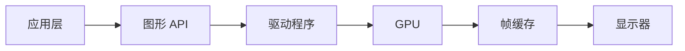

# 图形系统的硬件与软件架构 (Graphics System Architecture)

当你想画一个三维模型，或者在屏幕上显示一行文字时，CPU 是怎么把指令变成像素的？这就涉及图形系统的整体架构。

## 它是什么与为什么需要

图形系统（Graphics System）由**硬件**和**软件**两部分组成，核心目的是将应用程序的绘图命令高效地转换为屏幕上的像素。

如果只靠 CPU 逐像素计算并写入内存，速度会极慢。因此，我们需要专门的硬件（如 GPU、显示器）和分层的软件（API、驱动）来协同工作，实现==软硬件解耦与并行加速==。

> [!IMPORTANT]
> 核心架构：Application → Graphics API → Device Driver → Hardware (GPU + Frame Buffer + Display)。

## 怎么做：硬件与软件的分工

### 硬件部分

- **图形处理器（GPU）**：执行几何变换、光栅化等密集型计算。
- **帧缓存（Frame Buffer）**：一块专用内存，存储屏幕上每个像素的颜色值。分辨率 $W \times H$、色深 $b$ bits/pixel 时，所需最小容量为：
$$C = W \times H \times b \text{ (bits)}$$
- **显示设备（Display）**：读取帧缓存数据并刷新到屏幕。

### 软件部分

- **图形 API（如 OpenGL/Vulkan）**：提供标准化接口，让程序员无需关心底层硬件差异。
- **设备驱动（Device Driver）**：将 API 调用翻译为特定 GPU 能懂的机器指令。

> [!TIP]
> 记忆口诀：“上层定标准（API），下层干苦力（Driver+GPU），中间存结果（Frame Buffer）”。

## 相近概念的区别

| 对比项 | 图形系统 (Graphics System) | 通用计算系统 (General Computing) |
| :--- | :--- | :--- |
| **处理对象** | 几何图元、像素 | 通用数据、逻辑 |
| **核心瓶颈** | 内存带宽、浮点吞吐 | 分支预测、缓存命中 |
| **输出目标** | 帧缓存 $\to$ 显示器 | 文件、网络、终端 |

> [!NOTE]
> 现代 GPU 也能做通用计算（GPGPU），但在《计算机图形学》语境下，我们关注的是其渲染管线（Rendering Pipeline）能力。

## 常见坑与易错点

> [!WARNING]
> 不要把“显存（Video Memory）”和“帧缓存（Frame Buffer）”完全等同。帧缓存是显存中专门用于存放当前画面像素数据的区域，显存还包含纹理、深度缓冲等其他数据。

> [!CAUTION]
> 考试常考单位换算！题目若问“需要多少 MB”，记得除以 $8 \times 1024^2$ 或 $8 \times 10^6$（依教材约定），别算完 bits 就停笔。

## 算对了的例子

**问题**：分辨率为 $1920 \times 1080$，真彩色（24 bits/pixel），求帧缓存至少需要多少字节（Bytes）？约等于多少 MB？

**计算过程**：
1. 总像素数：$1920 \times 1080 = 2,073,600$
2. 总比特数：$2,073,600 \times 24 = 49,766,400 \text{ bits}$
3. 转字节：$49,766,400 \div 8 = 6,220,800 \text{ Bytes}$
4. 转 MB（按 $1\text{MB}=1024^2\text{B}$）：$6,220,800 \div (1024 \times 1024) \approx 5.93 \text{ MB}$

> [!IMPORTANT]
> 最终结论：该配置下帧缓存至少需要 ==6,220,800 Bytes（约 5.93 MB）==。
