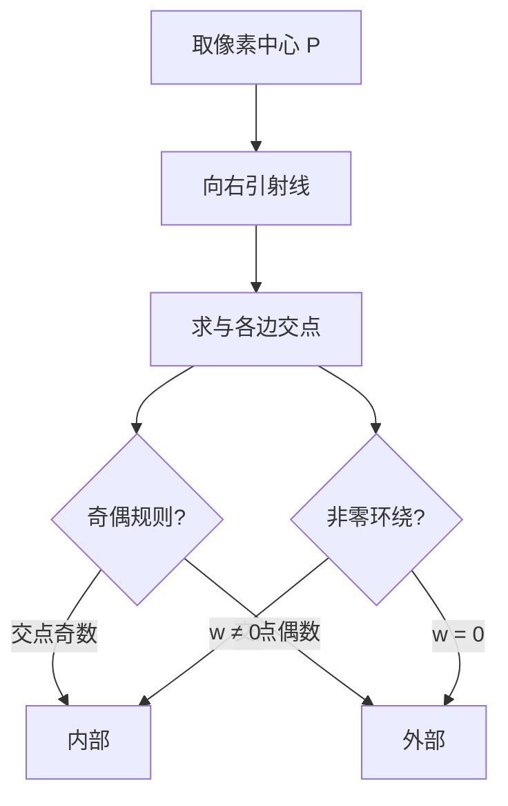

# 多边形表示与填充规则 (Polygon Representation & Fill Rules)

多边形是图形学里最常用的"面"图元：光栅化显示器只能显示像素点，想画出一个填充好的三角形、矩形或任意封闭轮廓，必须先给出边界的数学表示，再用规则决定每个像素属于"内部"还是"外部"。==多边形表示回答"边界怎么存"，填充规则回答"内部怎么判"==，两者缺一不可。

## 常见的多边形表示

| 表示方式 | 内容 | 优点 | 缺点 |
| --- | --- | --- | --- |
| 顶点表 (vertex list) | 有序顶点序列 $V_0V_1\ldots V_{n-1}$ | 简洁、易做变换 | 拓扑信息隐含 |
| 边表 (edge table) | 边的两个端点索引 | 便于扫描线求交 | 顶点重复存储 |
| 翼边结构 (winged-edge) | 每条边记录左右两个面、前后边 | 拓扑完整 | 结构复杂 |

课程里最常用 ==顶点表+边表== 的组合：顶点按顺序给出，相邻两点连边，最后一条边 $V_{n-1}V_0$ 自动闭合。所以"是不是多边形"的判据是：==边界必须封闭==，首尾顶点无需重复写两次。

## 为什么需要填充规则

同一个像素网格上，多边形的边可能恰好落在像素中心、穿过像素中心或根本不含像素中心。==如果每条边都把自己经过的像素算作内部，那么两条相邻边共享的像素会被重复计算==，对扫描线算法或颜色混合都会出错。为此必须定义一致的判内规则。

常用规则：

- **奇偶规则 (Even-Odd Rule)**：从待判像素向任意方向引一条射线，==与所有边的交点个数为奇数则在内部==，偶数则在外部。对自相交多边形也能给出确定结果。
- **非零环绕规则 (Non-Zero Winding Rule)**：射线与每条边相交时，按边的方向记 $+1$（向上）或 $-1$（向下），累计值 $w\neq 0$ 则在内部。对凹多边形和"带孔"多边形更友好。
- **正负规则 / 孔洞处理**：外轮廓顺时针、内孔逆时针，用非零环绕规则自然扣除孔洞。

> [!IMPORTANT]
> ==奇偶规则看交点个数的奇偶，非零环绕规则看方向累计值是否为零==。二者对简单多边形结果一致，对自相交多边形可能不同。

> [!TIP]
> 记忆口诀：**奇偶数数点，非零算代数和**。遇到"带孔"或"花瓣重叠"的图形，优先考虑非零环绕。

## 扫描线填充的流程

拿到顶点表后，通常按以下步骤光栅化：

1. 建立 **边表 (Edge Table, ET)**：按 $y_{\min}$ 分桶，每条边记录 $y_{\max}, x, \Delta x/\Delta y$。
2. 维护 **活动边表 (Active Edge Table, AET)**：扫描线 $y$ 每增加一像素，把 $y_{\min}=y$ 的边插入 AET，把 $y_{\max}=y$ 的边删除。
3. AET 按 $x$ 排序，==两两配对形成跨度 (span)==，中间像素填色。
4. 每条边的 $x$ 按 $x \leftarrow x + \Delta x/\Delta y$ 增量更新，避免重复求交。

> [!WARNING]
> 扫描线到达顶点时容易重复计数：==共享顶点的两条边要把顶点只算一次==，常见做法是让较短的那条边"上闭下开"，即 $y_{\min}$ 计入、$y_{\max}$ 不计入。

## 一个算对了的例子

三角形顶点 $(1,1),(5,1),(3,4)$，用奇偶规则判断像素 $(3,2)$ 是否内部：

- 向右引射线 $y=2$，与三角形三边求交。
- 边 $(1,1)-(5,1)$：$y$ 范围 $[1,1]$，不含 $y=2$，跳过。
- 边 $(1,1)-(3,4)$：交点 $x = 1 + (2-1)\cdot\frac{3-1}{4-1} = 1.67$。
- 边 $(5,1)-(3,4)$：交点 $x = 5 - (2-1)\cdot\frac{5-3}{4-1} = 4.33$。
- 共 2 个交点，偶数 ⇒ 按奇偶规则 $(3,2)$ **在外部**？

再细看：交点是 $x=1.67$ 和 $x=4.33$，而待判像素 $x=3$ 处，射线确实穿过三角形两次……但==关键是射线只统计"位于像素右侧"的交点==，两个交点都在 $x=3$ 的右侧，故交点数 2，偶数，判为外部。

> [!CAUTION]
> 射线方向可以任选，但==必须固定==；一旦中途换方向，奇偶性会算错。

## 与相近概念的区别

- **多边形表示 vs. 边界表示**：前者是图元的输入形式，后者是 CAD 中描述实体的拓扑结构。
- **填充规则 vs. 裁剪规则**：填充规则决定内部，裁剪规则（如 Cohen-Sutherland、Sutherland-Hodgman）决定可见部分，别混淆。
- **奇偶规则 vs. 非零环绕**：简单多边形等价；自相交、带孔图形时后者更稳定。
