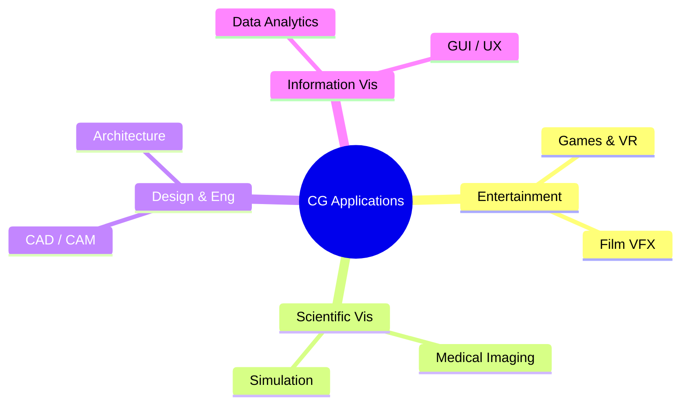

# 计算机图形学的应用领域 (Applications of CG)

## 什么是计算机图形学的应用领域

当我们谈论 CG 的应用时，仅仅列举“游戏”或“电影”是不够的。在学术与工程语境下，它指的是 ==利用计算机生成、处理并显示视觉信息的所有技术场景==。为什么需要专门学习这些应用分类？因为不同领域对图形管线（Graphics Pipeline）的需求截然不同：有的追求物理真实感，有的追求实时交互性，有的则强调数据表达的准确性。理解应用场景，才能明白后续章节中光照模型、裁剪算法或着色器设计的取舍依据。

## 核心应用领域全景

CG 的应用早已超越娱乐范畴，形成了多维度的技术矩阵。我们可以通过以下结构建立认知框架：

> [!IMPORTANT]
> 考试与工程中最常考察的四大支柱是：==Entertainment==（娱乐）、==Scientific Visualization==（科学可视化）、==CAD/CAM==（计算机辅助设计与制造）以及 ==Information Visualization==（信息可视化）。务必掌握其英文术语及典型特征。

| 应用领域 | 核心目标 | 关键技术侧重 | 典型示例 |
| :--- | :--- | :--- | :--- |
| Entertainment | 沉浸感与实时性 | Rasterization, Real-time Shading | Video Games, VR/AR |
| Scientific Vis | 数据洞察与精度 | Volume Rendering, Isosurface | CT/MRI, CFD Simulation |
| CAD/CAM | 几何精确与可制造性 | NURBS, Constructive Solid Geometry | AutoCAD, CATIA |
| Info Vis | 抽象数据具象化 | Graph Drawing, Dimensionality Reduction | Dashboard, Network Map |

## 易混淆概念辨析

在学习中，最容易踩坑的是混淆 **Scientific Visualization** 与 **Information Visualization**。两者虽都服务于“看见不可见之物”，但本质不同：

-   **Scientific Visualization**：处理具有 ==内在空间结构== 的数据（如流体场、人体器官）。数据本身就有 XYZ 坐标，渲染是为了还原或增强这种空间关系。
-   **Information Visualization**：处理 ==无固有空间属性== 的抽象数据（如社交网络、股票走势）。必须通过人工设计的隐喻（如节点连线、柱状图）赋予其空间布局。

> [!WARNING]
> 切勿将“医学影像重建”归入 Information Visualization。尽管它用于分析，但 MRI 数据自带三维空间拓扑，属于典型的 Scientific Visualization。这是选择题高频陷阱。

## 从需求到技术的映射实例

假设一道考题问：“为何手术模拟系统不能直接使用游戏引擎的渲染方案？”

这正是在考察应用领域的差异化需求。我们可以这样推导：

1.  **识别领域**：手术模拟属于 Scientific Visualization + Interactive Simulation。
2.  **分析约束**：要求 ==几何绝对精确==（毫米级误差可能导致医疗事故），且需支持软组织形变物理仿真。
3.  **对比差异**：游戏引擎为保帧率常使用近似法线贴图、LOD 简化等“视觉欺骗”手段，牺牲了几何真实性；而手术模拟必须采用高精度网格与物理正确的变形模型。
4.  **得出结论**：应用领域决定了技术选型，==Realism ≠ Visual Fidelity==。

> [!TIP]
> 复习本章时，不要死记硬背列表。尝试对每个领域自问三个问题：输入数据是什么？输出给谁看？允许什么程度的近似？答出这三点，就能在论述题中拿到高分。
