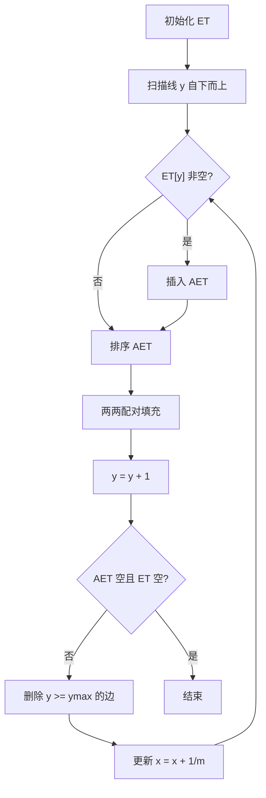

# 扫描线多边形填充算法 (Scan-Line Polygon Fill Algorithm)

## 它是什么

扫描线多边形填充（Scan-Line Polygon Fill）是光栅化的核心算法：它利用**扫描线的空间连贯性 (Coherence)**，避免对每个像素单独判断“在不在多边形内”。算法把多边形看作由一系列**相交线段**切割而成，通过维护动态数据结构，一次性填充一行内的多个跨度 (Spans)。

> [!IMPORTANT]
> 核心思想是 **==奇偶规则 (Odd-Parity Rule)==**：从屏幕外射入一条扫描线，每与边相交一次就翻转“内外”状态，奇数次进入，偶数次离开。

## 为什么需要

若采用逐点测试（Point-in-Polygon），复杂度为 $O(\text{像素数} \times \text{边数})$，效率极低。扫描线算法将复杂度降至 $O(\text{扫描线数} \times \log \text{边数})$，且天然支持**反走样**与**深度插值**。

## 怎么做

算法维护两个关键表：
- **ET (Edge Table)**：按 $y_{min}$ 分桶的静态边表，存储 $y_{max}$、$x_{min}$、斜率倒数 $\frac{1}{m}$；
- **AET (Active Edge Table)**：动态链表，保存当前扫描线穿过的边，按交点 $x$ 排序。

## 顶点交点的处理

当扫描线恰好经过**顶点**时，简单的奇偶规则会失效。需根据顶点两侧边的位置分类：

| 顶点类型 | 两侧边位置 | 交点计数 | 处理策略 |
|---------|-----------|---------|---------|
| **局部极值**（Local Min/Max） | 同侧 | 计 **2** 次（或 0 次） | 生成两个交点，保持奇偶性 |
| **普通顶点**（Monotonic 变化） | 异侧 | 计 **1** 次 | 正常作为一个交点 |

> [!CAUTION]
> **高危误区**：若顶点不是极值点却计为 2 次，会导致填充“漏掉一段”或“多填一段”，形成**空洞 (Holes)** 或**突出 (Spikes)**。

## 算例演示

给定三角形顶点：$A(2, 2)$、$B(10, 2)$、$C(6, 8)$。求扫描线 $y=4$ 时的填充区间。

**步骤 1**：计算边与 $y=4$ 的交点  
- 边 $AB$：$y=2$，与 $y=4$ 不相交（$4 > y_{max}$）。
- 边 $AC$：斜率 $m_{AC} = \frac{8-2}{6-2} = \frac{3}{2}$，$x = 2 + \frac{4-2}{3/2} = 2 + \frac{4}{3} \approx 3.33$。
- 边 $BC$：斜率 $m_{BC} = \frac{8-2}{6-10} = -\frac{3}{2}$，$x = 10 + \frac{4-2}{-3/2} = 10 - \frac{4}{3} \approx 8.67$。

**步骤 2**：排序配对  
AET 中交点排序为 $[3.33, 8.67]$，按奇偶规则配对：$(3.33, 8.67)$ 为内部区间。

**步骤 3**：像素填充  
取整后填充 $x = 4$ 到 $x = 8$ 的像素（或按四舍五入规则处理边界）。

> [!TIP]
> 记忆口诀：**“极值点成对，普通点落单；左闭右开，避免重绘。”** 处理共享边时，遵循“左下闭、右上开”的约定，防止相邻多边形重复填充同一像素。

## 与相近概念的区别

| 算法 | 原理 | 适用场景 | 缺陷 |
|------|------|---------|------|
| **扫描线填充** | 利用扫描线连贯性，维护 AET | 通用多边形，硬件实现 | 需处理顶点特殊情况 |
| **边界填充**（Boundary Fill） | 从种子点递归/迭代扩散 | 交互式绘图，已知内部点 | 递归深度大，栈溢出风险 |
| **泛滥填充**（Flood Fill） | 替换特定颜色区域 | 图像处理，颜色替换 | 无法处理复杂边界交叉 |

> [!NOTE]
> 扫描线算法是**光栅器 (Rasterizer)** 的基础，现代 GPU 的三角形遍历 (Triangle Traversal) 本质上是它的硬件并行化版本。
