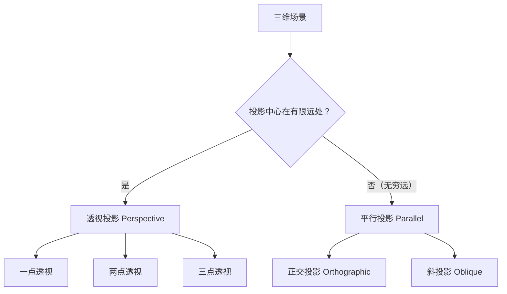

# 平行投影与透视投影的分类 (Parallel vs. Perspective Projection)

## 从眼睛到屏幕：投影是怎么一回事

在三维观察流水线中，场景里的物体是用三维坐标 $(x,y,z)$ 描述的，但屏幕只有两个维度。**投影（Projection）** 要回答的问题是：如何把三维物体“压”到二维平面上，同时尽量保留人眼对深度和形状的感知？

先想一个直观问题：站在铁轨中间向前看，两条铁轨在远处似乎交于一点；但看一张工程图纸上的立方体，平行的棱在图上依然平行。为什么同样是“把 3D 变成 2D”，结果却不同？

因为这是两种不同的投影方式：==透视投影==模拟人眼的视觉效果，==平行投影==保持几何关系的精确性。

> [!IMPORTANT]
> 区分两种投影的**唯一本质标准**是==投影中心到投影平面的距离==：有限远 → 透视投影；无穷远 → 平行投影。不是“有没有消失点”的视觉效果决定的——消失点只是透视投影的表现结果。

## 透视投影：近大远小

透视投影的投影线（projector）从**投影中心（Center of Projection, COP）**发出，穿过物体到达投影平面。投影中心相当于观察者的眼睛位置。

关键变换（以投影平面在 $z = d$，投影中心在原点为例）：

$$
x_p = \frac{x \cdot d}{z}, \qquad y_p = \frac{y \cdot d}{z}
$$

注意分母上的 $z$：物体离投影中心越远（$z$ 越大），投影坐标越小——这就是“近大远小”的数学来源。

透视投影按主灭点（principal vanishing point）的数量分类：

| 类型 | 主灭点数 | 例子 |
|------|---------|------|
| 一点透视 | 1 | 铁轨、走廊尽头的消失点 |
| 两点透视 | 2 | 站在建筑物一角看两墙 |
| 三点透视 | 3 | 从高处俯视摩天楼 |

> [!NOTE]
> 计算机图形学中使用的透视投影通常由一个 **透视变换矩阵** 表示，先通过齐次坐标除法产生“近大远小”，再由正交投影完成最终的二维映射。考题中常把“透视除法”作为判断透视与平行的关键线索。

## 平行投影：保持平行线不变

如果投影中心移到无穷远处，所有投影线互相平行，就得到平行投影。它不产生“近大远小”，平行线的投影仍然平行。

平行投影又分两类：

| 类型 | 投影线方向与投影平面关系 | 特点 |
|------|------------------------|------|
| 正交投影 Orthographic | 垂直 | 保留真实尺寸比例，常用于工程三视图 |
| 斜投影 Oblique | 不垂直 | 可同时看到“正面”和“侧面”，如 cavalier、cabinet 投影 |

正交投影常用在 CAD 和精确测量场景；斜投影则常见于某些示意图，能兼顾展示多个面。

> [!TIP]
> 记忆口诀：**透视有交点，平行无交点；正交垂直，斜投影歪着头看。** 判断题目时先问：投影线是否汇聚？汇聚 → 透视；平行 → 平行投影。正交与否只看投影线是否垂直于投影平面。

## 常见的坑

> [!WARNING]
> 不能把“能不能看到物体的多个面”当作透视与平行的判断依据。斜投影是平行投影的一种，但同样能看到侧面。

> [!CAUTION]
> 透视投影中的 $z$ 除法让**平移不是线性变换**——不能只用一个 $3\times3$ 矩阵完成，必须用 $4\times4$ 齐次矩阵。考试写变换矩阵时漏掉第四维是高频错误。

## 一个算对了的例子

设投影中心在原点 $O(0,0,0)$，投影平面为 $z = 2$。空间点 $P(3, 6, 6)$ 作透视投影，求投影点坐标。

按公式：

$$
x_p = \frac{3 \times 2}{6} = 1, \qquad y_p = \frac{6 \times 2}{6} = 2
$$

投影点为 $(1, 2, 2)$——点落在投影平面 $z=2$ 上。

如果这是**正交投影**沿 $z$ 轴方向投影到 $z=2$ 平面，则投影点直接取 $x, y$ 不变：

$$
P' = (3, 6, 2)
$$

同一个点，两种投影结果完全不同：透视投影把远处的点“拉向”原点方向，正交投影保持原样。
