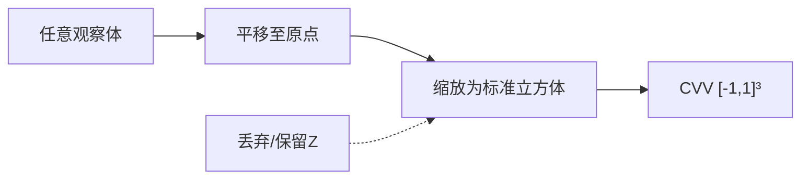

# 正交投影与规范观察体 (Orthographic Projection & Canonical View Volume)

---
requires: [计算机图形学（全英文）/3D Viewing Pipeline, 计算机图形学（全英文）/Viewing Coordinate System]
---

想象你站在一个无限大的玻璃窗前观察世界，如果所有视线都互相平行且垂直于窗户，你看到的画面会是什么样？没有近大远小，远处的楼和近处的树一样高。这就是正交投影的直观感受。但计算机怎么“看懂”这个画面？我们需要把千奇百怪的观察空间统一成一种标准形状。

## 正交投影与规范观察体是什么

在三维观察流水线中，我们首先在世界坐标系下定义了一个 **观察体（View Volume）**。对于正交投影，这个观察体是一个 ==轴对齐的长方体==，由六个平面界定：$x = x_{min},\; x = x_{max},\; y = y_{min},\; y = y_{max},\; z = z_{min},\; z = z_{max}$（这里的 $z$ 通常指观察坐标系下的深度方向）。

**正交投影（Orthographic Projection）** 的本质是将这个长方体内的点沿平行于观察方向（通常为 $z_v$ 轴）投射到投影平面上，直接丢弃深度信息或将其线性映射。

但每个场景的观察体大小、位置都不同，后续裁剪（Clipping）算法很难为每种尺寸单独写代码。怎么办？引入 **规范观察体（Canonical View Volume, CVV）**。

> [!IMPORTANT]
> 规范观察体是一个中心在原点、边长为 2 的标准立方体，范围是 $[-1, 1] \times [-1, 1] \times [-1, 1]$（部分教材深度取 $[0, 1]$，南邮课件以 $[-1,1]$ 为准）。

将任意正交观察体变换为 CVV 的过程，就是正交投影矩阵要完成的核心任务。

## 怎么做：推导正交投影矩阵

要把长方体变成 CVV，只需两步：**先平移，后缩放**。

1. **平移（Translation）**：将观察体的中心移到原点。中心坐标为 $\left(\frac{x_{min}+x_{max}}{2}, \frac{y_{min}+y_{max}}{2}, \frac{z_{min}+z_{max}}{2}\right)$，因此平移量取负值。
2. **缩放（Scaling）**：将各边长缩放到 2。$x$ 方向的缩放因子为 $s_x = \frac{2}{x_{max}-x_{min}}$，$y$、$z$ 同理。

组合起来，正交投影矩阵 $M_{ortho} = S \cdot T$：

$$
M_{ortho} = \begin{bmatrix} \frac{2}{x_{max}-x_{min}} & 0 & 0 & -\frac{x_{max}+x_{min}}{x_{max}-x_{min}} \\ 0 & \frac{2}{y_{max}-y_{min}} & 0 & -\frac{y_{max}+y_{min}}{y_{max}-y_{min}} \\ 0 & 0 & \frac{2}{z_{max}-z_{min}} & -\frac{z_{max}+z_{min}}{z_{max}-z_{min}} \\ 0 & 0 & 0 & 1 \end{bmatrix}
$$

> [!TIP]
> 记忆技巧：对角线永远是 `2 / (max - min)`，最后一列永远是 `-(max + min) / (max - min)`。分子分母别搞反！

## 算对了的例子

设观察体边界为 $x \in [0, 4],\; y \in [0, 2],\; z \in [-2, 2]$。求点 $P(2, 1, 0)$ 投影后的规范化坐标。

- $s_x = 2/4 = 0.5$，$t_x = -(4+0)/4 = -1$
- $s_y = 2/2 = 1$，$t_y = -(2+0)/2 = -1$
- $s_z = 2/4 = 0.5$，$t_z = -(2-2)/4 = 0$

代入计算：
$x' = 0.5 \times 2 + (-1) = 0$
$y' = 1 \times 1 + (-1) = 0$
$z' = 0.5 \times 0 + 0 = 0$

结果 $(0, 0, 0)$，正好是 CVV 的中心，符合直觉（因为 $P$ 原本就在观察体中心）。

## 与透视投影的区别及常见坑

| 对比维度 | 正交投影 (Orthographic) | 透视投影 (Perspective) |
| :--- | :--- | :--- |
| **观察体形状** | 长方体 (Box) | 视锥体 (Frustum) |
| **投影线** | 互相平行 | 交于一点 (COP) |
| **近大远小** | 无 | 有 |
| **CVV 变换** | 仅平移+缩放 | 需非线性透视除法 |

> [!WARNING]
> 易错坑：正交投影矩阵虽然改变了 $z$ 的数值范围，但它 ==不会改变物体间的深度相对顺序==。而在透视投影中，经过透视除法后深度的映射是非线性的。

> [!CAUTION]
> 高危误区：写矩阵时忘记齐次坐标的第四行必须是 $[0, 0, 0, 1]$；或者在算 $t_x$ 时漏掉负号，导致整个观察体偏移到 CVV 外面被裁剪掉。
