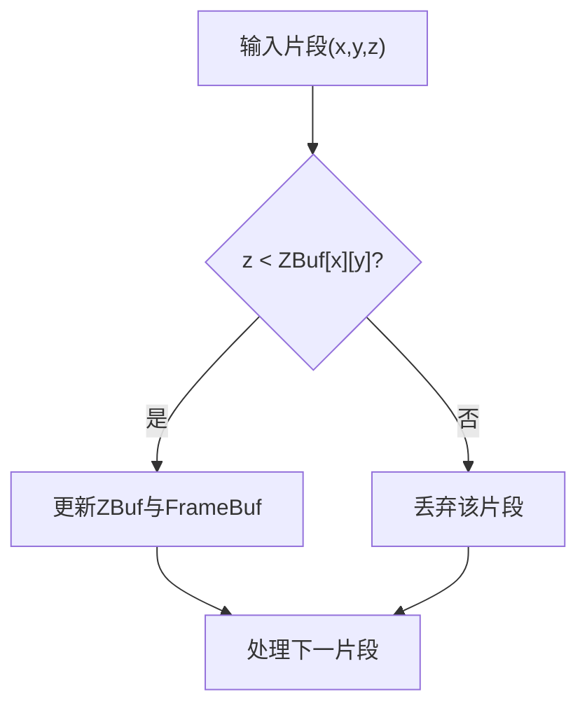

# Z-Buffer深度测试算法 (Z-Buffer / Depth Testing Algorithm)

## 为什么需要深度测试

当多个三维物体投影到同一屏幕像素时，如何确定哪个物体“在前面”？如果仅按绘制顺序处理，后画的物体会无条件覆盖先画的，导致遮挡关系错误。==Z-Buffer 算法正是为解决可见性判定而生的图像空间方法==，它不依赖物体绘制顺序，而是逐像素比较深度值，确保最终帧缓存中只保留离视点最近的表面颜色。

## 算法核心流程

Z-Buffer 维护两个与屏幕等大的缓冲区：帧缓存（Frame Buffer）存颜色，深度缓存（Z-Buffer）存当前最近深度 $z_{\min}$。对每个待光栅化的片段 $(x, y, z)$，执行以下判断：

> [!IMPORTANT]
> ==深度测试本质是“保留最小 z 值”的逐像素竞争机制==，与物体绘制顺序无关。

初始化时，Z-Buffer 所有位置设为最大深度值（如远裁剪面 $z_f$），帧缓存设为背景色。每当一个三角形被光栅化生成片段，就将其插值得到的 $z$ 与 Z-Buffer 对应位置比较：若新 $z$ 更小，说明更靠近视点，则同时更新深度和颜色；否则直接丢弃。

## 与画家算法的区别

| 特性 | Z-Buffer | 画家算法（Painter's Algorithm） |
| :--- | :--- | :--- |
| 排序依赖 | 无需预排序 | 必须按深度从远到近排序 |
| 循环遮挡 | 正确处理 | 无法处理相互穿透或循环遮挡 |
| 内存开销 | 需额外深度缓存 | 仅需帧缓存 |
| 时间复杂度 | $O(n \cdot p)$，$p$ 为像素数 | $O(n \log n + n \cdot p)$，含排序开销 |

> [!NOTE]
> 画家算法在复杂场景中易出错且效率低，现代 GPU 普遍采用 Z-Buffer 作为默认可见性解决方案。

## 常见陷阱与注意事项

> [!WARNING]
> 深度精度非线性！由于透视投影下 $z$ 与屏幕空间呈双曲线关系，==近处精度高、远处精度低==，可能导致远处物体出现 Z-Fighting（深度冲突闪烁）。

> [!CAUTION]
> 切勿将 Z-Buffer 初始化为 0。若使用标准化设备坐标（NDC），$z \in [-1,1]$，应初始化为 $+1$；若使用窗口坐标 $z \in [0,1]$，则初始化为 $1.0$。错误初始化会导致所有物体被误判为“更远”而被剔除。

## 正确计算示例

假设屏幕某像素 $(100, 200)$ 当前 Z-Buffer 值为 $0.6$。先后到达两个片段：

- 片段 A：$z = 0.55$
- 片段 B：$z = 0.65$

处理 A 时，$0.55 < 0.6$，更新 Z-Buffer 为 $0.55$，写入 A 的颜色；  
处理 B 时，$0.65 > 0.55$，丢弃 B。  
最终该像素显示 A 的颜色，符合物理遮挡关系。

> [!TIP]
> 考试中若给出多个片段的 $z$ 值和绘制顺序，只需模拟上述比较过程，无需考虑几何位置——==Z-Buffer 只看数值大小，不看绘制先后==。
