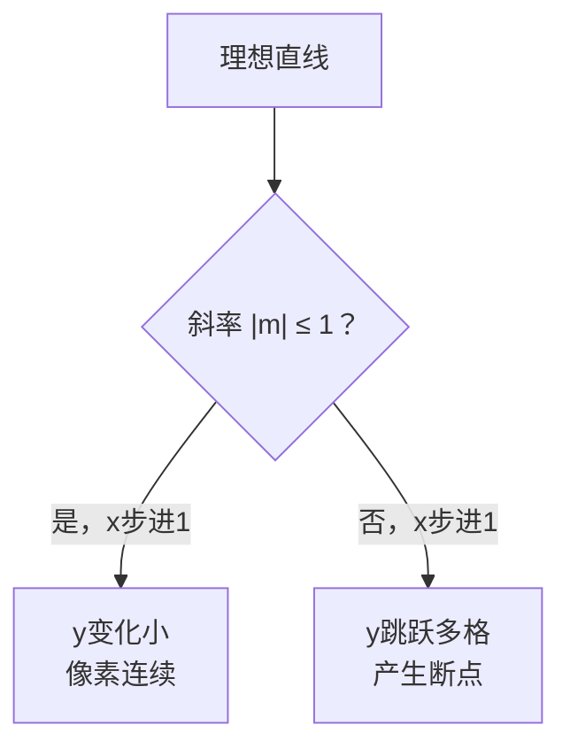
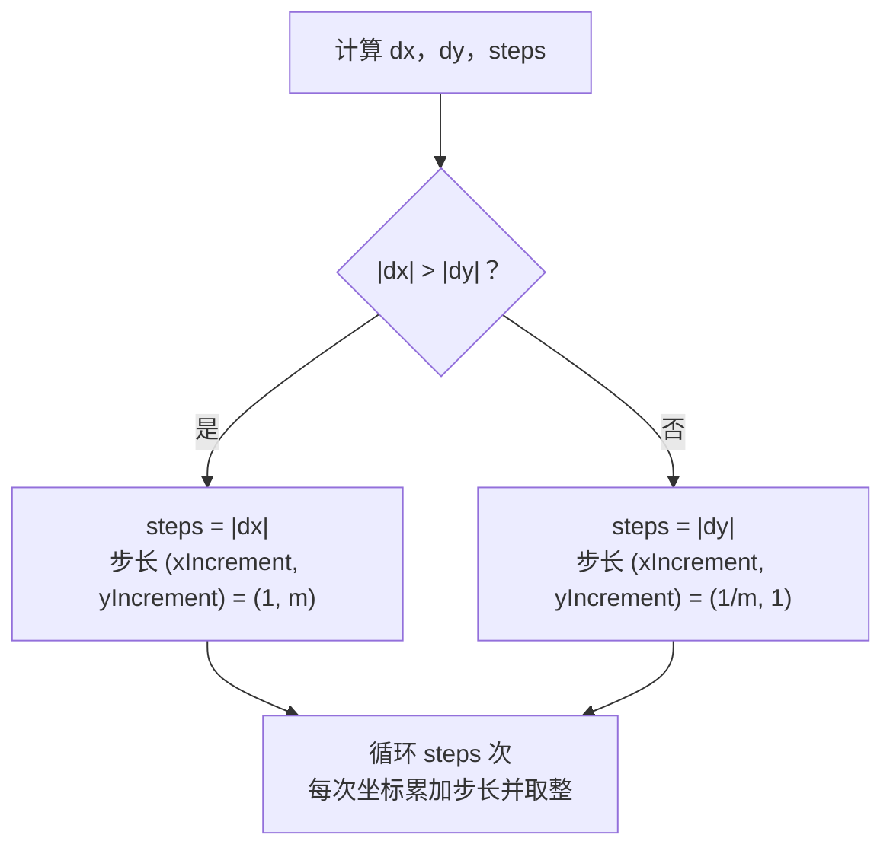
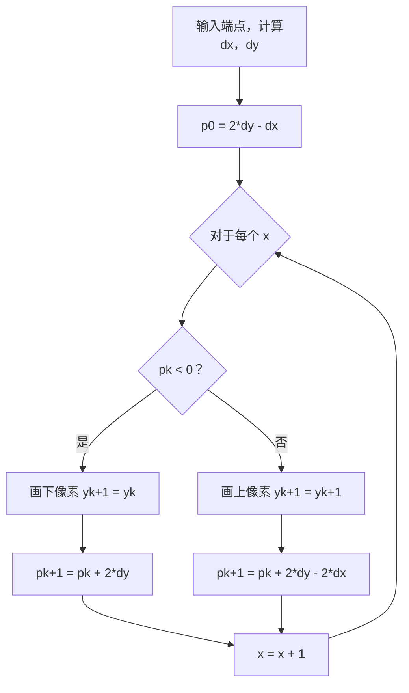

# 点(Point)与直线(Line)的绘制

在计算机图形学中，屏幕由成千上万个离散的像素点构成。我们需要找到一种方法，将几何上“理想”的、无限精细的点与直线，转化为屏幕上最逼近它们的像素集合。这个过程，就是我们探讨的==点与直线的绘制==，又称==光栅化==。

## 为什么需要专门的算法？

你可能觉得，直线方程 $y = mx + b$ 我们都很熟悉，直接代入 $x$ 算 $y$，然后四舍五入不就行了？

让我们试试看：绘制从 $(0,0)$ 到 $(5,2)$ 的线段。斜率 $m = 0.4$。

- $x=0 \Rightarrow y=0$ ➡️ 像素 $(0,0)$
- $x=1 \Rightarrow y=0.4$ ➡️ 像素 $(1,0)$
- $x=2 \Rightarrow y=0.8$ ➡️ 像素 $(2,1)$
- $x=3 \Rightarrow y=1.2$ ➡️ 像素 $(3,1)$
- $x=4 \Rightarrow y=1.6$ ➡️ 像素 $(4,2)$
- $x=5 \Rightarrow y=2.0$ ➡️ 像素 $(5,2)$

用这段 `Java` 风格伪代码来直观感受一下：

```java
for (int x = x0; x <= x1; x++) {
    float y = m * x + b;
    int pixelY = Math.round(y);  // 四舍五入取整
    setPixel(x, pixelY);
}
```

> [!WARNING]
> **严重的性能和精度问题**
> 1.  每步都进行**浮点乘法**和**取整运算**，计算成本高昂。
> 2.  当斜率 $|m| > 1$ 时，$x$ 每增加1，$y$ 可能跳跃多个像素，导致绘出的直线出现“断点”，像虚线一样。



因此，我们需要高效、精确且能处理所有斜率情况的整数算法，这就是 **DDA 算法** 和经典的 **Bresenham 算法**。

## DDA 算法：增量法的思想

DDA（数字微分分析仪）算法的核心，是==用加法取代乘法==。

它不再孤立地计算每个 $y$，而是利用前一个点的 $y$ 值，递推得到下一个点：
$$y_{i+1} = y_i + m$$

**该算法的精妙之处在于：**
1.  **判断“主导轴”**：比较 $|dx|$ 和 $|dy|$。
    - 如果 $|dx| \ge |dy|$，说明直线在 $x$ 轴方向变化更快，我们让 $x$ 每一步增加 1（步长 $=1$），$y$ 每一步增加 $m$（步长 $=m$）。
    - 如果 $|dx| < |dy|$，说明直线在 $y$ 轴方向变化更快，我们让 $y$ 每一步增加 1（步长 $=1$），$x$ 每一步增加 $1/m$（步长 $=1/m$）。
2.  **像素选择**：每一步计算出的浮点坐标 $(x, y)$，通过 `round()` 取整得到最接近的整数像素坐标。



> [!TIP]
> **记忆口诀：谁长谁主导。** 在主导轴方向步进恒为 1，另一轴按斜率增量累加。

## Bresenham 算法：纯粹整数的艺术

Bresenham 算法是对 DDA 的进一步优化，它彻底消灭了浮点运算，==仅用整数加减和位运算==就完成了直线的绘制，是计算机图形学领域的标杆算法。

### 它是怎么做到的？（以 $0 < m < 1$ 为例）

此类情况下，$x$ 是主导轴，像素位置 $x_{k+1} = x_k + 1$。关键是如何决定 $y_{k+1}$ 的值。

当 $x$ 从 $x_k$ 走到 $x_k+1$ 时，理想直线与横线 $y=y_k$ 的交点会有两个候选像素：
- **下像素**： $(x_k+1, y_k)$
- **上像素**： $(x_k+1, y_k+1)$

选择哪一个，取决于谁离真实直线交点更近。我们引入一个**决策参数** $p_k$，它能通过一个巧妙的==整数递推公式==更新，其符号直接告诉我们该选哪个像素。

核心推导步骤：
1.  根据直线方程，计算两个候选像素与真实点之间的垂直距离之差，其初始符号决定了初始决策参数。
2.  通过一系列恒等变换，可以推导出 $p_{k}$ 的纯整数递推公式。

对于一条从 $(x_0, y_0)$ 开始的直线，Bresenham 算法的流程如下：



> [!IMPORTANT]
> **Bresenham 算法的灵魂在于决策参数**
> - 其初始值: $p_0 = 2\Delta y - \Delta x$（仅用于斜率 $0 < m < 1$ 的通用公式）。
> - 递推过程中：
>   - 若 $p_k < 0$，选下像素，则 $p_{k+1} = p_k + 2\Delta y$
>   - 若 $p_k \ge 0$，选上像素，则 $p_{k+1} = p_k + 2\Delta y - 2\Delta x$
> 注意：这只是第一象限斜率小于1的特殊情况，但理解了它，就掌握了算法的精髓。其他七分象限的情况可以通过对称性映射到此情况处理。

## 算对为止：一个手算例子

用 Bresenham 算法绘制从 $(0,0)$ 到 $(6,2)$ 的直线。
1.  计算初始值：
    $dx = 6, dy = 2$。
    初始决策参数 $p_0 = 2dy - dx = 2 \times 2 - 6 = -2$。
2.  迭代计算：
| $k$ | $p_k$ | $p_k < 0$? | $x_{k+1}$ | $y_{k+1}$ | $p_{k+1}$ (更新)                  |
| :-- | :---- | :--------- | :-------- | :-------- | :-------------------------------- |
| 0   | -2    | 是         | 1         | 0         | $p_1 = -2 + 2\times2 = 2$         |
| 1   | 2     | 否         | 2         | 1         | $p_2 = 2 + 2\times2 - 2\times6 = -6$ |
| 2   | -6    | 是         | 3         | 1         | $p_3 = -6 + 2\times2 = -2$        |
| 3   | -2    | 是         | 4         | 1         | $p_4 = -2 + 2\times2 = 2$         |
| 4   | 2     | 否         | 5         | 2         | $p_5 = 2 + 2\times2 - 2\times6 = -6$ |
| 5   | -6    | 是         | 6         | 2         | *(算法结束)*                      |
3.  绘制的像素点为：$(0,0), (1,0), (2,1), (3,1), (4,1), (5,2), (6,2)$。这与我们直观感受应绘制的点完全一致，且整个过程没有涉及任何浮点数。

## 常见误区辨析

[!CAUTION]
> 1.  **混淆算法与硬件**：现代 GPU 内部有专为光栅化设计的硬件单元，其实现远比基本算法复杂高效。我们学习这些算法是为了理解图形渲染的==核心原理与思维范式==。
> 2.  **Bresenham 算法公式的死记硬背**：表格中的公式仅适用于特定象限和斜率。考试常考的陷阱是给出其他象限的线段。**正确的应对方法是**：掌握利用**对称性**将任意线段映射到第一象限 $0<m<1$ 情况的方法，然后根据映射关系推导候选像素和决策参数的符号。
> 3.  **直线属性设置**：这些算法只负责“点亮”哪些像素。像素的**颜色、宽度、线型（实线、虚线）**等属性，是在光栅化阶段由其他管线单元（如像素着色器）并行处理完成的。
