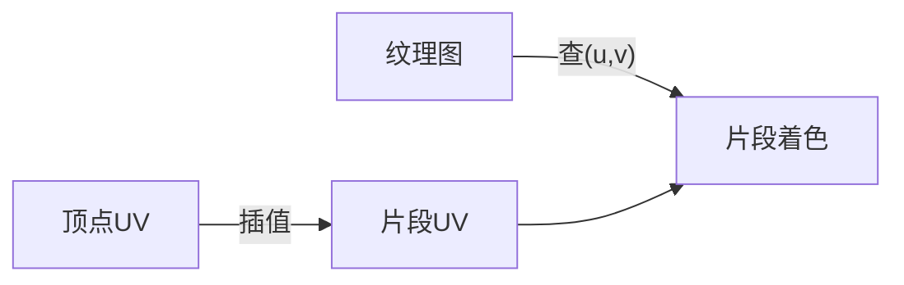

# 纹理坐标UV与纹理映射原理 (Texture Coordinates & Texture Mapping)

纹理映射要解决的核心问题是：==如何把一张 2D 图片“贴”到 3D 模型表面？== 如果只靠顶点颜色，想表现木纹、砖墙等复杂细节就需要海量多边形。纹理映射允许我们用高分辨率图像增加表面细节，而不增加几何复杂度。

## 纹理坐标 UV 是什么

每个顶点除了位置 $(x, y, z)$，还要额外存一对 ==纹理坐标 $(u, v)$==。它们定义了该顶点在纹理图像上的采样位置。

> [!IMPORTANT]
> $u, v$ 是归一化坐标，取值范围通常为 $[0, 1]$，与纹理的实际像素分辨率无关。

- **原点**：$(0,0)$ 通常在纹理左下角（OpenGL 默认）。
- **方向**：$u$ 向右递增，$v$ 向上递增。

## 映射原理：从顶点到像素

光栅化后，三角形内部每个 Fragment 都需要一个 $(u, v)$ 来查纹理。这个值不是随便给的，而是通过 ==重心坐标插值（Barycentric Interpolation）== 算出来的。

设三角形三顶点纹理坐标为 $(u_0,v_0), (u_1,v_1), (u_2,v_2)$，某 Fragment 的重心坐标为 $(\alpha, \beta, \gamma)$ 且 $\alpha+\beta+\gamma=1$，则：

$$u = \alpha u_0 + \beta u_1 + \gamma u_2$$
$$v = \alpha v_0 + \beta v_1 + \gamma v_2$$

拿到插值后的 $(u, v)$，再乘以纹理宽高即可定位具体 Texel（纹理像素），结合过滤方式（如双线性过滤 Bilinear Filtering）得到最终颜色。

> [!TIP]
> 记忆口诀：**顶点定 UV，光栅做插值，片段查纹理**。

## 一个算对了的例子

已知屏幕空间三角形三顶点及其纹理坐标：

| 顶点 | 屏幕坐标 | 纹理坐标 $(u,v)$ |
| :--: | :------: | :--------------: |
| $V_0$ | $(0,0)$ | $(0.0, 0.0)$ |
| $V_1$ | $(4,0)$ | $(1.0, 0.0)$ |
| $V_2$ | $(0,4)$ | $(0.0, 1.0)$ |

求 Fragment $P(1,1)$ 处的纹理坐标。

**Step 1**：求重心坐标。由面积比或解方程可得 $P(1,1)$ 对应的重心坐标为 $\alpha=0.5,\; \beta=0.25,\; \gamma=0.25$（验证：$0.5+0.25+0.25=1$）。

**Step 2**：代入插值公式。

$$u = 0.5 \times 0.0 + 0.25 \times 1.0 + 0.25 \times 0.0 = 0.25$$
$$v = 0.5 \times 0.0 + 0.25 \times 0.0 + 0.25 \times 1.0 = 0.25$$

所以 $P$ 点采样纹理的位置为 $(0.25, 0.25)$。若纹理大小为 $256 \times 256$，则对应 Texel 索引约为 $(64, 64)$。

## 相近概念辨析与常见坑

| 对比项 | 纹理坐标 (Texture Coordinates) | 屏幕坐标 (Screen Coordinates) |
| :--- | :--- | :--- |
| 维度 | 2D $(u,v)$ | 2D/3D $(x,y,z)$ |
| 范围 | 通常 $[0,1]$ | 视口像素大小 |
| 作用 | 索引纹理图像 | 决定画在屏幕哪里 |

> [!WARNING]
> **透视失真陷阱**：直接在屏幕空间对 $(u,v)$ 做线性插值会导致远处纹理被压缩变形。正确做法是对 $\frac{u}{w}, \frac{v}{w}, \frac{1}{w}$ 分别线性插值，最后除以插值后的 $\frac{1}{w}$ 还原，这叫 ==透视校正插值（Perspective-Correct Interpolation）==。

> [!CAUTION]
> **UV 越界**：当计算出的 $u$ 或 $v$ 不在 $[0,1]$ 内时，必须指定环绕模式（Wrap Mode），如 Repeat（重复）、Clamp（截断至边缘），否则会出现未定义行为或黑边。
