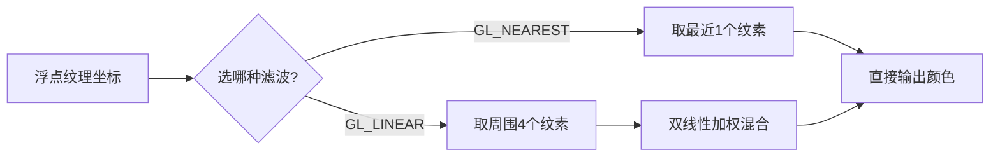

# 纹理放大缩小滤波 GL_NEAREST与GL_LINEAR (Texture Filtering: Nearest & Linear)

纹理映射时，片元（fragment）的纹理坐标 $(s, t)$ 通常是浮点数，而纹素（texel）存储在离散的二维数组中。当屏幕像素与纹素无法一一对应时，OpenGL 该如何决定最终颜色？这就引出了==纹理滤波（Texture Filtering）==。

## 为什么需要纹理滤波

想象把一张 $64 \times 64$ 的小贴图贴满整个屏幕：一个像素可能覆盖不到一个纹素，此时需要“放大”；反之，若将 $4K$ 贴图缩到图标大小，多个纹素挤进一个像素，此时需要“缩小”。无论放大（Magnification）还是缩小（Minification），都需要一种规则来从离散纹素中算出连续的颜色值。

> [!IMPORTANT]
> `GL_NEAREST` 与 `GL_LINEAR` 就是 OpenGL 提供的两种基础滤波策略，分别对应**最近邻采样**与**双线性插值**。

通过 `glTexParameteri` 设置：

```cpp
glTexParameteri(GL_TEXTURE_2D, GL_TEXTURE_MAG_FILTER, GL_LINEAR); // 放大
glTexParameteri(GL_TEXTURE_2D, GL_TEXTURE_MIN_FILTER, GL_NEAREST); // 缩小
```

## 两种滤波怎么做

- **`GL_NEAREST`（最近邻）**：取纹理坐标映射到的、距离最近的==单个纹素==颜色。计算快，但放大后呈现明显马赛克（锯齿）。
- **`GL_LINEAR`（双线性插值）**：取纹理坐标周围==四个相邻纹素==，按距离做两次线性插值，得到平滑过渡。



设归一化后的纹理坐标落在纹素网格上，其周围四个纹素中心分别为 $(i, j)$、$(i+1, j)$、$(i, j+1)$、$(i+1, j+1)$。令小数偏移量 $\alpha = s - i$，$\beta = t - j$。

`GL_LINEAR` 的插值公式为：

$$C = (1-\alpha)(1-\beta)C_{i,j} + \alpha(1-\beta)C_{i+1,j} + (1-\alpha)\beta C_{i,j+1} + \alpha\beta C_{i+1,j+1}$$

其中 $C_{i,j}$ 表示对应位置纹素的 RGBA 颜色值。

## 对比辨析

| 特性 | `GL_NEAREST` | `GL_LINEAR` |
| :--- | :--- | :--- |
| 采样数量 | 1 个纹素 | 4 个纹素 |
| 视觉效果 | 锯齿/马赛克 | 平滑/模糊 |
| 计算开销 | 低 | 较高（需插值） |
| 适用场景 | 像素风游戏、UI 图标 | 3D 场景、写实渲染 |

> [!NOTE]
> 两者既可用于放大（`MAG_FILTER`），也可用于缩小（`MIN_FILTER`）。但缩小滤波还支持 Mipmap 相关枚举（如 `GL_LINEAR_MIPMAP_LINEAR`），而放大滤波**只允许** `GL_NEAREST` 或 `GL_LINEAR`。

## 手算示例

假设某纹理坐标映射到四个相邻纹素，小数偏移 $\alpha = 0.25$，$\beta = 0.75$，四个纹素灰度值如下：

- $C_{i,j} = 100$（左下）
- $C_{i+1,j} = 200$（右下）
- $C_{i,j+1} = 150$（左上）
- $C_{i+1,j+1} = 250$（右上）

代入双线性插值公式：

$$C = (1-0.25)(1-0.75) \times 100 + 0.25 \times (1-0.75) \times 200 + (1-0.25) \times 0.75 \times 150 + 0.25 \times 0.75 \times 250$$

$$C = 0.75 \times 0.25 \times 100 + 0.25 \times 0.25 \times 200 + 0.75 \times 0.75 \times 150 + 0.25 \times 0.75 \times 250$$

$$C = 18.75 + 12.5 + 84.375 + 46.875 = ==162.5==$$

若用 `GL_NEAREST`，因为 $\alpha=0.25 < 0.5$ 且 $\beta=0.75 \geq 0.5$，最近的纹素是左上角 $(i, j+1)$，结果直接为 $150$。

> [!WARNING]
> 计算权重时务必确认 $\alpha$、$\beta$ 是相对于**左下角纹素中心**的小数部分，而非全局坐标。搞错基准点会导致四个权重分配完全颠倒。

> [!TIP]
> 记忆口诀：**N 取一，L 取四；N 锐利，L 平滑。** 考试遇到插值计算，先画 $2 \times 2$ 格子标好 $\alpha$（水平）、$\beta$（垂直），再套公式不易出错。
