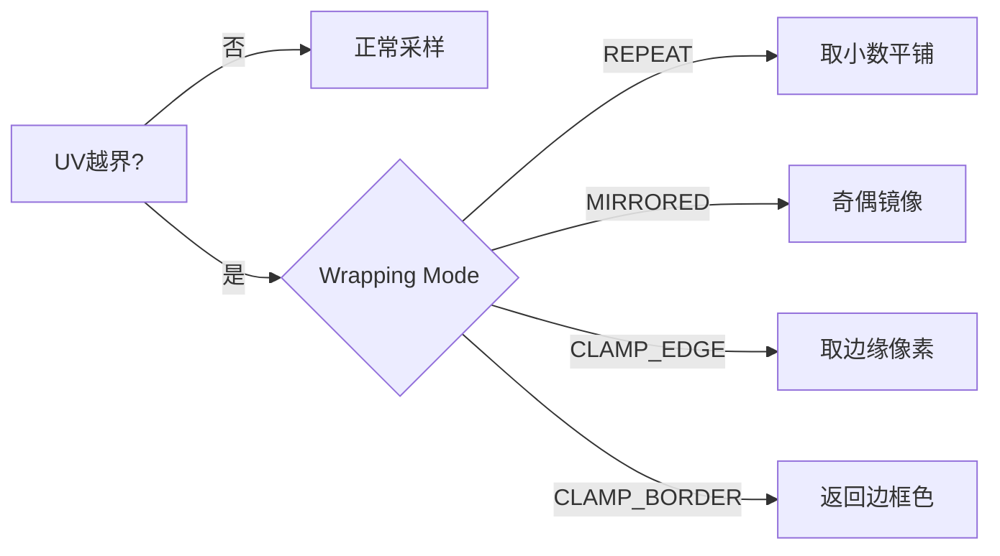

# 纹理环绕方式 GL_REPEAT等 (Texture Wrapping Modes)

## 什么是纹理环绕方式

当纹理坐标 $(s, t)$ 超出 $[0, 1]$ 标准范围时，GPU 如何确定采样颜色？这就是纹理环绕（Texture Wrapping）要解决的问题。若未显式设置，OpenGL 默认使用 `GL_REPEAT`，但不同场景需要不同策略来避免视觉瑕疵或实现特定效果。

> [!IMPORTANT]
> ==环绕模式仅对超出 [0,1] 的纹理坐标生效==，范围内坐标始终正常采样。

## 四种核心环绕模式对比

| 模式 | 枚举值 | 越界行为 | 典型应用 |
| :--- | :--- | :--- | :--- |
| Repeat | `GL_REPEAT` | 取小数部分，平铺重复 | 砖墙、草地、地砖 |
| Mirrored Repeat | `GL_MIRRORED_REPEAT` | 整数部分奇偶决定镜像 | 对称图案、减少接缝 |
| Clamp to Edge | `GL_CLAMP_TO_EDGE` | 钳制到 [0,1]，取边缘像素 | UI 贴图、天空盒边缘 |
| Clamp to Border | `GL_CLAMP_TO_BORDER` | 越界返回预设边框色 | 阴影图、高光遮罩 |



## 如何正确设置

通过 `glTexParameteri` 分别指定 S/T/R 轴的环绕方式：

```cpp
glTexParameteri(GL_TEXTURE_2D, GL_TEXTURE_WRAP_S, GL_CLAMP_TO_EDGE);
glTexParameteri(GL_TEXTURE_2D, GL_TEXTURE_WRAP_T, GL_REPEAT);
```

> [!WARNING]
> `GL_CLAMP_TO_BORDER` 必须配合 `glTexParameterfv(GL_TEXTURE_2D, GL_TEXTURE_BORDER_COLOR, borderColor)` 设置边框颜色，否则返回值未定义。

## 计算示例：Mirrored Repeat 采样

设 `GL_MIRRORED_REPEAT`，纹理宽度 4 像素，求 $s = 2.3$ 对应的实际采样坐标。

**步骤：**

1.  取绝对值：$|2.3| = 2.3$
2.  整数部分 $\lfloor 2.3 \rfloor = 2$（偶数）→ 不镜像
3.  小数部分：$\text{frac}(2.3) = 0.3$
4.  最终采样坐标：$s' = 0.3$

若 $s = 3.7$：整数部分 3（奇数）→ 镜像，$s' = 1.0 - 0.7 = 0.3$。

> [!TIP]
> 记忆口诀：==偶正奇反，只取小数==。Mirrored 本质是周期为 2 的三角波函数。

## 常见坑与辨析

-   **Clamp to Edge ≠ Clamp to Border**：前者永远取纹理最外圈像素，后者才用自定义颜色。UI 圆角贴图误用 Border 会出现黑边。
-   **Mipmap + Clamp to Edge**：低层级 Mipmap 可能因缩小而丢失边缘信息，导致远处物体边缘闪烁。解决方案：生成 Mipmap 前对纹理做 padding 或使用 `GL_CLAMP_TO_EDGE` 配合 `GL_TEXTURE_MAX_LEVEL` 限制层级。
-   **NPOT 纹理**：非 2 的幂纹理在旧硬件上不支持 `GL_REPEAT`，现代 OpenGL ES 3.0+ 已解除此限制，但考试仍可能考查历史兼容性。
-   **浮点精度**：$s = 1.0$ 恰好等于边界时，`GL_REPEAT` 会映射回 0.0，可能导致接缝处双线性插值混合首尾像素。==无缝平铺需确保纹理本身是 tileable 的==。

> [!CAUTION]
> 考试中若题目给出 $s < 0$ 的情况，务必先取绝对值再判断奇偶，负数直接取模会得到错误结果。
