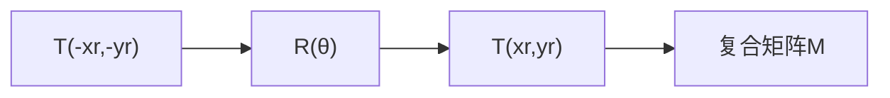

# 绕任意基准点旋转 (Rotation About an Arbitrary Pivot Point)

## 什么是绕任意基准点旋转

在二维几何变换中，标准旋转变换矩阵 $R(\theta)$ 默认以==坐标原点 $(0,0)$== 为旋转中心。但在实际图形应用中，物体往往需要绕自身中心或某个特定锚点转动。若直接套用原点旋转公式，物体会绕原点公转并发生非预期平移，而非原地自转。因此，我们需要一种复合变换策略来实现绕任意基准点 $(x_r, y_r)$ 的旋转。

## 为什么不能直接旋转

试想：如果旋转中心不是原点，点的坐标与旋转轴之间还存在偏移量，这个偏移量在旋转时会如何影响最终位置？直接应用 $R(\theta)$ 会丢失这部分偏移信息。解决思路是将“复杂问题”转化为“已解决的问题”：既然我们只会绕原点转，那就先把目标点搬到原点，转完再搬回去。

> [!IMPORTANT]
> ==核心策略：Translate-Rotate-Translate Back==
> 绕任意点 $(x_r, y_r)$ 旋转 $\theta$ 角，等价于三步复合变换：先平移至原点，再绕原点旋转，最后反向平移回原位置。

## 复合变换矩阵推导

设旋转基准点为 $P_r(x_r, y_r)$，旋转角度为 $\theta$，则完整变换矩阵 $M$ 由三个基本矩阵按==从右到左==的顺序相乘得到：

$$
M = T(x_r, y_r) \cdot R(\theta) \cdot T(-x_r, -y_r)
$$

展开后得到通用公式：

$$
M = \begin{bmatrix}
\cos\theta & -\sin\theta & x_r(1-\cos\theta) + y_r\sin\theta \\
\sin\theta & \cos\theta & y_r(1-\cos\theta) - x_r\sin\theta \\
0 & 0 & 1
\end{bmatrix}
$$

> [!WARNING]
> 矩阵乘法顺序==不可交换==！必须严格按照 $T_{back} \cdot R \cdot T_{to\_origin}$ 从右向左组合。顺序颠倒会导致旋转中心错误，结果完全偏离预期。

## 与原点旋转的区别

| 对比项 | 绕原点旋转 | 绕任意点旋转 |
| :--- | :--- | :--- |
| 变换矩阵 | $3\times3$ 纯旋转块 | 含平移分量的复合矩阵 |
| 固定不动点 | 仅 $(0,0)$ | 指定基准点 $(x_r,y_r)$ |
| 计算复杂度 | 低 | 需额外两次平移运算 |
| 应用场景 | 坐标系整体旋转 | 物体局部自转、UI控件旋转 |

## 计算示例与验算

将点 $A(4, 2)$ 绕基准点 $P_r(1, 1)$ 逆时针旋转 $90^\circ$。

代入公式：$\cos90^\circ=0, \sin90^\circ=1, x_r=1, y_r=1$

$$
M = \begin{bmatrix}
0 & -1 & 1(1-0)+1\cdot1 \\
1 & 0 & 1(1-0)-1\cdot1 \\
0 & 0 & 1
\end{bmatrix} = \begin{bmatrix}
0 & -1 & 2 \\
1 & 0 & 0 \\
0 & 0 & 1
\end{bmatrix}
$$

对 $A$ 应用变换：$x' = 0\times4 + (-1)\times2 + 2 = 0$，$y' = 1\times4 + 0\times2 + 0 = 4$，得 $A'(0, 4)$。

> [!TIP]
> 快速验算技巧：旋转前后点到基准点的距离应保持不变。验证：$|AP_r| = \sqrt{(4-1)^2+(2-1)^2}=\sqrt{10}$，$|A'P_r|=\sqrt{(0-1)^2+(4-1)^2}=\sqrt{10}$，结果正确。

> [!CAUTION]
> 角度方向务必确认：教材约定==逆时针为正==。若题目给顺时针角度，须取负值代入三角函数，否则符号全反。
