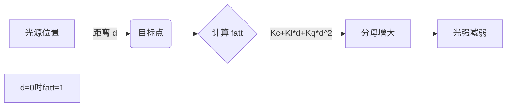

# 光源距离衰减与聚光灯效果 (Distance Attenuation & Spotlights)

# 光源距离衰减与聚光灯效果 (Distance Attenuation & Spotlights)

在真实感渲染中，点光源并非无限远，其强度随距离减弱；聚光灯则具有方向性和锥形照射范围。理解这两者是将“理想光照”转化为“物理可信图像”的关键。

## 为什么需要距离衰减？

现实世界中，光强遵循**平方反比定律**。若忽略衰减，场景远处物体将与近处一样亮，导致深度感丧失。
==核心结论==：衰减因子 $f_{att}$ 用于模拟光能扩散，使光照随距离 $d$ 增加而自然减弱。

常用线性组合模型计算衰减系数：
$$ f_{att} = \frac{1}{K_c + K_l d + K_q d^2} $$
其中 $K_c, K_l, K_q$ 分别为常数、线性、二次项系数。

> [!IMPORTANT]
> 当 $d=0$ 时，$f_{att}=1$（无衰减）。随着 $d$ 增大，分母迅速变大，$f_{att}$ 趋近于 0。

## 聚光灯效应如何实现？

聚光灯（Spotlight）不仅有点光源的位置，还有**方向** $\vec{s}$ 和**切角** $\phi$（Cutoff Angle）。只有当光线方向 $\vec{l}$ 与聚光轴 $\vec{s}$ 的夹角 $\theta$ 小于 $\phi$ 时，物体才被照亮。

引入聚光指数 $S_{exp}$（Shininess-like exponent）控制光束边缘的柔和度：
$$ I_{spot} = (\max(0, \vec{l} \cdot \vec{s}))^{S_{exp}} $$
- $\vec{l} \cdot \vec{s} = \cos \theta$
- $S_{exp}$ 越大，光束越集中，边缘越锐利。

## 综合光照计算

最终的光照强度是环境光、漫反射、镜面反射与衰减、聚光因子的乘积：
$$ I = I_{light} \cdot f_{att} \cdot I_{spot} \cdot (K_a + K_d (\vec{n}\cdot\vec{l}) + K_s (\vec{r}\cdot\vec{v})^n) $$

> [!TIP]
> **解题步骤**：
> 1. 计算向量 $\vec{l}$（光指向点）和 $\vec{s}$（聚光轴）。
> 2. 判断 $\vec{l} \cdot \vec{s}$ 是否大于 $\cos \phi$。若否，光照为 0。
> 3. 计算距离 $d$ 和 $f_{att}$。
> 4. 代入 Phong 模型公式。

## 常见误区与辨析

| 概念 | 关键点 | 易错坑 |
| :--- | :--- | :--- |
| **距离衰减** | 仅与距离 $d$ 有关 | 误将衰减应用于平行光（平行光 $d=\infty$，无衰减） |
| **聚光指数** | 控制光束集中度 | 混淆 $S_{exp}$ 与镜面反射指数 $n$ |
| **向量方向** | $\vec{l}$ 是从**点指向光源**还是**光源指向点**？ | 需与课件定义一致，通常 $\vec{l}$ 指向光源，$\vec{s}$ 为发射方向，点积需注意符号 |

> [!WARNING]
> **向量归一化**：在进行点积运算前，务必确保 $\vec{l}, \vec{s}, \vec{n}, \vec{v}$ 均为**单位向量**，否则 $\cos \theta$ 计算错误。

## 典型例题解析

**题目**：点光源位于 $(0,0,0)$，聚光轴沿 $z$ 轴正向 $\vec{s}=(0,0,1)$，切角 $\phi=60^\circ$，$S_{exp}=2$。衰减系数 $K_c=1, K_l=0, K_q=0$。求点 $P(0,0,2)$ 处的聚光因子和衰减因子。

**解析**：
1.  **距离**：$d = \|P - L\| = 2$。
2.  **衰减**：$f_{att} = \frac{1}{1 + 0 + 0} = 1$（注意：若 $K_q=0, K_l=0$，则无衰减，此处假设仅为演示，若 $K_q=1$ 则为 $1/5$）。*修正：通常考题会给出非零衰减，假设 $K_q=1$，则 $f_{att} = 1/(1+4) = 0.2$。*
3.  **光向量**：$\vec{l}$ 从 $P$ 指向 $L$ 为 $(0,0,-2)$，单位化 $\vec{l}=(0,0,-1)$。但聚光轴 $\vec{s}$ 是发射方向。若定义为从光源发出，$\vec{l}_{dir} = (0,0,1)$。
4.  **点积**：$\vec{l}_{dir} \cdot \vec{s} = 1$。$\cos \theta = 1 > \cos 60^\circ (0.5)$，在锥内。
5.  **聚光因子**：$I_{spot} = 1^2 = 1$。

==核心高亮==：若点 $P$ 移至 $(1,0,2)$，$\vec{l}_{dir}=(1,0,2)$，单位化后与 $\vec{s}$ 点积变小，可能超出切角或强度降低。
