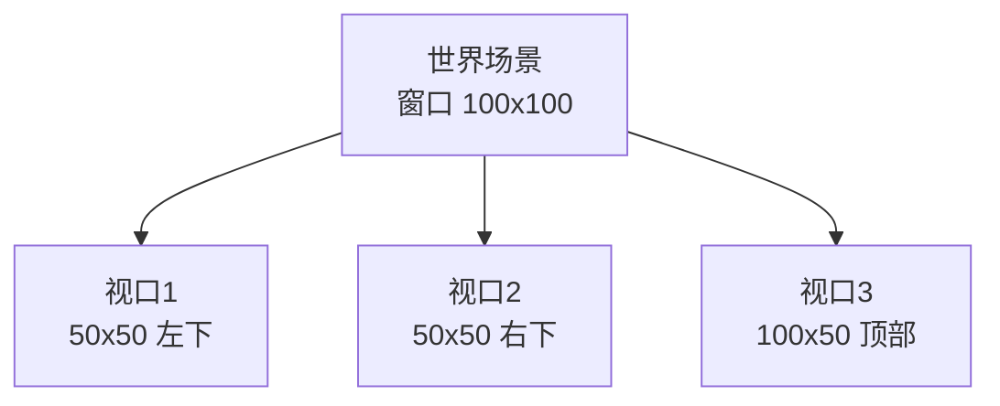

# 观察坐标系与窗口-视口映射 (Viewing Coordinate System & Window-to-Viewport Mapping)

## 观察坐标系与窗口-视口映射

先想一个问题：你有一个三维世界里的物体，最终要显示到屏幕上。屏幕是二维的、有固定分辨率；而你的场景可能很大，用户只想看其中一部分。==这一“看”的动作，就是把世界里的某个矩形区域映射到屏幕上的某个矩形区域==。前者叫**窗口（Window）**，后者叫**视口（Viewport）**。

### 为什么需要窗口和视口分离

- **窗口**定义在**世界坐标系（World Coordinate System）**中，回答“我要观察场景的哪一块”。
- **视口**定义在**设备坐标系（Device Coordinate System）**中，回答“这块内容画在屏幕的哪个区域”。

两者分离的好处是：同一块世界场景可以画在屏幕的不同位置，比如 CAD 里的多视图；同一个屏幕区域也可以显示世界场景的不同部分，比如画中画。

### 观察流水线

从世界坐标到设备坐标，通常经历三步：

1. **窗口变换到观察坐标系**：把世界坐标平移到窗口左下角，再缩放到单位大小。
2. **规范化设备坐标（NDC）**：窗口被映射到 $[0,1]\times[0,1]$。
3. **视口映射**：把 NDC 映射到实际的设备坐标（像素）。

### 窗口-视口映射公式

设世界坐标点为 $(x_w, y_w)$，窗口边界为 $xw_{min}, xw_{max}, yw_{min}, yw_{max}$，视口边界为 $xv_{min}, xv_{max}, yv_{min}, yv_{max}$。

先算缩放系数：

$$
s_x = \frac{xv_{max} - xv_{min}}{xw_{max} - xw_{min}}, \quad
s_y = \frac{yv_{max} - yv_{min}}{yw_{max} - yw_{min}}
$$

然后映射：

$$
x_v = xv_{min} + (x_w - xw_{min}) \cdot s_x
$$

$$
y_v = yv_{min} + (y_w - yw_{min}) \cdot s_y
$$

这个变换可以写成矩阵形式（齐次坐标）：

$$
\begin{bmatrix} x_v \\ y_v \\ 1 \end{bmatrix}
=
\begin{bmatrix}
s_x & 0 & xv_{min} - xw_{min} \cdot s_x \\
0 & s_y & yv_{min} - yw_{min} \cdot s_y \\
0 & 0 & 1
\end{bmatrix}
\begin{bmatrix} x_w \\ y_w \\ 1 \end{bmatrix}
$$

> [!IMPORTANT]
> 窗口-视口映射的核心是：**先平移窗口到原点，再按比例缩放，最后平移到视口位置**。缩放因子分别是两个矩形宽度之比和高度之比。

### 和“观察坐标系”的关系

观察坐标系（Viewing Coordinate System）是把世界坐标系经过平移、旋转后得到的坐标系，使观察方向与某个轴对齐。在本章“二维观察”里，观察坐标系通常简化为：==窗口的左下角作为新原点，轴方向与世界坐标一致==。这样窗口-视口映射就退化为“平移 + 缩放 + 平移”，没有旋转项。

但在更一般的三维场景或支持旋转观察的二维场景中，观察变换还包含旋转。南邮课件里此处的“观察坐标系”主要指 **Viewing Reference Coordinate System**，它通过 `setViewport` 和 `setWindow` 一类的函数生效。

### 同一窗口映射到不同视口

如果窗口宽高比与视口宽高比不一致，图形会被拉伸。例如窗口是正方形 $[0,100]\times[0,100]$，视口是长方形 $[0,200]\times[0,100]$，那么 $s_x=2$，$s_y=1$，画出来的圆会变成横椭圆。

> [!WARNING]
> **宽高比不一致会导致变形。** 除非你故意做不等比缩放，否则应该保持窗口和视口的宽高比相同，或做比例调整留白。

### 常见的坑

- **坐标系起点不同**：有的库（如 OpenGL 窗口函数参数）视口原点在左下角，有的（如屏幕像素）在左上角。方向反了图形会上下颠倒。
- **窗口边界相等**：`xw_max = xw_min` 时缩放因子分母为零，程序崩溃。做任意窗口输入时要检查。
- **先缩放再平移 vs 先平移再缩放**：矩阵乘法顺序不同结果不同。正确顺序是：$T(xv_{min}, yv_{min}) \cdot S(s_x, s_y) \cdot T(-xw_{min}, -yw_{min})$。
- **归一化坐标漏掉**：在做裁剪时通常先映射到 NDC，再裁剪，再映射到视口。如果直接世界 → 视口，会多算很多点。

### 一个算对了的例子

设窗口为 $xw_{min}=0, xw_{max}=100, yw_{min}=0, yw_{max}=100$；视口为 $xv_{min}=50, xv_{max}=150, yv_{min}=20, yv_{max}=120$。

求世界坐标点 $P(25, 25)$ 映射到设备坐标哪里。

**第一步：算缩放因子**

$$
s_x = \frac{150 - 50}{100 - 0} = 1
$$

$$
s_y = \frac{120 - 20}{100 - 0} = 1
$$

**第二步：映射**

$$
x_v = 50 + (25 - 0) \times 1 = 75
$$

$$
y_v = 20 + (25 - 0) \times 1 = 45
$$

所以 $P'(75, 45)$。

如果视口改成 $xv_{min}=100, xv_{max}=200, yv_{min}=0, yv_{max}=100$，同样窗口时：

$$
s_x = \frac{100}{100}=1,\quad s_y=\frac{100}{100}=1
$$

$$
x_v = 100 + 25 = 125,\quad y_v = 0 + 25 = 25
$$

点变成 $(125,25)$，整个窗口被平移到视口区域，没有缩放。

> [!TIP]
> 记公式口诀：**“先减窗口左下，乘上缩放因子，再加视口左下”**。三步对应“平移—缩放—平移”。

### 与“裁剪”的区别

**窗口**是“看哪一块”，**裁剪**是“把不在窗口里的部分扔掉”。窗口-视口映射是一个坐标变换；裁剪是一个几何运算。通常流程是先定义窗口，再对窗口进行裁剪，最后把裁剪后的图元映射到视口。两个概念经常一起出现，但不要混为一谈。
