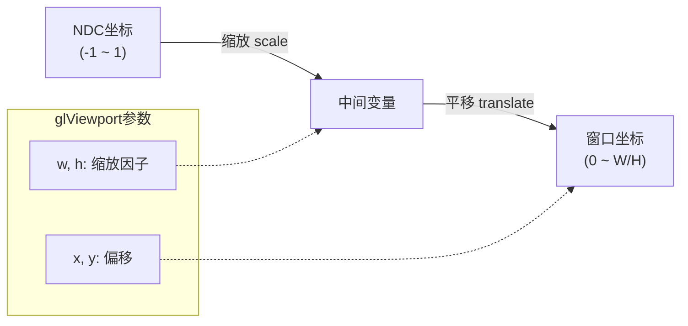

# 视口变换 glViewport (Viewport Transform)

## 视口变换是什么

在 OpenGL 的渲染管线中，经过投影变换（Projection）和透视除法后，顶点坐标处于**标准化设备坐标系（NDC）**中，其 $x, y$ 范围均为 $[-1, 1]$。然而，屏幕像素是离散的整数坐标，且窗口大小可变。**视口变换（Viewport Transform）**的任务就是将 NDC 中的坐标线性映射到屏幕窗口的特定矩形区域（即视口）。

简单来说，它解决了“如何将归一化的逻辑坐标适配到具体像素窗口”的问题。

## 核心函数与数学原理

在 OpenGL 中，通过 `glViewport` 设置视口：

```cpp
glViewport(GLint x, GLint y, GLsizei width, GLsizei height);
```

其中 $(x, y)$ 是视口左下角在窗口中的位置，`width` 和 `height` 是视口的尺寸。

映射公式如下：
$$
\begin{aligned}
x_{win} &= \frac{width}{2} x_{ndc} + \left( x + \frac{width}{2} \right) \\
y_{win} &= \frac{height}{2} y_{ndc} + \left( y + \frac{height}{2} \right)
\end{aligned}
$$

> [!IMPORTANT]
> ==核心结论==：视口变换是一个简单的**线性缩放和平移**过程，不涉及透视或非线性变形。

为了直观理解这一流程，可以参考以下映射关系：



## 为什么需要视口变换？

1.  **硬件适配**：不同显示器分辨率不同，NDC 是设备无关的，必须转换为具体的像素坐标才能光栅化。
2.  **多视图支持**：通过设置不同的 `glViewport`，可以在同一个窗口中绘制多个子视图（如分屏显示、小地图），而无需改变场景的几何数据。

## 常见误区与辨析

很多初学者容易混淆**投影变换**与**视口变换**，或者误解 `glViewport` 的作用范围。

| 特性 | 投影变换 (Projection) | 视口变换 (Viewport) |
| :--- | :--- | :--- |
| **阶段** | 顶点着色器之后，裁剪之前 | 裁剪、透视除法之后，光栅化之前 |
| **作用** | 定义视野、纵横比、近远平面 | 定义 NDC 到屏幕像素的映射 |
| **影响** | 改变物体的透视感/正交性 | 仅改变物体在屏幕上的位置和大小 |
| **API** | `gluPerspective` / `glm::perspective` | `glViewport` |

> [!WARNING]
> ==易错坑==：`glViewport` **不会**裁剪超出范围的图形。裁剪发生在视口变换之前的**裁剪空间（Clip Space）**。如果物体在 NDC 之外（$|x|>1$ 或 $|y|>1$），它会被裁剪掉，而不是被压缩进视口。

> [!TIP]
> **记忆技巧**：把 NDC 想象成一张弹性橡胶膜（-1到1），`glViewport` 就是决定把这张膜拉伸并贴到窗户的哪个位置（x,y）以及拉多大（w,h）。

## 典型计算示例

**题目**：设 `glViewport(0, 0, 800, 600)`，某顶点在 NDC 中的坐标为 $(0.5, -0.5, 0.1)$，求其窗口坐标 $(x_{win}, y_{win})$。

**解析**：
根据公式：
- $width = 800, height = 600, x=0, y=0$
- $x_{ndc} = 0.5, y_{ndc} = -0.5$

计算 $x_{win}$：
$$ x_{win} = \frac{800}{2}(0.5) + \left( 0 + \frac{800}{2} \right) = 200 + 400 = 600 $$

计算 $y_{win}$：
$$ y_{win} = \frac{600}{2}(-0.5) + \left( 0 + \frac{600}{2} \right) = -150 + 300 = 150 $$

> [!NOTE]
> 最终窗口坐标为 $(600, 150)$。注意 OpenGL 窗口坐标原点在**左下角**，这与某些 UI 框架（原点在左上角）不同，处理鼠标交互时需特别留意 $y$ 轴翻转。
