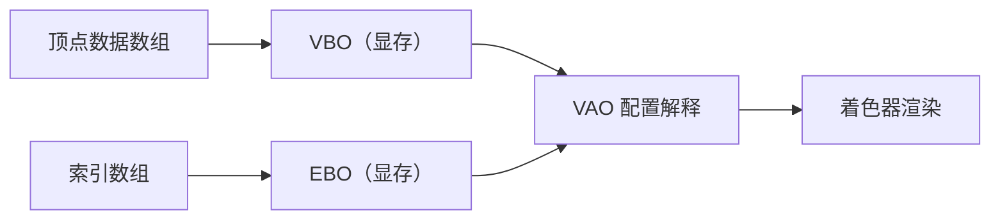

# 顶点属性与VAO/VBO/EBO配置 (Vertex Attributes, VAO, VBO & EBO)

## 顶点属性与 VAO/VBO/EBO 配置

在 OpenGL 中，把模型数据交给 GPU 渲染，不是一次性把顶点数组 `float vertices[]` 传进去就行，而是要经过一套**缓冲对象配置流程**。你可能会问：为什么不直接传数组？因为 GPU 的显存和 CPU 的内存是两套存储，OpenGL 需要你把数据先拷到显存里的缓冲对象中，再告诉 GPU “这些数据怎么解读”。这就是 VBO、VAO、EBO 的职责所在。

### 三个对象的职责

| 对象 | 全称 | 作用 |
|------|------|------|
| **VBO** | Vertex Buffer Object | 在显存中存储顶点数据（位置、法线、纹理坐标等） |
| **EBO** | Element Buffer Object | 存储顶点索引，避免重复存储共享顶点 |
| **VAO** | Vertex Array Object | 记录“如何解释 VBO 中的数据”——即顶点属性指针配置的快照 |

> [!IMPORTANT]
> ==VAO 不存数据，只存“配置”==：哪个 VBO 绑定到哪个 attribute location、每个属性的偏移量、步长、数据类型等。切换不同模型时，只需绑定对应的 VAO，之前配置好的所有属性指针立即生效。

### 为什么需要 EBO

一个立方体有 8 个顶点，但 6 个面共需要 36 个顶点数据（每个面 2 个三角形 × 3 顶点）。如果不使用索引，就要在数组中重复存储大量共享顶点。EBO 让顶点数组只存 8 个顶点，再用 36 个索引描述三角形组成，大幅减少内存占用。



### 配置流程

以绘制一个带索引的三角形为例：

```cpp
// 顶点数据：位置 (x, y, z)
float vertices[] = {
    -0.5f, -0.5f, 0.0f,  // 顶点 0
     0.5f, -0.5f, 0.0f,  // 顶点 1
     0.5f,  0.5f, 0.0f,  // 顶点 2
    -0.5f,  0.5f, 0.0f   // 顶点 3
};
unsigned int indices[] = { 0, 1, 2,  0, 2, 3 };  // 两个三角
```

**步骤一：创建并绑定 VAO**

```cpp
unsigned int VAO, VBO, EBO;
glGenVertexArrays(1, &VAO);
glGenBuffers(1, &VBO);
glGenBuffers(1, &EBO);

glBindVertexArray(VAO);   // 先绑 VAO，后续所有配置都记录到它
```

**步骤二：上传 VBO 数据并设置属性指针**

```cpp
glBindBuffer(GL_ARRAY_BUFFER, VBO);
glBufferData(GL_ARRAY_BUFFER, sizeof(vertices), vertices, GL_STATIC_DRAW);

// 位置属性 location = 0：3 个 float，步长 3 * sizeof(float)，偏移 0
glVertexAttribPointer(0, 3, GL_FLOAT, GL_FALSE, 3 * sizeof(float), (void*)0);
glEnableVertexAttribArray(0);
```

**步骤三：上传 EBO 数据**

```cpp
glBindBuffer(GL_ELEMENT_ARRAY_BUFFER, EBO);
glBufferData(GL_ELEMENT_ARRAY_BUFFER, sizeof(indices), indices, GL_STATIC_DRAW);
```

**步骤四：解绑 VAO（关键）**

```cpp
glBindVertexArray(0);
```

> [!WARNING]
> EBO 的绑定状态是**保存在 VAO 里的**。如果你在 VAO 解绑之前就解绑了 EBO（`glBindBuffer(GL_ELEMENT_ARRAY_BUFFER, 0)`），VAO 里记录的 EBO 引用会丢失，绘制时就找不到索引数据了。正确顺序是：先解绑 VAO，再解绑 EBO。

### 绘制阶段

```cpp
glBindVertexArray(VAO);
glDrawElements(GL_TRIANGLES, 6, GL_UNSIGNED_INT, 0);
glBindVertexArray(0);
```

一个算对了的例子：以上矩形由 4 个顶点、6 个索引组成。`glDrawElements` 的第二个参数是**索引个数**（不是顶点个数），所以传 `6` 而不是 `4`。如果用 `glDrawArrays` 画两个三角形则需要 6 个顶点；用 EBO 后，`vertices[]` 只需要 4×3=12 个 float，而不用 6×3=18 个。

### 常见坑

- **忘绑 VAO 就配属性指针**：`glVertexAttribPointer` 的配置会写入当前绑定的 VAO；若没有 VAO 绑定，配置丢失。
- **步长和偏移算错**：步长是“一个顶点占多少字节”；偏移是“该属性在该顶点内的字节偏移”，不能直接传数组下标。
- **`glDrawElements` 参数填成顶点数**：填索引数。
- **用 `glDrawArrays` 却绑了 EBO**：`glDrawArrays` 不读 EBO，索引数据白传。

> [!TIP]
> 背口诀：**VAO 是经纪人，VBO 是仓库里的货，EBO 是提货清单。** 先绑 VAO，再装 VBO，索引塞 EBO，最后记得“先解 VAO 再解 EBO”。
