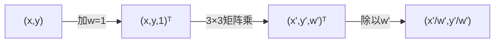

# 齐次坐标与二维仿射变换矩阵 (Homogeneous Coordinates & 2D Affine Matrix)

## 为什么需要齐次坐标

在二维图形学中，平移变换的公式为 $x' = x + t_x$，而旋转和缩放则是线性组合（如 $x' = x\cos\theta - y\sin\theta$）。如果只用 $2\times2$ 矩阵，我们只能表示旋转、缩放等==线性变换==，却无法将“加法”形式的平移纳入矩阵乘法框架。这导致复合变换时无法用单一矩阵统一表达，计算效率低下且难以硬件加速。

> [!IMPORTANT]
> 引入齐次坐标的核心目的：==将平移转化为线性运算==，使所有二维仿射变换都能统一为 $3\times3$ 矩阵乘法。

## 齐次坐标的定义与转换

我们将二维点 $(x, y)$ 扩展为三维向量 $(x_h, y_h, w)$，其中 $w \neq 0$。实际二维坐标通过归一化获得：$x = x_h/w,\ y = y_h/w$。通常取 $w=1$，即点表示为 $(x, y, 1)^T$，向量表示为 $(x, y, 0)^T$。

> [!WARNING]
> 向量必须设为 $w=0$！若误用 $w=1$，向量会被错误平移，破坏方向性语义。

## 二维仿射变换矩阵结构

所有二维仿射变换均可写成如下 $3\times3$ 矩阵：

$$
M = \begin{bmatrix}
a & b & t_x \\
c & d & t_y \\
0 & 0 & 1
\end{bmatrix}
$$

其中左上 $2\times2$ 子块控制线性变换（旋转、缩放、剪切），右侧列 $(t_x, t_y)^T$ 控制平移，底行固定为 $(0,0,1)$ 以保证结果仍为仿射变换（$w'=1$）。

| 变换类型 | 矩阵形式 | 关键参数 |
|----------|----------|----------|
| 平移     | $\begin{bmatrix}1&0&t_x\\0&1&t_y\\0&0&1\end{bmatrix}$ | $t_x,t_y$ |
| 旋转(θ)  | $\begin{bmatrix}\cos\theta&-\sin\theta&0\\\sin\theta&\cos\theta&0\\0&0&1\end{bmatrix}$ | θ |
| 缩放     | $\begin{bmatrix}s_x&0&0\\0&s_y&0\\0&0&1\end{bmatrix}$ | $s_x,s_y$ |

> [!TIP]
> 记忆口诀：==左旋右移下固定==。复合变换时，矩阵按==从右到左==顺序相乘（先应用的变换在右边）。

## 常见误区与辨析

- **仿射 vs 投影**：仿射变换底行为 $(0,0,1)$，保持平行线；投影变换底行可变，会产生透视效果。
- **点与向量混淆**：点对 $w=1$，参与平移；向量对 $w=0$，仅受线性部分影响。
- **矩阵乘法顺序**：若想先平移再旋转，应写为 $R \cdot T$，而非 $T \cdot R$。这是考试高频失分点。

> [!CAUTION]
> 计算复合变换时务必验证底行是否仍为 $(0,0,1)$。若不为，则已超出仿射范畴，可能误用了投影矩阵或计算出错。

## 正确计算示例

求点 $P=(2,3)$ 先绕原点逆时针旋转 $90^\circ$，再平移 $(4,1)$ 后的坐标。

旋转矩阵 $R_{90} = \begin{bmatrix}0&-1&0\\1&0&0\\0&0&1\end{bmatrix}$，平移矩阵 $T = \begin{bmatrix}1&0&4\\0&1&1\\0&0&1\end{bmatrix}$。

复合矩阵 $M = T \cdot R_{90} = \begin{bmatrix}0&-1&4\\1&0&1\\0&0&1\end{bmatrix}$。

应用：$M \cdot (2,3,1)^T = (-3+4,\ 2+1,\ 1)^T = (1,3,1)^T$。

最终结果为 ==$(1, 3)$==。注意若顺序颠倒为 $R_{90} \cdot T$，结果将为 $(-7,6)$，完全错误。
