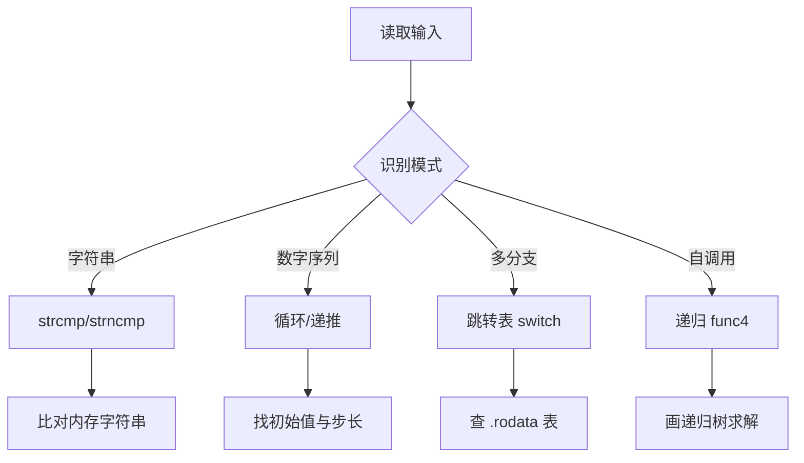

# BombLab：GDB调试与汇编逆向分析（字符串比较、数字序列递推、跳转表switch、递归函数func4、隐藏关phase_defused/secret_phase）

## BombLab 逆向分析核心机制

BombLab 本质是通过 GDB 动态调试与静态反汇编，还原 C 语言源码逻辑的逆向工程训练。它不是单纯的“破解”，而是验证你对==函数调用约定、控制流映射及数据表示==的理解深度。为什么必须掌握它？因为编译器优化后的汇编与源码差异巨大，只有亲手拆解过 `phase` 关卡，才能真正建立从高级语言到底层指令的映射直觉。

## 关键 Phase 拆解策略

面对不同关卡，如何快速定位突破口？

- **字符串比较**：找到 `strings_not_equal` 或 `strcmp` 调用后，用 `x/s <地址>` 直接查看目标字符串。注意输入可能含空格，需用引号包裹。
- **数字序列递推**：观察循环体内的 `add`/`imul` 指令，结合寄存器初值反推通项公式。==务必记录每次迭代寄存器的变化==。
- **跳转表 switch**：当看到 `jmp *0x402470(,%rax,8)` 时，立即用 `x/8gx 0x402470` 读出 8 个目标地址，再根据 `%rax` 范围（通常 0~6）逐一映射 case 分支。
- **递归函数 func4**：这是隐藏关 `secret_phase` 的前置技能。不要试图心算，==必须在纸上画出递归调用树==，标注每层参数与返回值，自底向上合并结果。

[!IMPORTANT]
> 跳转表的基地址和索引寄存器是解题钥匙，切勿混淆间接寻址语法中比例因子的含义。

## 栈帧操作与 RSP 追踪

简答题常考“哪些指令改变 rsp”。记住：==只有显式修改栈指针的指令才会影响 rsp==，包括 `push`、`pop`、`sub/add %rsp`、`call`（隐式 push）、`ret`（隐式 pop）。而 `mov`、`lea`、`cmp` 等绝不改变 rsp。

以真题为例：若反汇编中有 `sub $0x18, %rsp`，且进入函数时 `%rsp = 0x7fffffffe0a0`，则执行后 `%rsp = 0x7fffffffe088`。计算时注意十六进制减法借位，$0xa0 - 0x18 = 0x88$。

[!WARNING]
> `lea` 指令仅计算有效地址，不访问内存也不修改 rsp；误将其当作栈操作是高频失分点。

## 隐藏关触发条件

`phase_defused` 并非独立存在，需在前四个 phase 中输入特定“暗号”才能激活。通常是在某 phase 的正确输入后附加额外字符串（如 `phase_3` 输入 `4 7 DrEvil`）。GDB 中可设断点于 `read_line` 或 `sscanf`，检查缓冲区是否包含隐藏关键字。若未触发，说明前置 phase 输入不完整。

[!TIP]
> 调试时用 `run < input.txt` 重定向输入，避免重复手动键入；修改 input.txt 即可快速测试不同暗号组合。

## 常见误区辨析

| 误区 | 正确认知 |
| :--- | :--- |
| 认为 `call` 只压返回地址 | `call` 还会隐式修改 rsp，属于栈操作指令 |
| 用 `p/x $rax` 看字符串内容 | 应用 `x/s $rax`，`p/x` 仅显示指针值 |
| 递归靠脑内模拟 | 必须画图，func4 参数变化非线性 |
| 忽略输入格式要求 | 空格、换行、大小写均可能导致 strcmp 失败 |

[!CAUTION]
> 隐藏关输入错误不会爆炸，但会静默跳过；务必通过断点确认 `phase_defused` 是否被调用，而非依赖输出提示。
